# 2018 - 21 - Engenheir(a) Júnior - Automação

## Petrobras Transporte S.A - TRANSPETRO

## Conhecimentos Básicos

### Língua Portuguesa

<!-- considere o texto retirado da prova 21 do concurso transpetro do ano de 2018: -->
**Memórias Póstumas de Brás Cubas**

<table style="border: none; border-collapse: collapse;">
  <tbody>
    <tr>
      <td style="font-style: italic; padding-right: 15px; border: none !important;"></td>
      <td style="padding: 1px; border: none;">&emsp;&nbsp;&nbsp;&nbsp;&nbsp;&nbsp;Lobo Neves, a princípio, metia-me
        grandes sus- </td>
    </tr>
    <tr>
      <td style="font-style: italic; padding-right: 15px; border: none !important;"></td>
      <td style="padding: 1px; border: none;">tos. Pura ilusão! Como adorasse a mulher, não se ve- </td>
    </tr>
    <tr>
      <td style="font-style: italic; padding-right: 15px; border: none !important;"></td>
      <td style="padding: 1px; border: none;">xava de mo dizer muitas vezes; achava que Virgília</td>
    </tr>
    <tr>
      <td style="font-style: italic; padding-right: 15px; border: none !important;"></td>
      <td style="padding: 1px; border: none;">era a perfeição mesma, um conjunto de qualidades</td>
    </tr>
    <tr>
      <td style="font-style: italic; padding-right: 15px; border: none !important;"> 5</td>
      <td style="font-style: italic; padding-right: 15px; border: none !important;">sólidas e finas, amorável, elegante,
        austera, um mo-</td>
    </tr>
    <tr>
      <td style="font-style: italic; padding-right: 15px; border: none !important;"></td>
      <td style="padding: 1px; border: none;">delo. E a confiança não parava aí. De fresta que era,</td>
    </tr>
    <tr>
      <td style="font-style: italic; padding-right: 15px; border: none !important;"></td>
      <td style="padding: 1px; border: none;">chegou a porta escancarada. Um dia confessou-me</td>
    </tr>
    <tr>
      <td style="font-style: italic; padding-right: 15px; border: none !important;"></td>
      <td style="padding: 1px; border: none;">que trazia uma triste carcoma na existência; faltava-</td>
    </tr>
    <tr>
      <td style="font-style: italic; padding-right: 15px; border: none !important;"></td>
      <td style="padding: 1px; border: none;">-lhe a glória pública. Animei-o; disse-lhe muitas coi-</td>
    </tr>
    <tr>
      <td style="font-style: italic; padding-right: 15px; border: none !important;">10</td>
      <td style="padding: 1px; border: none;">sas bonitas, que ele ouviu com aquela unção religiosa</td>
    </tr>
    <tr>
      <td style="font-style: italic; padding-right: 15px; border: none !important;"></td>
      <td style="padding: 1px; border: none;">de um desejo que não quer acabar de morrer; então</td>
    </tr>
    <tr>
      <td style="font-style: italic; padding-right: 15px; border: none !important;"></td>
      <td style="padding: 1px; border: none;">compreendi que a ambição dele andava cansada de</td>
    </tr>
    <tr>
      <td style="font-style: italic; padding-right: 15px; border: none !important;"></td>
      <td style="padding: 1px; border: none;">bater as asas, sem poder abrir o voo. Dias depois</td>
    </tr>
    <tr>
      <td style="font-style: italic; padding-right: 15px; border: none !important;"></td>
      <td style="padding: 1px; border: none;">disse-me todos os seus tédios e desfalecimentos, as</td>
    </tr>
    <tr>
      <td style="font-style: italic; padding-right: 15px; border: none !important;">15</td>
      <td style="padding: 1px; border: none;">amarguras engolidas, as raivas sopitadas; contou-me</td>
    </tr>
    <tr>
      <td style="font-style: italic; padding-right: 15px; border: none !important;"></td>
      <td style="padding: 1px; border: none;">que a vida política era um tecido de invejas, despei-</td>
    </tr>
    <tr>
      <td style="font-style: italic; padding-right: 15px; border: none !important;"></td>
      <td style="padding: 1px; border: none;">tos, intrigas, perfídias, interesses, vaidades. Eviden-</td>
    </tr>
    <tr>
      <td style="font-style: italic; padding-right: 15px; border: none !important;"></td>
      <td style="padding: 1px; border: none;">temente havia aí uma crise de melancolia; tratei de</td>
    </tr>
    <tr>
      <td style="font-style: italic; padding-right: 15px; border: none !important;"></td>
      <td style="padding: 1px; border: none;">combatê-la.</td>
    </tr>
    <tr>
      <td style="font-style: italic; padding-right: 15px; border: none !important;">20</td>
      <td style="padding: 1px; border: none;">&emsp;&nbsp;&nbsp;&nbsp;&nbsp;&nbsp;- Sei o que lhe digo, replicou-me com
        tristeza.</td>
    </tr>
    <tr>
      <td style="font-style: italic; padding-right: 15px; border: none !important;"></td>
      <td style="padding: 1px; border: none;">Não pode imaginar o que tenho passado. Entrei na</td>
    </tr>
    <tr>
      <td style="font-style: italic; padding-right: 15px; border: none !important;"></td>
      <td style="padding: 1px; border: none;">política por gosto, por família, por ambição, e um pou-</td>
    </tr>
    <tr>
      <td style="font-style: italic; padding-right: 15px; border: none !important;"></td>
      <td style="padding: 1px; border: none;">co por vaidade. Já vê que reuni em mim só todos os</td>
    </tr>
    <tr>
      <td style="font-style: italic; padding-right: 15px; border: none !important;"></td>
      <td style="padding: 1px; border: none;">motivos que levam o homem à vida pública; faltou-me</td>
    </tr>
    <tr>
      <td style="font-style: italic; padding-right: 15px; border: none !important;">25</td>
      <td style="padding: 1px; border: none;">só o interesse de outra natureza. Vira o teatro pelo</td>
    </tr>
    <tr>
      <td style="font-style: italic; padding-right: 15px; border: none !important;"></td>
      <td style="padding: 1px; border: none;">lado da plateia; e, palavra, que era bonito! Soberbo</td>
    </tr>
    <tr>
      <td style="font-style: italic; padding-right: 15px; border: none !important;"></td>
      <td style="padding: 1px; border: none;">cenário, vida, movimento e graça na representação.</td>
    </tr>
    <tr>
      <td style="font-style: italic; padding-right: 15px; border: none !important;"></td>
      <td style="padding: 1px; border: none;">Escriturei-me; deram-me um papel que... Mas para</td>
    </tr>
    <tr>
      <td style="font-style: italic; padding-right: 15px; border: none !important;"></td>
      <td style="padding: 1px; border: none;">que o estou a fatigar com isto? Deixe-me ficar com as</td>
    </tr>
    <tr>
      <td style="font-style: italic; padding-right: 15px; border: none !important;">30</td>
      <td style="padding: 1px; border: none;">minhas amofinações. Creia que tenho passado horas</td>
    </tr>
    <tr>
      <td style="font-style: italic; padding-right: 15px; border: none !important;"></td>
      <td style="padding: 1px; border: none;">e dias... Não há constância de sentimentos, não há</td>
    </tr>
    <tr>
      <td style="font-style: italic; padding-right: 15px; border: none !important;"></td>
      <td style="padding: 1px; border: none;">gratidão, não há nada... nada.... nada...</td>
    </tr>
    <tr>
      <td style="font-style: italic; padding-right: 15px; border: none !important;"></td>
      <td style="padding: 1px; border: none;">&emsp;&nbsp;&nbsp;&nbsp;&nbsp;&nbsp;Calou-se, profundamente abatido, com
        os olhos</td>
    </tr>
    <tr>
      <td style="font-style: italic; padding-right: 15px; border: none !important;"></td>
      <td style="padding: 1px; border: none;">no ar, parecendo não ouvir coisa nenhuma, a não ser</td>
    </tr>
    <tr>
      <td style="font-style: italic; padding-right: 15px; border: none !important;">35</td>
      <td style="padding: 1px; border: none;">o eco de seus próprios pensamentos. Após alguns</td>
    </tr>
    <tr>
      <td style="font-style: italic; padding-right: 15px; border: none !important;"></td>
      <td style="padding: 1px; border: none;">instantes, ergueu-se e estendeu-me a mão: - O se-</td>
    </tr>
    <tr>
      <td style="font-style: italic; padding-right: 15px; border: none !important;"></td>
      <td style="padding: 1px; border: none;">nhor há de rir-se de mim, disse ele; mas desculpe</td>
    </tr>
    <tr>
      <td style="font-style: italic; padding-right: 15px; border: none !important;"></td>
      <td style="padding: 1px; border: none;">aquele desabafo; tinha um negócio, que me mordia o</td>
    </tr>
    <tr>
      <td style="font-style: italic; padding-right: 15px; border: none !important;"></td>
      <td style="padding: 1px; border: none;">espírito. E ria, de um jeito sombrio e triste; depois pe-</td>
    </tr>
    <tr>
      <td style="font-style: italic; padding-right: 15px; border: none !important;">40</td>
      <td style="padding: 1px; border: none;">diu-me que não referisse a ninguém o que se passara</td>
    </tr>
    <tr>
      <td style="font-style: italic; padding-right: 15px; border: none !important;"></td>
      <td style="padding: 1px; border: none;">entre nós; ponderei-lhe que a rigor não se passara</td>
    </tr>
    <tr>
      <td style="font-style: italic; padding-right: 15px; border: none !important;"></td>
      <td style="padding: 1px; border: none;">nada. Entraram dois deputados e um chefe político</td>
    </tr>
    <tr>
      <td style="font-style: italic; padding-right: 15px; border: none !important;"></td>
      <td style="padding: 1px; border: none;">da paróquia. Lobo Neves recebeu-os com alegria, a</td>
    </tr>
    <tr>
      <td style="font-style: italic; padding-right: 15px; border: none !important;"></td>
      <td style="padding: 1px; border: none;">princípio um tanto postiça, mas logo depois natural.</td>
    </tr>
    <tr>
      <td style="font-style: italic; padding-right: 15px; border: none !important;">45</td>
      <td style="padding: 1px; border: none;">No fim de meia hora, ninguém diria que ele não era o</td>
    </tr>
    <tr>
      <td style="font-style: italic; padding-right: 15px; border: none !important;"></td>
      <td style="padding: 1px; border: none;">mais afortunado dos homens; conversava, chasque-</td>
    </tr>
    <tr>
      <td style="font-style: italic; padding-right: 15px; border: none !important;"></td>
      <td style="padding: 1px; border: none;">ava, e ria, e riam todos.</td>
    </tr>
  </tbody>
</table>

ASSIS, M. de. Memórias Póstumas de Brás Cubas; IN: CHIARA, A. C. et alli (Orgs.). Machado de Assis para jovens leitores.
Rio de Janeiro: Eduerj, 2008.

---
---
<!-- resolver a questão no contexto do concurso transpetro com banca cesgranrio: 
  - identificar a área de conhecimento da questão (classifique a área de conhecimento e as devidas sub-áreas de conhecimento);
  - apresentar uma justificativa detalhada contendo uma análise das alternativas; -->
### 1

Com base na leitura do texto, entende-se que o desabafo de Lobo Neves ao longo do texto deve-se à sua insatisfação com
a(o)

(A) &nbsp;vida pública  
(B) &nbsp;sua família  
(C) &nbsp;seu casamento  
(D) &nbsp;teatro da época  
(E) &nbsp;_glamour_ da sociedade  

A alternativa correta é a **(A) vida pública**.

---

#### Justificativa:

O desabafo de Lobo Neves gira inteiramente em torno das suas amarguras, desilusões e frustrações com a carreira política e os seus bastidores:

1. **Linhas 15-17:** *"...contou-me que a **vida política** era um tecido de invejas, despeitos, intrigas, perfídias, interesses, vaidades."*
2. **Linhas 22-25:** *"Entrei na política por gosto, por família, por ambição, e um pouco por vaidade. Já vê que reuni em mim só todos os motivos que levam o homem à **vida pública**..."*

Embora ele mencione a admiração pela esposa (C) e use metáforas sobre o teatro (D), o motivo central do seu sofrimento e desabafo é o descontentamento com o meio político e a **vida pública**.

---
---
<!-- resolver a questão no contexto do concurso transpetro com banca cesgranrio: 
  - identificar a área de conhecimento da questão (classifique a área de conhecimento e as devidas sub-áreas de conhecimento);
  - apresentar uma justificativa detalhada contendo uma análise das alternativas; -->
### 2

Em \"Como adorasse a mulher, não se vexava de mo dizer muitas vezes\" (&ell;. 2-3), o conector **como** estabelece, com
a oração seguinte, uma relação semântica de

(A) &nbsp; causa  
(B) &nbsp; condição  
(C) &nbsp; contraste  
(D) &nbsp; comparação  
(E) &nbsp; consequência  

A alternativa correta é a **(A) causa**.

---

#### Justificativa:

No trecho *"**Como** adorasse a mulher, não se vexava de mo dizer muitas vezes"*, o termo **"como"** atua como uma conjunção subordinativa causal, indicando o **motivo** ou a **razão** de Lobo Neves não se envergonhar de declarar seu amor.

* **Teste de substituição:** Sempre que a oração iniciada por *"como"* estiver anteposta (no início do período) e puder ser substituída por conectores causais como **"já que"**, **"visto que"** ou **"porque"**, a relação semântica estabelecida será de **causa**:
> *"**Já que** adorava a mulher, não se vexava de mo dizer muitas vezes."*
> *"**Visto que** adorava a mulher, não se vexava de mo dizer muitas vezes."*

---
---
<!-- resolver a questão no contexto do concurso transpetro com banca cesgranrio: 
  - identificar a área de conhecimento da questão (classifique a área de conhecimento e as devidas sub-áreas de conhecimento);
  - apresentar uma justificativa detalhada contendo uma análise das alternativas; -->
### 3

A palavra carcoma foi empregada metaforicamente no trecho \"Um dia confessou-me que trazia uma triste carcoma na
existência\" (&ell;. 7-8).\nUm outro exemplo de metáfora empregada no texto é:

(A) &nbsp; \"Lobo Neves, a princípio, metia-me grandes sustos\" (&ell;. 1-2)"  
(B) &nbsp; \"De fresta que era, chegou a porta escancarada\" (&ell;. 6-7)"  
(C) &nbsp; \"Evidentemente havia aí uma crise de melancolia; tratei de combatê-la\" (&ell;. 17-18)"  
(D) &nbsp; \"Entrei na política por gosto, por família, por ambição, e um pouco por vaidade\" (&ell;. 21-23)"  
(E) &nbsp; \"Lobo Neves recebeu-os com alegria\" (&ell;. 43)"  

A alternativa correta é a **(B) "De fresta que era, chegou a porta escancarada" (ℓ. 6-7)**.

---

#### Justificativa:

A **metáfora** é a figura de linguagem na qual se transfere o significado de uma palavra para outra por meio de uma comparação implícita (sem o uso de conectivos comparativos como *como*, *tal qual* etc.).

Na alternativa **(B)**, as palavras **"fresta"** e **"porta escancarada"** não estão empregadas em seu sentido literal (de aberturas físicas em uma parede), mas sim de forma figurada para descrever a evolução da **confiança e intimidade** que Lobo Neves passou a demonstrar:

* **"Fresta":** Representa o início modesto de uma aproximação e desabafo.
* **"Porta escancarada":** Representa a abertura total e sem barreiras para fazer confidências profundas.

As demais alternativas utilizam a linguagem em seu sentido denotativo (literal) ou comum na narrativa.

---
---
<!-- resolver a questão no contexto do concurso transpetro com banca cesgranrio: 
  - identificar a área de conhecimento da questão (classifique a área de conhecimento e as devidas sub-áreas de conhecimento);
  - apresentar uma justificativa detalhada contendo uma análise das alternativas; -->
### 4

O trecho do texto \"Vira o teatro pelo lado da plateia; e, palavra, que era bonito!\" (&ell;. 25-26) faz referência ao
fato de Lobo Neves

(A) &nbsp; misturar política e lazer.  
(B) &nbsp; ter uma vida social muito intensa.  
(C) &nbsp; poder deslumbrar-se com o teatro.  
(D) &nbsp; estar saudoso de sua vida como ator.  
(E) &nbsp; ter ignorado as dificuldades da atividade política.  

A alternativa correta é a **(E) ter ignorado as dificuldades da atividade política.**

---

#### Justificativa:

A metáfora do teatro é empregada no texto para ilustrar a mudança de visão de Lobo Neves sobre a carreira pública:

* **Ver o teatro do lado da plateia:** Representa a posição do espectador (de fora), quando a política aparentava ser um espetáculo belo, fascinante e sem defeitos (*"soberbo cenário, vida, movimento e graça"*). Nesse momento prévio, ele não enxergava os bastidores.
* **Tornar-se ator (*"Escriturei-me..."*):** Representa o ingresso efetivo na vida pública, quando ele passou a vivenciar a realidade de *"invejas, despeitos, intrigas, perfídias, interesses, vaidades"* da política.

Assim, o trecho refere-se ao momento em que Lobo Neves **ignorava as amarguras e as reais dificuldades do meio político**.

---
---
<!-- resolver a questão no contexto do concurso transpetro com banca cesgranrio: 
  - identificar a área de conhecimento da questão (classifique a área de conhecimento e as devidas sub-áreas de conhecimento);
  - apresentar uma justificativa detalhada contendo uma análise das alternativas; -->
### 5

O trecho do texto \"Vira o teatro pelo lado da plateia; e, palavra, que era bonito!\" (&ell;. 25-26) faz referência ao
fato de Lobo Neves"

(A) &nbsp; misturar política e lazer.  
(B) &nbsp; ter uma vida social muito intensa.  
(C) &nbsp; poder deslumbrar-se com o teatro.  
(D) &nbsp; estar saudoso de sua vida como ator.  
(E) &nbsp; ter ignorado as dificuldades da atividade política."  

<!-- A alternativa correta é a **(E) ter ignorado as dificuldades da atividade política.**

---

#### Justificativa:

No trecho em questão, Lobo Neves recorre a uma metáfora teatral para explicar como ele via a política antes de nela
ingressar:

1. **Visão externa (a plateia):** Antes de fazer parte da vida pública, ele via apenas o espetáculo por fora (o
_"soberbo cenário, vida, movimento e graça"_), ou seja, enxergava apenas o lado belo, glamouroso e atraente da política.
2. **Entrada na política (a representação/o palco):** Ao dizer _"Escriturei-me; deram-me um papel..."_, ele relata sua
entrada efetiva na carreira e o consequente choque com a realidade de "invejas, despeitos, intrigas, perfídias" que não
conseguia enxergar quando estava apenas na "plateia".

Portanto, a expressão faz referência ao fato de que, antes de se engajar na política, ele desconhecia ou **ignorava as
verdadeiras dificuldades e os bastidores amargos da atividade pública.**

--- -->

A alternativa correta é a **(E) ter ignorado as dificuldades da atividade política.**

---

#### Justificativa:

No texto de Machado de Assis, Lobo Neves utiliza uma metáfora do mundo teatral para comparar como ele enxergava a vida política **antes** e **depois** de ingressar nela:

1. **Antes de entrar na política (a plateia):** Ao dizer *"Vira o teatro pelo lado da plateia; e, palavra, que era bonito! Soberbo cenário, vida, movimento e graça na representação"*, o personagem explica que, do ponto de vista do espectador (de fora), a política parecia algo fascinante e perfeito. Ele via apenas os encantos e o glamour exterior.
2. **Depois de entrar na política (o palco/a atuação):** Em seguida, ao dizer *"Escriturei-me; deram-me um papel que..."*, ele revela a desilusão de ter descoberto a realidade amarga dos bastidores (as invejas, intrigas, perfídias e interesses).

Portanto, a metáfora de ver o teatro do lado da plateia refere-se ao momento em que ele **ignorava (ou desconhecia) as reais dificuldades, intrigas e problemas inerentes à atividade política.**

---
---
<!-- resolver a questão no contexto do concurso transpetro com banca cesgranrio: 
  - identificar a área de conhecimento da questão (classifique a área de conhecimento e as devidas sub-áreas de conhecimento);
  - apresentar uma justificativa detalhada contendo uma análise das alternativas; -->
### 6

Os sinais de pontuação contribuem para a construção dos sentidos dos textos.\nNo fragmento do texto \"Escriturei-me;
deram-me um papel que... mas para que o estou a fatigar com isso? Deixe-me ficar com as minhas amofinações\" (&ell;
28-30), as reticências são usadas para demarcar a

(A) &nbsp; interrupção de uma ideia.  
(B) &nbsp; insinuação de uma ameaça.  
(C) &nbsp; hesitação comum na oralidade.  
(D) &nbsp; continuidade de uma ação ou fato.  
(E) &nbsp; omissão proposital de algo que se devia dizer.  

A alternativa correta é a **(A) interrupção de uma ideia.**

---

#### Justificativa:

No trecho _"Escriturei-me; deram-me um papel que... Mas para que o estou a fatigar com isto?"_, o personagem Lobo Neves
começa a explicar qual foi o papel que lhe deram no "teatro" da política, mas **interrompe abruptamente o próprio
pensamento** no meio da frase.

Essa interrupção (uma **aposiopese** ou **reticência de pensamento**) serve para cortar o raciocínio que vinha
desenvolvendo ao perceber que não vale a pena continuar desabafando e "fatigando" o ouvinte com suas amarguras.

As demais alternativas estão incorretas porque:

- **(B)** Não há qualquer ideia de ameaça no discurso.
- **(C)** O corte não marca uma simples dúvida/hesitação na fala, mas a parada completa de uma frase que não é
concluída.
- **(D)** As reticências aqui não indicam algo que continua ocorrendo, mas o oposto (a interrupção da fala e da
narrativa da ideia).
- **(E)** Ele não omite propositalmente algo por segredo ou tabu (o que seria uma elipse ou reticência com valor de
insinuação), e sim por desistir voluntariamente de concluir o pensamento para não cansar o interlocutor.

---
---
<!-- resolver a questão no contexto do concurso transpetro com banca cesgranrio: 
  - identificar a área de conhecimento da questão (classifique a área de conhecimento e as devidas sub-áreas de conhecimento);
  - apresentar uma justificativa detalhada contendo uma análise das alternativas; -->
### 7

O fragmento no qual a regência do verbo em destaque é a mesma do verbo **referir** no trecho \"que não referisse a
ninguém o que se passara entre nós\" (&ell; 40-41) é

(A) &nbsp; \"Como **adorasse** a mulher\" (&ell; 2)  
(B) &nbsp; \"Virgília **era** a perfeição mesma\" (&ell; 3-4)  
(C) &nbsp; \"Um dia **confessou**-me que trazia uma triste carcoma na existência\" (&ell; 7-8)  
(D) &nbsp; \"Mas para que o estou a **fatigar** com isto?\" (&ell; 28-29)  
(E) &nbsp; \"**Entraram** dois deputados e um chefe político da paróquia\" (&ell; 42-43)  

A alternativa correta é a **(C) "Um dia confessou-me que trazia uma triste carcoma na existência" (l. 7-8)**.

---

#### Justificativa:

Para responder a essa questão, analisamos a **regência verbal** (transitividade) do verbo principal no enunciado e
comparamos com as alternativas:

1. **Análise do termo do enunciado:**

- No trecho: _"que não **referisse** a ninguém o que se passara entre nós"_:
- Quem refere, refere **algo** (_o que se passara entre nós_ = Objeto Direto) **a alguém** (_a ninguém_ = Objeto
Indireto).
- Trata-se de um **Verbo Transitivo Direto e Indireto (VTDI)**.

2. **Análise do verbo na alternativa (C):**

- No trecho: _"Um dia **confessou**-me que trazia uma triste carcoma na existência"_:
- Quem confessa, confessa **algo** (_que trazia uma triste carcoma na existência_ = Oração Subordinada Substantiva
Objetiva Direta) **a alguém** (_-me_ = Objeto Indireto).
- O verbo **confessar** apresenta exatamente a mesma predicação: **Verbo Transitivo Direto e Indireto (VTDI)**.

---

#### Análise das demais alternativas:

- **(A) _"Como adorasse a mulher"_**: O verbo _adorar_ é **Verbo Transitivo Direto (VTD)** (_a mulher_ é Objeto Direto).
- **(B) _"Virgília era a perfeição mesma"_**: O verbo _ser_ é **Verbo de Ligação (VL)** (_a perfeição mesma_ é
Predicativo do Sujeito).
- **(D) _"Mas para que o estou a fatigar com isto?"_**: O verbo _fatigar_ exige complemento direto do ser fatigado (_o_
= Objeto Direto) e complemento indireto/circunstancial com preposição (_com isto_).
- **(E) _"Entraram dois deputados e um chefe político da paróquia"_**: O verbo _entrar_ é **Verbo Intransitivo (VI)**
(tem como sujeito _dois deputados e um chefe político..._).

---
---
<!-- resolver a questão no contexto do concurso transpetro com banca cesgranrio: 
  - identificar a área de conhecimento da questão (classifique a área de conhecimento e as devidas sub-áreas de conhecimento);
  - apresentar uma justificativa detalhada contendo uma análise das alternativas; -->
###  8

O pronome oblíquo átono está empregado de acordo com o que prevê a variedade formal da norma-padrão da língua em:

(A)  &nbsp; Poucos dar-lhe-iam a atenção merecida.  
(B)  &nbsp; Lobo Neves nunca se afastara da vida pública.  
(C)  &nbsp; Diria-lhe para evitar a carreira política se perguntasse.  
(D)  &nbsp; Ele tinha um problema que mantinha-o preocupado todo o tempo.  
(E)  &nbsp; Se atormentou com aquela crise de melancolia que parecia não ter fim.

A alternativa correta é a **(B) Lobo Neves nunca se afastara da vida pública.**

---

#### Justificativa:

A questão exige o conhecimento das regras de **colocação pronominal** (próclise, mesóclise e ênclise) segundo a norma-padrão da língua portuguesa:

* Na alternativa **(B)**, o advérbio de negação **"nunca"** é uma **palavra atrativa** que exige obrigatoriamente a **próclise** (pronome antes do verbo): *"nunca **se** afastara"*. Portanto, a construção está perfeita.

---

#### Análise dos erros das demais alternativas:

* **(A) Errada:** *"Poucos **dar-lhe-iam** a atenção merecida."*
* **Erro:** O pronome indefinido **"Poucos"** funciona como palavra atrativa (fator de próclise). O correto é: *"Poucos **lhe dariam** a atenção merecida."*

* **(C) Errada:** *"**Diria-lhe** para evitar a carreira política..."*
* **Erro:** O verbo está no futuro do pretérito (*diria*). Quando o verbo está no futuro e não há palavra atrativa antes dele, a norma-padrão exige a **mesóclise**. O correto é: *"**Dir-lhe-ia** para evitar..."*

* **(D) Errada:** *"...um problema que **mantinha-o** preocupado..."*
* **Erro:** O pronome relativo **"que"** é uma palavra atrativa e atrai obrigatoriamente o pronome para antes do verbo (próclise). O correto é: *"...um problema que **o mantinha** preocupado..."*

* **(E) Errada:** *"**Se atormentou** com aquela crise..."*
* **Erro:** Segundo a gramática normativa, **não se deve iniciar orações com pronome oblíquo átono**. O correto é usar a ênclise: *"**Atormentou-se** com aquela crise..."*

---
--- 
<!-- resolva a questão no contexto do concurso transpetro com banca cesgranrio: identifique a área de conhecimento da questão (classifique a área de conhecimento e as sub-áreas de conhecimento) e apresente justificativa com a análise das alternativas -->
###  9

Em português, o acento grave indica a contração de dois &quot;a&quot; em um só, em um processo chamado crase, e está corretamente empregado em:

(A)  &nbsp; Verei a política de outra forma à partir daquela conversa.  
(B)  &nbsp; Daqui à duas horas Lobo Neves receberá os amigos com alegria.  
(C)  &nbsp; Assistimos à apresentações inflamadas de alguns deputados e senadores.  
(D)  &nbsp; Em referência àqueles pensamentos, Lobo Neves calou-os rapidamente.  
(E)  &nbsp; A política, à qual não quero mais em minha vida, causou-me muitos problemas.

A alternativa correta é a **(D) Em referência àqueles pensamentos, Lobo Neves calou-os rapidamente.**

---

#### Justificativa:

Na alternativa **(D)**, ocorre a fusão da preposição **a** (exigida pelo substantivo *"referência"*: quem faz referência, faz referência **a** algo) com o pronome demonstrativo **aqueles** (iniciado pela letra **a**):

$$\text{preposição } a + \text{pronome } aqueles = \text{àqueles}$$

Por haver essa junção dos dois "a", o uso do acento grave indicador de crase é obrigatoriamente correto.

---

#### Análise dos erros das demais alternativas:

* **(A) Errada:** *"Verei a política de outra forma **à** partir..."*
* **Erro:** Não ocorre crase antes de verbo no infinitivo (*partir*). O correto é *"a partir"*.

* **(B) Errada:** *"Daqui **à** duas horas..."*
* **Erro:** Não há crase diante de palavras que indicam tempo futuro ou distância decorrida (*daqui a...*). Além disso, não há artigo feminino no singular antes de palavra no plural (*duas*). O correto é *"Daqui a duas horas"*.

* **(C) Errada:** *"Assistimos **à** apresentações inflamadas..."*
* **Erro:** Não ocorre crase quando a preposição **a** está no singular e o substantivo seguinte está no plural e de forma indefinida (*apresentações*). O correto é *"Assistimos a apresentações"* (ou *"às apresentações"*, caso houvesse o artigo definido no plural).

* **(E) Errada:** *"A política, **à** qual não quero mais..."*
* **Erro:** O verbo *querer* no sentido de *desejar/almejar* é transitivo direto (não exige a preposição *a*): *"não quero [a política] em minha vida"*. Sendo assim, o pronome relativo *a qual* não recebe acento grave. O correto é *"A política, **a qual** não quero mais..."*.

--- 
---
<!-- resolver a questão no contexto do concurso transpetro com banca cesgranrio: 
  - identificar a área de conhecimento da questão (classifique a área de conhecimento e as devidas sub-áreas de conhecimento);
  - apresentar uma justificativa detalhada contendo uma análise das alternativas; -->
###  10

O período que atende plenamente às exigências da concordância verbal na norma-padrão da língua portuguesa é:

(A)  &nbsp; Mais de um mandato foram exercidos por Lobo Neves.  
(B)  &nbsp; Fazem quinze anos que ele conseguiu entrar para a vida pública.  
(C)  &nbsp; Necessita-se de políticos mais compromissados com a população.  
(D)  &nbsp; Com certeza, haviam mais de trinta deputados no plenário naquele dia.  
(E)  &nbsp; Reeleger-se-á, somente, os políticos com um histórico de trabalho honesto.

A alternativa correta é a **(C) Necessita-se de políticos mais compromissados com a população.**

---

#### Justificativa:

Na alternativa **(C)**, temos a presença do índice de indeterminação do sujeito **"se"** ligado ao verbo transitivo indireto (*necessitar*), acompanhado da preposição *de* (*"de políticos..."*).

Em estruturas com **Verbo Transitivo Indireto + "se" + Preposição**, o verbo permanece **obrigatoriamente no singular**, pois o sujeito é indeterminado:

$$\text{Necessita-se } (\text{singular}) + \text{ de políticos } (\text{objeto indireto})$$

---

#### Análise dos erros das demais alternativas:

* **(A) Errada:** *"Mais de um mandato **foram exercidos**..."*
* **Erro:** Com a expressão *"mais de um"*, a regra geral de concordância determina que o verbo concorde com o numeral **um**, ficando no **singular**. O correto é: *"Mais de um mandato **foi exercido**..."*

* **(B) Errada:** *"**Fazem** quinze anos que..."*
* **Erro:** O verbo *fazer*, quando indica tempo decorrido, é **impessoal** (não possui sujeito) e deve permanecer obrigatoriamente na 3ª pessoa do **singular**. O correto é: *"**Faz** quinze anos que..."*

* **(D) Errada:** *"Com certeza, **haviam** mais de trinta deputados..."*
* **Erro:** O verbo *haver*, no sentido de *existir*, é **impessoal** e fica obrigatoriamente na 3ª pessoa do **singular**. O correto é: *"Com certeza, **havia** mais de trinta deputados..."*

* **(E) Errada:** *"**Reeleger-se-á**, somente, os políticos..."*
* **Erro:** Aqui o *"se"* funciona como **partícula apassivadora** (*"os políticos serão reeleitos"*). O sujeito paciente é plural (*"os políticos"*), logo o verbo precisa ir para o plural: *"**Reeleger-se-ão**, somente, os políticos..."*

---
---

### Língua Inglesa

<!-- considere o texto retirado da prova 21 do concurso transpetro do ano de 2018: -->
**The key energy questions for 2018**

_The renewables industry has had a great year. How fast can it grow now?_

<table style="border: none; border-collapse: collapse;">
  <!-- <thead>
    <tr>
      <th></th>
      <th></th>
    </tr>
  </thead> -->
  <tbody>
  <tr>
    <td style="font-style: italic; padding-right: 15px; border: none !important;"></td>
    <td style="padding: 1px; border: none;">&emsp;&nbsp;&nbsp;&nbsp;&nbsp;&nbsp;What are the issues that will shape the global</td>
  </tr>
  <tr>
    <td style="font-style: italic; padding-right: 15px; border: none !important;"></td>
    <td style="padding: 1px; border: none;">energy market in 2018? What will be the energy</td>
  </tr>
  <tr>
    <td style="font-style: italic; padding-right: 15px; border: none !important;"></td>
    <td style="padding: 1px; border: none;">mix, trade patterns and price trends? Every country</td>
  </tr>
  <tr>
    <td style="font-style: italic; padding-right: 15px; border: none !important;"></td>
    <td style="padding: 1px; border: none;">is different and local factors, including politics, are</td>
  </tr>
  <tr>
    <td style="font-style: italic; padding-right: 15px; border: none !important;">5</td>
    <td style="padding: 1px; border: none;">important. But at the global level there are four key</td>
  </tr>
  <tr>
    <td style="font-style: italic; padding-right: 15px; border: none !important;"></td>
    <td style="padding: 1px; border: none;">questions, and each of which answers is highly</td>
  </tr>
  <tr>
    <td style="font-style: italic; padding-right: 15px; border: none !important;"></td>
    <td style="padding: 1px; border: none;">uncertain.</td>
  </tr>
  <tr>
    <td style="font-style: italic; padding-right: 15px; border: none !important;"></td>
    <td style="padding: 1px; border: none;">&emsp;&nbsp;&nbsp;&nbsp;&nbsp;&nbsp;The first question is whether Saudi Arabia is</td>
  </tr>
  <tr>
    <td style="font-style: italic; padding-right: 15px; border: none !important;"></td>
    <td style="padding: 1px; border: none;">stable. The kingdom&#39;s oil exports now mostly go to</td>
  </tr>
  <tr>
    <td style="font-style: italic; padding-right: 15px; border: none !important;">10</td>
    <td style="padding: 1px; border: none;">Asia but the volumes involved mean that any volatility</td>
  </tr>
  <tr>
    <td style="font-style: italic; padding-right: 15px; border: none !important;"></td>
    <td style="padding: 1px; border: none;">will destabilise a market where speculation is rife.</td>
  </tr>
  <tr>
    <td style="font-style: italic; padding-right: 15px; border: none !important;"></td>
    <td style="padding: 1px; border: none;">&emsp;&nbsp;&nbsp;&nbsp;&nbsp;&nbsp;The risk is that an open conflict, which Iran and</td>
  </tr>
  <tr>
    <td style="font-style: italic; padding-right: 15px; border: none !important;"></td>
    <td style="padding: 1px; border: none;">Saudi have traditionally avoided despite all their</td>
  </tr>
  <tr>
    <td style="font-style: italic; padding-right: 15px; border: none !important;"></td>
    <td style="padding: 1px; border: none;">differences, would spread and hit oil production and</td>
  </tr>
  <tr>
    <td style="font-style: italic; padding-right: 15px; border: none !important;">15</td>
    <td style="padding: 1px; border: none;">trade. It is worth remembering that the Gulf states</td>
  </tr>
  <tr>
    <td style="font-style: italic; padding-right: 15px; border: none !important;"></td>
    <td style="padding: 1px; border: none;">account for a quarter of global production and over</td>
  </tr>
  <tr>
    <td style="font-style: italic; padding-right: 15px; border: none !important;"></td>
    <td style="padding: 1px; border: none;">40 per cent of all the oil traded globally. The threat to</td>
  </tr>
  <tr>
    <td style="font-style: italic; padding-right: 15px; border: none !important;"></td>
    <td style="padding: 1px; border: none;">stability is all the greater given that Iran is likely to win</td>
  </tr>
  <tr>
    <td style="font-style: italic; padding-right: 15px; border: none !important;"></td>
    <td style="padding: 1px; border: none;">any such clash and to treat the result as a licence to</td>
  </tr>
  <tr>
    <td style="font-style: italic; padding-right: 15px; border: none !important;">20</td>
    <td style="padding: 1px; border: none;">reassert its influence in the region.</td>
  </tr>
  <tr>
    <td style="font-style: italic; padding-right: 15px; border: none !important;"></td>
    <td style="padding: 1px; border: none;">&emsp;&nbsp;&nbsp;&nbsp;&nbsp;&nbsp;The second question is how rapidly production</td>
  </tr>
  <tr>
    <td style="font-style: italic; padding-right: 15px; border: none !important;"></td>
    <td style="padding: 1px; border: none;">of oil from shale rock will grow in the US. 2017 has</td>
  </tr>
  <tr>
    <td style="font-style: italic; padding-right: 15px; border: none !important;"></td>
    <td style="padding: 1px; border: none;">seen an increase of 600,000 barrels a day to over 6m.</td>
  </tr>
  <tr>
    <td style="font-style: italic; padding-right: 15px; border: none !important;"></td>
    <td style="padding: 1px; border: none;">The increase in global prices over the past six months</td>
  </tr>
  <tr>
    <td style="font-style: italic; padding-right: 15px; border: none !important;">25</td>
    <td style="padding: 1px; border: none;">has made output from almost all America&#39;s producing</td>
  </tr>
  <tr>
    <td style="font-style: italic; padding-right: 15px; border: none !important;"></td>
    <td style="padding: 1px; border: none;">areas commercially viable and drilling activity is rising.</td>
  </tr>
  <tr>
    <td style="font-style: italic; padding-right: 15px; border: none !important;"></td>
    <td style="padding: 1px; border: none;">A comparable increase in 2018 would offset most of</td>
  </tr>
  <tr>
    <td style="font-style: italic; padding-right: 15px; border: none !important;"></td>
    <td style="padding: 1px; border: none;">the current OPEC production cuts and either force</td>
  </tr>
  <tr>
    <td style="font-style: italic; padding-right: 15px; border: none !important;"></td>
    <td style="padding: 1px; border: none;">another quota reduction or push prices down.</td>
  </tr>
  <tr>
    <td style="font-style: italic; padding-right: 15px; border: none !important;">30</td>
    <td style="padding: 1px; border: none;">&emsp;&nbsp;&nbsp;&nbsp;&nbsp;&nbsp;The third question concerns China. For the</td>
  </tr>
  <tr>
    <td style="font-style: italic; padding-right: 15px; border: none !important;"></td>
    <td style="padding: 1px; border: none;">last three years the country has managed to deliver</td>
  </tr>
  <tr>
    <td style="font-style: italic; padding-right: 15px; border: none !important;"></td>
    <td style="padding: 1px; border: none;">economic growth with only minimal increases in</td>
  </tr>
  <tr>
    <td style="font-style: italic; padding-right: 15px; border: none !important;"></td>
    <td style="padding: 1px; border: none;">energy consumption. Growth was probably lower than</td>
  </tr>
  <tr>
    <td style="font-style: italic; padding-right: 15px; border: none !important;"></td>
    <td style="padding: 1px; border: none;">the claimed numbers – the Chinese do not like to</td>
  </tr>
  <tr>
    <td style="font-style: italic; padding-right: 15px; border: none !important;">35</td>
    <td style="padding: 1px; border: none;">admit that they, too, are subject to economic cycles</td>
  </tr>
  <tr>
    <td style="font-style: italic; padding-right: 15px; border: none !important;"></td>
    <td style="padding: 1px; border: none;">and recessions – but even so the achievement</td>
  </tr>
  <tr>
    <td style="font-style: italic; padding-right: 15px; border: none !important;"></td>
    <td style="padding: 1px; border: none;">is considerable. The question is whether the trend</td>
  </tr>
  <tr>
    <td style="font-style: italic; padding-right: 15px; border: none !important;"></td>
    <td style="padding: 1px; border: none;">can be continued. If it can, the result will limit global</td>
  </tr>
  <tr>
    <td style="font-style: italic; padding-right: 15px; border: none !important;"></td>
    <td style="padding: 1px; border: none;">demand growth for oil, gas and coal.</td>
  </tr>
  <tr>
    <td style="font-style: italic; padding-right: 15px; border: none !important;">40</td>
    <td style="padding: 1px; border: none;">&emsp;&nbsp;&nbsp;&nbsp;&nbsp;&nbsp;China, which accounts for a quarter of the world&#39;s</td>
  </tr>
  <tr>
    <td style="font-style: italic; padding-right: 15px; border: none !important;"></td>
    <td style="padding: 1px; border: none;">daily energy use, is the swing consumer. If energy</td>
  </tr>
  <tr>
    <td style="font-style: italic; padding-right: 15px; border: none !important;"></td>
    <td style="padding: 1px; border: none;">efficiency gains continue, CO2 emissions will remain</td>
  </tr>
  <tr>
    <td style="font-style: italic; padding-right: 15px; border: none !important;"></td>
    <td style="padding: 1px; border: none;">flat or even fall. The country&#39;s economy is changing</td>
  </tr>
  <tr>
    <td style="font-style: italic; padding-right: 15px; border: none !important;"></td>
    <td style="padding: 1px; border: none;">and moving away from heavy industry fuelled largely</td>
  </tr>
  <tr>
    <td style="font-style: italic; padding-right: 15px; border: none !important;">45</td>
    <td style="padding: 1px; border: none;">by coal to a more service-based one, with a more</td>
  </tr>
  <tr>
    <td style="font-style: italic; padding-right: 15px; border: none !important;"></td>
    <td style="padding: 1px; border: none;">varied fuel mix. But the pace of that shift is uncertain</td>
  </tr>
  <tr>
    <td style="font-style: italic; padding-right: 15px; border: none !important;"></td>
    <td style="padding: 1px; border: none;">and some recent data suggests that as economic</td>
  </tr>
  <tr>
    <td style="font-style: italic; padding-right: 15px; border: none !important;"></td>
    <td style="padding: 1px; border: none;">growth has picked up, so has consumption of oil and</td>
  </tr>
  <tr>
    <td style="font-style: italic; padding-right: 15px; border: none !important;"></td>
    <td style="padding: 1px; border: none;">coal. Beijing has high ambitions for a much cleaner</td>
  </tr>
  <tr>
    <td style="font-style: italic; padding-right: 15px; border: none !important;">50</td>
    <td style="padding: 1px; border: none;">energy economy, driven not least by the levels of air</td>
  </tr>
  <tr>
    <td style="font-style: italic; padding-right: 15px; border: none !important;"></td>
    <td style="padding: 1px; border: none;">pollution in many of the major cities; 2018 will show</td>
  </tr>
  <tr>
    <td style="font-style: italic; padding-right: 15px; border: none !important;"></td>
    <td style="padding: 1px; border: none;">how much progress they are making.</td>
  </tr>
  <tr>
    <td style="font-style: italic; padding-right: 15px; border: none !important;"></td>
    <td style="padding: 1px; border: none;">&emsp;&nbsp;&nbsp;&nbsp;&nbsp;&nbsp;The fourth question is, if anything, the most</td>
  </tr>
  <tr>
    <td style="font-style: italic; padding-right: 15px; border: none !important;"></td>
    <td style="padding: 1px; border: none;">important. How fast can renewables grow? The last</td>
  </tr>
  <tr>
    <td style="font-style: italic; padding-right: 15px; border: none !important;">55</td>
    <td style="padding: 1px; border: none;">few years have seen dramatic reductions in costs</td>
  </tr>
  <tr>
    <td style="font-style: italic; padding-right: 15px; border: none !important;"></td>
    <td style="padding: 1px; border: none;">and strong increase in supply. The industry has had</td>
  </tr>
  <tr>
    <td style="font-style: italic; padding-right: 15px; border: none !important;"></td>
    <td style="padding: 1px; border: none;">a great year, with bids from offshore wind for capacity</td>
  </tr>
  <tr>
    <td style="font-style: italic; padding-right: 15px; border: none !important;"></td>
    <td style="padding: 1px; border: none;">auctions in the UK and elsewhere at record low levels.</td>
  </tr>
  <tr>
    <td style="font-style: italic; padding-right: 15px; border: none !important;"></td>
    <td style="padding: 1px; border: none;">&emsp;&nbsp;&nbsp;&nbsp;&nbsp;&nbsp;Wind is approaching grid parity – the moment</td>
  </tr>
  <tr>
    <td style="font-style: italic; padding-right: 15px; border: none !important;">60</td>
    <td style="padding: 1px; border: none;">when it can compete without subsidies. Solar is also</td>
  </tr>
  <tr>
    <td style="font-style: italic; padding-right: 15px; border: none !important;"></td>
    <td style="padding: 1px; border: none;">thriving: according to the International Energy Agency,</td>
  </tr>
  <tr>
    <td style="font-style: italic; padding-right: 15px; border: none !important;"></td>
    <td style="padding: 1px; border: none;">costs have fallen by 70 per cent since 2010 – not least</td>
  </tr>
  <tr>
    <td style="font-style: italic; padding-right: 15px; border: none !important;"></td>
    <td style="padding: 1px; border: none;">because of advances in China, which now accounts</td>
  </tr>
  <tr>
    <td style="font-style: italic; padding-right: 15px; border: none !important;"></td>
    <td style="padding: 1px; border: none;">for 60 per cent of total solar cell manufacturing</td>
  </tr>
  <tr>
    <td style="font-style: italic; padding-right: 15px; border: none !important;">65</td>
    <td style="padding: 1px; border: none;">capacity. The question is how rapidly all those gains</td>
  </tr>
  <tr>
    <td style="font-style: italic; padding-right: 15px; border: none !important;"></td>
    <td style="padding: 1px; border: none;">can be translated into electric supply.</td>
  </tr>
  <tr>
    <td style="font-style: italic; padding-right: 15px; border: none !important;"></td>
    <td style="padding: 1px; border: none;">&emsp;&nbsp;&nbsp;&nbsp;&nbsp;&nbsp;Renewables, including hydro, accounted for just</td>
  </tr>
  <tr>
    <td style="font-style: italic; padding-right: 15px; border: none !important;"></td>
    <td style="padding: 1px; border: none;">5 per cent of global daily energy supply according</td>
  </tr>
  <tr>
    <td style="font-style: italic; padding-right: 15px; border: none !important;"></td>
    <td style="padding: 1px; border: none;">to the IEA&#39;s latest data. That is increasing – solar</td>
  </tr>
  <tr>
    <td style="font-style: italic; padding-right: 15px; border: none !important;">70</td>
    <td style="padding: 1px; border: none;">photovoltaic capacity grew by 50 per cent in 2016</td>
  </tr>
  <tr>
    <td style="font-style: italic; padding-right: 15px; border: none !important;"></td>
    <td style="padding: 1px; border: none;">– but to make a real difference the industry needs</td>
  </tr>
  <tr>
    <td style="font-style: italic; padding-right: 15px; border: none !important;"></td>
    <td style="padding: 1px; border: none;">a period of expansion comparable in scale to the</td>
  </tr>
  <tr>
    <td style="font-style: italic; padding-right: 15px; border: none !important;"></td>
    <td style="padding: 1px; border: none;">growth of personal computing and mobile phones in</td>
  </tr>
  <tr>
    <td style="font-style: italic; padding-right: 15px; border: none !important;"></td>
    <td style="padding: 1px; border: none;">the 1990s and 2000s.</td>
  </tr>
  <tr>
    <td style="font-style: italic; padding-right: 15px; border: none !important;">75</td>
    <td style="padding: 1px; border: none;">&emsp;&nbsp;&nbsp;&nbsp;&nbsp;&nbsp;The problem is that the industry remains</td>
  </tr>
  <tr>
    <td style="font-style: italic; padding-right: 15px; border: none !important;"></td>
    <td style="padding: 1px; border: none;">fragmented. Most renewable companies are small</td>
  </tr>
  <tr>
    <td style="font-style: italic; padding-right: 15px; border: none !important;"></td>
    <td style="padding: 1px; border: none;">and local, and in many cases undercapitalised; some</td>
  </tr>
  <tr>
    <td style="font-style: italic; padding-right: 15px; border: none !important;"></td>
    <td style="padding: 1px; border: none;">are built to collect subsidies. A radical change will be</td>
  </tr>
  <tr>
    <td style="font-style: italic; padding-right: 15px; border: none !important;"></td>
    <td style="padding: 1px; border: none;">necessary to make the industry global and capable</td>
  </tr>
  <tr>
    <td style="font-style: italic; padding-right: 15px; border: none !important;">80</td>
    <td style="padding: 1px; border: none;">of competing on the scale necessary to displace</td>
  </tr>
  <tr>
    <td style="font-style: italic; padding-right: 15px; border: none !important;"></td>
    <td style="padding: 1px; border: none;">coal and natural gas. The coming year will show us</td>
  </tr>
  <tr>
    <td style="font-style: italic; padding-right: 15px; border: none !important;"></td>
    <td style="padding: 1px; border: none;">whether it is ready for that challenge.</td>
  </tr>
  <tr>
    <td style="font-style: italic; padding-right: 15px; border: none !important;"></td>
    <td style="padding: 1px; border: none;">&emsp;&nbsp;&nbsp;&nbsp;&nbsp;&nbsp;In many ways, the energy business is at a</td>
  </tr>
  <tr>
    <td style="font-style: italic; padding-right: 15px; border: none !important;"></td>
    <td style="padding: 1px; border: none;">moment of change and transition. Every reader will</td>
  </tr>
  <tr>
    <td style="font-style: italic; padding-right: 15px; border: none !important;">85</td>
    <td style="padding: 1px; border: none;">have their own view on each of the four questions. To</td>
  </tr>
  <tr>
    <td style="font-style: italic; padding-right: 15px; border: none !important;"></td>
    <td style="padding: 1px; border: none;">me, the prospect is of supply continuing to outpace</td>
  </tr>
  <tr>
    <td style="font-style: italic; padding-right: 15px; border: none !important;"></td>
    <td style="padding: 1px; border: none;">demand. If that is right, the surge in oil prices over</td>
  </tr>
  <tr>
    <td style="font-style: italic; padding-right: 15px; border: none !important;"></td>
    <td style="padding: 1px; border: none;">the past two months is a temporary and unsustainable</td>
  </tr>
  <tr>
    <td style="font-style: italic; padding-right: 15px; border: none !important;"></td>
    <td style="padding: 1px; border: none;">phenomenon. It would take another Middle East war</td>
  </tr>
  <tr>
    <td style="font-style: italic; padding-right: 15px; border: none !important;">90</td>
    <td style="padding: 1px; border: none;">to change the equation. Unfortunately, that is all too</td>
  </tr>
  <tr>
    <td style="font-style: italic; padding-right: 15px; border: none !important;"></td>
    <td style="padding: 1px; border: none;">possible.</td>
  </tr>
  </tbody>
</table>

Available at: <https://www.ft.com/content/c9bdc750-ec85-11e7-8713-513b1d7ca85a>. Retrieved on: Feb 18, 2018. Adapted.

---
---

<!-- resolver a questão no contexto do concurso transpetro com banca cesgranrio: 
  - identificar a área de conhecimento da questão (classifique a área de conhecimento e as devidas sub-áreas de conhecimento);
  - apresentar uma justificativa detalhada contendo uma análise das alternativas; -->
###  11

The main purpose of the text is to

(A)  &nbsp; explain the reasons for the sudden increase in the price of oil in 2018.  
(B)  &nbsp; speculate on matters that may affect the global energy market in 2018.  
(C)  &nbsp; provide precise answers to the most relevant questions on global energy.  
(D)  &nbsp; forecast changes in trade and energy production in Asia and the Middle East.  
(E)  &nbsp; measure the devastating impact of renewable industry on coal and natural gas.

---

A alternativa correta é a **(B) speculate on matters that may affect the global energy market in 2018**.

---

#### Classificação da Área de Conhecimento

* **Área Principal:** Língua Inglesa / Leitura e Compreensão de Textos (Compreensão Leitora)
* **Sub-área:** Objetivos e Intenção Textual do Autor (*Main Purpose / Author's Purpose*), Análise de Tipologia Textual e Interpretação Global.

---

#### Justificativa Detalhada e Análise das Alternativas

O objetivo central de uma questão de **propósito principal do texto** (*main purpose*) é identificar a intenção abrangente do autor ao escrever o artigo como um todo, sem se ater a detalhes isolados ou secundários.

#### Por que a alternativa (B) é a correta?

A alternativa **(B)** resume perfeitamente o propósito global do artigo. O autor propõe examinar cenários futuros e incertezas que rondam o mercado energético global em 2018.

* Logo no primeiro parágrafo (linhas 5-7), o autor declara:
> *"But at the global level there are four key questions, and each of which answers is highly uncertain."*
> (*"Mas em nível global há quatro questões fundamentais, e as respostas para cada uma delas são altamente incertas."*)

* Ao longo do texto, o autor elabora hipóteses e reflexões sobre **quatro questões incertas**: a estabilidade na Arábia Saudita/Oriente Médio, o crescimento da produção de *shale oil* nos EUA, a demanda e eficiência energética da China, e a velocidade de expansão das energias renováveis. O uso constante de verbos e expressões condicionais/especulativas (*risk*, *if*, *uncertain*, *would*) confirma essa postura de especulação fundamentada.

---

#### Análise dos erros das demais alternativas:

* **(A) *explain the reasons for the sudden increase in the price of oil in 2018.***
* **Incorreta:** A oscilação/aumento recente nos preços do petróleo é mencionada brevemente nas linhas 87-89 apenas como um acontecimento pontual e incerto no final do artigo, e não como o foco principal do texto inteiro.

* **(C) *provide precise answers to the most relevant questions on global energy.***
* **Incorreta:** A ideia de fornecer "respostas precisas" (*precise answers*) entra em contradição direta com o próprio texto, que afirma na linha 7 que todas as respostas para essas questões são **altamente incertas** (*"highly uncertain"*).

* **(D) *forecast changes in trade and energy production in Asia and the Middle East.***
* **Incorreta:** Embora a Ásia e o Oriente Médio sejam abordados em dois dos tópicos do texto, a intenção do autor é analisar o mercado de energia em âmbito global (envolvendo também EUA, Reino Unido e tendências globais de renováveis), tornando essa opção restritiva e parcial.

* **(E) *measure the devastating impact of renewable industry on coal and natural gas.***
* **Incorreta:** O texto menciona que as renováveis precisam de uma grande expansão para conseguir substituir (*displace*) o carvão e o gás natural (linhas 80-81), mas ressalta que o setor ainda é fragmentado e incerto, não havendo medição de um "impacto devastador" já consolidado.

--- 
---

<!-- resolver a questão no contexto do concurso transpetro com banca cesgranrio: 
  - identificar a área de conhecimento da questão (classifique a área de conhecimento e as devidas sub-áreas de conhecimento);
  - apresentar uma justificativa detalhada contendo uma análise das alternativas; -->
###  12

Saudi Arabia and Iran are mentioned in paragraphs 2 and 3 (lines 8-20) because they

(A)  &nbsp; are latent enemies about to engage in violent strife.  
(B)  &nbsp; produce more than 40 per cent of the world&\#39;s crude oil.  
(C)  &nbsp; should spread their influence over the other Gulf States.  
(D)  &nbsp; can be considered the most stable countries in the Middle East.  
(E)  &nbsp; might affect oil production and trade if they engage in an open conflict.

---

A alternativa correta é a **(E) might affect oil production and trade if they engage in an open conflict.**

---

#### Classificação da Área de Conhecimento

* **Área Principal:** Língua Inglesa / Leitura e Compreensão de Textos
* **Sub-área:** Identificação de Relações de Causa e Efeito, Compreensão de Detalhes Específicos e Leitura Localizada (*Scanning*).

---

#### Justificativa Detalhada e Análise das Alternativas

A questão exige a compreensão do motivo pelo qual o autor menciona a Arábia Saudita e o Irã especificamente nos parágrafos 2 e 3 (linhas 8 a 20).

#### Por que a alternativa (E) é a correta?

A justificativa para a menção de ambos os países é apresentada explicitamente nos parágrafos indicados:

1. **Linhas 12–15:**
> *"The risk is that an open conflict, which Iran and Saudi have traditionally avoided despite all their differences, **would spread and hit oil production and trade**."*
> (*"O risco é que um conflito aberto, que o Irã e a Arábia tradicionalmente evitaram apesar de todas as suas diferenças, **se espalhasse e atingisse a produção e o comércio de petróleo**."*)

2. **Linhas 15–17:** O texto complementa explicando que os países do Golfo respondem por um quarto da produção global e por **mais de 40% de todo o petróleo comercializado mundialmente**, destacando o enorme impacto de um eventual conflito direto.

Portanto, a alternativa **(E)** traduz perfeitamente esse trecho ao afirmar que eles são mencionados porque **poderiam afetar a produção e o comércio de petróleo caso se envolvessem em um conflito aberto** (*"might affect oil production and trade if they engage in an open conflict"*).

---

#### Análise dos erros das demais alternativas:

* **(A) *are latent enemies about to engage in violent strife.***
* **Incorreta:** O texto afirma expressamente na linha 13 que ambos os países **tradicionalmente evitaram um conflito aberto** (*"traditionally avoided"*), tratando a guerra apenas como um risco hipotético (*"The risk is..."*), e não como algo inevitável ou prestes a acontecer.

* **(B) *produce more than 40 per cent of the world's crude oil.***
* **Incorreta:** Trata-se de uma interpretação equivocada dos dados numéricos. Os parágrafos afirmam que os estados do Golfo (*Gulf states*) como um todo representam 25% da produção global (*"a quarter of global production"*) e mais de 40% do petróleo **comercializado globalmente** (*"traded globally"*), e não que apenas Arábia Saudita e Irã sozinhos *produzem* mais de 40% de todo o petróleo bruto do mundo.

* **(C) *should spread their influence over the other Gulf States.***
* **Incorreta:** O texto menciona na linha 20 que o Irã poderia tentar reafirmar sua influência na região (*"reassert its influence in the region"*), mas em momento algum defende ou afirma que eles "deveriam espalhar" (*should spread*) sua influência sobre os demais estados do Golfo.

* **(D) *can be considered the most stable countries in the Middle East.***
* **Incorreta:** Contraria frontalmente a premissa do parágrafo 2, que começa questionando justamente se a Arábia Saudita é estável (*"whether Saudi Arabia is stable"*) e aponta os riscos de desestabilização do mercado por volatilidade e conflitos na região.

--- 
---

<!-- resolver a questão no contexto do concurso transpetro com banca cesgranrio: 
  - identificar a área de conhecimento da questão (classifique a área de conhecimento e as devidas sub-áreas de conhecimento);
  - apresentar uma justificativa detalhada contendo uma análise das alternativas; -->
###  13

In the fragment &quot;The threat to stability is all the greater given that Iran is likely to win any such clash and to treat the result as a licence to reassert its influence in the region&quot; (lines 17-20), given that can be replaced, without change in meaning, by

(A)  &nbsp; even so  
(B)  &nbsp; even though  
(C)  &nbsp; despite the fact that  
(D)  &nbsp; because of the fact that  
(E)  &nbsp; taking into account that

---

A alternativa correta é a **(E) taking into account that**.

---

#### Classificação da Área de Conhecimento

* **Área Principal:** Língua Inglesa / Gramática e Vocabulário
* **Sub-área:** Conectivos e Expressões de Coesão (*Cohesive Devices / Prepositional & Conjunctional Phrases*), Substituição Sinonímica e Equivalência Semântica.

---

#### Justificativa Detalhada e Análise das Alternativas

A questão exige a identificação do sinônimo exato para a locução **"given that"** no contexto apresentado.

#### Análise do Trecho:

> *"The threat to stability is all the greater **given that** Iran is likely to win any such clash..."*
> (*"A ameaça à estabilidade é ainda maior **dado que / considerando que / levando em conta que** o Irã provavelmente vencerá qualquer confronto desse tipo..."*)

* A expressão **"given that"** é usada para introduzir um fato conhecido que serve de premissa ou consideração para a afirmação principal (significa *"considerando que"*, *"dado que"*, *"tendo em vista que"* ou *"levando em conta que"*).
* A expressão **"taking into account that"** (*levando em consideração/conta que*) possui a **mesma equivalência semântica e funcional**, funcionando como substituto direto e perfeito sem qualquer alteração do sentido original.

---

#### Análise dos erros das demais alternativas:

* **(A) *even so***
* **Incorreta:** Significa *"mesmo assim"* ou *"ainda assim"*. Trata-se de um conectivo adversativo/concessivo de transição (indica oposição ou ressalva, não consideração/causa).

* **(B) *even though***
* **Incorreta:** Significa *"embora"* ou *"ainda que"*. É uma conjunção subordinativa concessiva utilizada para introduzir uma ideia de contraste/quebra de expectativa.

* **(C) *despite the fact that***
* **Incorreta:** Significa *"apesar do fato de que"*. É uma locução concessiva (sinônimo de *even though* / *although*).

* **(D) *because of the fact that***
* **Incorreta:** Embora *because of the fact that* indique uma causa estrita ("pelo fato de que"), a expressão *given that* em inglês formal refere-se mais precisamente a um contexto/premissa levada em consideração (*taking into account / considering*), tornando a alternativa **(E)** a opção mais precisa do ponto de vista lexicográfico e o gabarito oficial adotado pela Cesgranrio.

--- 
---

<!-- resolver a questão no contexto do concurso transpetro com banca cesgranrio: 
  - identificar a área de conhecimento da questão (classifique a área de conhecimento e as devidas sub-áreas de conhecimento);
  - apresentar uma justificativa detalhada contendo uma análise das alternativas; -->
###  14

The production of oil from shale rock in the US is mentioned in paragraph 4 (lines 21-29) because in 2018 it

(A)  &nbsp; can rapidly achieve the record level of 6 million barrels a day.  
(B)  &nbsp; will certainly reach higher levels than those announced in 2017.  
(C)  &nbsp; will make output from America&\#39;s producing areas commercially viable in 2018.  
(D)  &nbsp; might compensate for present OPEC production cuts and cause a decrease in oil prices.  
(E)  &nbsp; is going to have devastating effects on the drilling activity in the country in the near future.

---

A alternativa correta é a **(D) might compensate for present OPEC production cuts and cause a decrease in oil prices.**

---

#### Classificação da Área de Conhecimento

* **Área Principal:** Língua Inglesa / Leitura e Compreensão de Textos
* **Sub-área:** Compreensão de Detalhes e Relações Causa-Efeito / Sinonímia Contextual (*Paraphrasing & Detail Comprehension*).

---

#### Justificativa Detalhada e Análise das Alternativas

A questão avalia a capacidade de localizar e interpretar o quarto parágrafo do texto (linhas 21-29) sobre a produção de petróleo de xisto (*shale rock*) nos EUA.

#### Análise do Trecho:

> *"A comparable increase in 2018 would **offset most of the current OPEC production cuts** and either force another quota reduction or **push prices down**."* (linhas 27–29)
> (*"Um aumento comparável em 2018 **compensaria [anularia] a maior parte dos cortes atuais de produção da OPEP** e forçaria outra redução de cota ou **empirraria os preços para baixo**."*)

* **"offset"** = *compensar / anular / neutralizar* (sinônimo de **"compensate for"**).
* **"push prices down"** = *reduzir/diminuir os preços* (sinônimo de **"cause a decrease in oil prices"**).
* **"would"** indica uma possibilidade/hipótese (traduzida por **"might"** na alternativa).

Portanto, a alternativa **(D)** expressa com exatidão a paráfrase do texto ao afirmar que essa produção *pode compensar os cortes atuais da OPEP e causar uma queda nos preços do petróleo*.

---

#### Análise dos erros das demais alternativas:

* **(A) *can rapidly achieve the record level of 6 million barrels a day.***
* **Incorreta:** O texto afirma no passado (linha 23) que em **2017** a produção já havia atingido mais de 6 milhões de barris por dia (*"2017 has seen an increase [...] to over 6m"*), e não que alcançaria esse nível em 2018.

* **(B) *will certainly reach higher levels than those announced in 2017.***
* **Incorreta:** O uso do advérbio de certeza *"certainly"* está errado. O texto coloca o crescimento como algo hipotético (*"A comparable increase in 2018 would..."* / *"how rapidly [...] will grow"*), sem garantias absolutas.

* **(C) *will make output from America's producing areas commercially viable in 2018.***
* **Incorreta:** A viabilidade comercial ocorreu devido ao aumento de preços do petróleo ocorrido **nos 6 meses anteriores** (no segundo semestre de 2017, linhas 23-26: *"The increase in global prices over the past six months has made output [...] commercially viable"*), não sendo uma promessa para 2018.

* **(E) *is going to have devastating effects on the drilling activity in the country in the near future.***
* **Incorreta:** O texto diz o oposto: a atividade de perfuração está **crescendo/aumentando** (*"drilling activity is rising"*, linha 26), sem qualquer menção a "efeitos devastadores".

--- 
---

<!-- resolver a questão no contexto do concurso transpetro com banca cesgranrio: 
  - identificar a área de conhecimento da questão (classifique a área de conhecimento e as devidas sub-áreas de conhecimento);
  - apresentar uma justificativa detalhada contendo uma análise das alternativas; -->
###  15

The phrase that shift (line 46) refers to the change in China from a

(A)  &nbsp; heavy industry fuelled by coal to a service-based industry using a more varied mix.  
(B)  &nbsp; large consumption of the world&\#39;s fossil fuels to lower consumption levels.  
(C)  &nbsp; limited demand for oil, gas and coal to an increasing demand.  
(D)  &nbsp; low-fossil-fuel economy to a pollution-based economy.  
(E)  &nbsp; fast-growing economy to a receding one.

---

A alternativa correta é a **(A) heavy industry fuelled by coal to a service-based industry using a more varied mix.**

---

#### Classificação da Área de Conhecimento

* **Área Principal:** Língua Inglesa / Leitura e Compreensão de Textos
* **Sub-área:** Coesão Referencial e Discursiva (*Referential Cohesion / Discourse Referencing*), Retomada Contextual e Compreensão Localizada.

---

#### Justificativa Detalhada e Análise das Alternativas

A questão exige a identificação do referente de um termo coesivo (*"that shift"* na linha 46) dentro do contexto do texto.

#### Análise do Trecho:

Buscando a ocorrência da expressão no terceiro parágrafo (focado na China), encontramos:

> *"The country's economy is changing and **moving away from heavy industry fuelled largely by coal to a more service-based one, with a more varied fuel mix**. But the pace of **that shift** is uncertain..."* (linhas 43–46)
> (*"A economia do país está mudando e **afastando-se da indústria pesada alimentada em grande parte pelo carvão para uma economia mais baseada em serviços, com uma matriz energética mais variada**. Mas o ritmo **dessas mudanças / dessa transição** é incerto..."*)

* A expressão **"that shift"** (*essa mudança/transição*) funciona como um elemento de coesão referencial por substituição que retoma diretamente a mudança estrutural descrita na frase anterior.
* A alternativa **(A)** parafraseia exatamente essa transformação descrita no texto (da indústria pesada movida a carvão para um modelo focado em serviços com matriz variada).

---

#### Análise dos erros das demais alternativas:

* **(B) *large consumption of the world's fossil fuels to lower consumption levels.***
* **Incorreta:** O texto discute a eficiência energética e a possibilidade de limitação no crescimento da demanda, mas a transição exata (*shift*) nomeada pelo autor refere-se especificamente à mudança estrutural da base econômica (da indústria pesada para serviços).

* **(C) *limited demand for oil, gas and coal to an increasing demand.***
* **Incorreta:** Contraria a lógica do texto, que aponta o esforço de conter o consumo e buscar energias mais limpas.

* **(D) *low-fossil-fuel economy to a pollution-based economy.***
* **Incorreta:** Inverte a lógica e a realidade descrita, visto que a China tenta justamente afastar-se da poluição gerada pelo carvão e buscar uma economia mais limpa.

* **(E) *fast-growing economy to a receding one.***
* **Incorreta:** O texto aborda ciclos econômicos, mas não define essa transição estrutural como uma mudança de economia de crescimento rápido para recessão.

--- 
---

<!-- resolver a questão no contexto do concurso transpetro com banca cesgranrio: 
  - identificar a área de conhecimento da questão (classifique a área de conhecimento e as devidas sub-áreas de conhecimento);
  - apresentar uma justificativa detalhada contendo uma análise das alternativas; -->
###  16

In the fragments &quot;some recent data suggests that as economic growth has picked up&quot; (lines 47-48) and &quot;Beijing has high ambitions for a much cleaner energy economy, driven not least by the levels of air pollution in many of the major cities&quot; (lines 49-51), picked up and driven by mean, respectively,

(A)  &nbsp; declined - guided by  
(B)  &nbsp; increased - delayed by  
(C)  &nbsp; deteriorated - caused by  
(D)  &nbsp; improved - motivated by  
(E)  &nbsp; stabilized - hindered by

---

A alternativa correta é a **(D) improved - motivated by**.

---

### Classificação da Área de Conhecimento

* **Área Principal:** Língua Inglesa / Vocabulário e Semântica
* **Sub-área:** Frasais Verbais (*Phrasal Verbs*), Expressões Idiomáticas, Sinonímia Contextual e Polissemia Lexical.

---

### Justificativa Detalhada e Análise das Alternativas

A questão exige o conhecimento do significado de dois termos no contexto em que foram empregados no texto: o *phrasal verb* **"picked up"** e a locução participial **"driven by"**.

#### 1. Análise de "picked up":

> *"some recent data suggests that as economic growth has **picked up**, so has consumption of oil and coal."* (linhas 47–48)
> (*"alguns dados recentes sugerem que à medida que o crescimento econômico **se acelerou / melhorou / aumentou**, o mesmo aconteceu com o consumo de petróleo e carvão."*)

* No contexto econômico, o verbo **"pick up"** significa recuperar-se, melhorar, crescer ou acelerar o ritmo (sinônimo de **"increased"** ou **"improved"**).

#### 2. Análise de "driven by":

> *"Beijing has high ambitions for a much cleaner energy economy, **driven not least by** the levels of air pollution..."* (linhas 49–51)
> (*"Pequim tem grandes ambições para uma economia de energia muito mais limpa, **impulsionada / motivada** em grande parte pelos níveis de poluição do ar..."*)

* A expressão **"driven by"** significa impulsionado por, motivado por ou guiado por forças motrizes (sinônimo de **"motivated by"** ou *caused/prompted by*).

Unindo os dois significados contextuais na ordem pedida, temos **improved** (ou *increased*) e **motivated by**, o que valida perfeitamente a alternativa **(D)**.

---

#### Análise dos erros das demais alternativas:

* **(A) *declined - guided by***
* **Incorreta:** *"Declined"* significa declinou/caiu, o que contradiz o fato de que dados recentes mostram que o crescimento econômico e o consumo subiram.

* **(B) *increased - delayed by***
* **Incorreta:** Embora *"increased"* esteja correto para o primeiro termo, *"delayed by"* significa atrasado por, o que distorce totalmente o sentido de que a poluição *impulsionou* as ambições por energias limpas.

* **(C) *deteriorated - caused by***
* **Incorreta:** *"Deteriorated"* significa deteriorou, sentido oposto à recuperação econômica descrita.

* **(E) *stabilized - hindered by***
* **Incorreta:** *"Stabilized"* significa estabilizou (e não acelerou/melhorou) e *"hindered by"* significa atrapalhado/dificultado por, o que contraria o texto.

--- 
---

<!-- resolver a questão no contexto do concurso transpetro com banca cesgranrio: 
  - identificar a área de conhecimento da questão (classifique a área de conhecimento e as devidas sub-áreas de conhecimento);
  - apresentar uma justificativa detalhada contendo uma análise das alternativas; -->
###  17

In terms of numerical reference, one concludes that

(A)  &nbsp; &quot;over 40 per cent&quot; (lines 16-17) refers to the percentage of global oil produced by Iran and Saudi.  
(B)  &nbsp; &quot;70 per cent&quot; (line 62) refers to the percentage decrease in solar energy costs since 2010.  
(C)  &nbsp; &quot;60 per cent&quot; (line 64) refers to the total percentage of solar cells commercialized in China.  
(D)  &nbsp; &quot;5 per cent&quot; (line 68) refers to the percentage of global energy generated by hydroelectric plants.  
(E)  &nbsp; &quot;50 per cent&quot; (line 70) refers to the percentage decrease in solar photovoltaic capacity in 2016.

---

A alternativa correta é a **(B) "70 per cent" (line 62) refers to the percentage decrease in solar energy costs since 2010.**

---

#### Classificação da Área de Conhecimento

* **Área Principal:** Língua Inglesa / Leitura e Compreensão de Textos
* **Sub-área:** Compreensão de Dados Numéricos e Informações Específicas (*Numerical Reference & Scanning*).

---

#### Justificativa Detalhada e Análise das Alternativas

A questão exige a verificação da exatidão da referência de dados numéricos apresentados ao longo do texto.

#### Por que a alternativa (B) está correta?

O texto afirma textualmente nas linhas 60 a 62:

> *"Solar is also thriving: according to the International Energy Agency, **costs have fallen by 70 per cent since 2010**..."*
> (*"A energia solar também está prosperando: de acordo com a Agência Internacional de Energia, **os custos caíram 70 por cento desde 2010**..."*)

A alternativa **(B)** descreve exatamente esse dado, confirmando que os 70% referem-se à **queda/redução nos custos da energia solar desde 2010**.

---

#### Análise dos erros das demais alternativas:

* **(A) *"over 40 per cent" (lines 16-17) refers to the percentage of global oil produced by Iran and Saudi.***
* **Incorreta:** As linhas 15–17 dizem que os estados do Golfo respondem por 25% da produção global (*"a quarter of global production"*) e por mais de 40% de todo o petróleo **comercializado globalmente** (*"traded globally"*), e não especificamente produzido apenas por Irã e Arábia Saudita.

* **(C) *"60 per cent" (line 64) refers to the total percentage of solar cells commercialized in China.***
* **Incorreta:** A linha 64 indica que a China responde por 60% da **capacidade de fabricação** de células solares (*"manufacturing capacity"*), e não de células comercializadas.

* **(D) *"5 per cent" (line 68) refers to the percentage of global energy generated by hydroelectric plants.***
* **Incorreta:** A linha 68 diz que as energias **renováveis, incluindo a hidrelétrica** (*"Renewables, including hydro"*), responderam por 5%, e não apenas as hidrelétricas isoladamente.

* **(E) *"50 per cent" (line 70) refers to the percentage decrease in solar photovoltaic capacity in 2016.***
* **Incorreta:** A linha 70 afirma que a capacidade fotovoltaica solar **cresceu (*grew*) 50% em 2016**, tratando-se de um aumento, e não de uma queda (*decrease*).

--- 
---

<!-- resolver a questão no contexto do concurso transpetro com banca cesgranrio: 
  - identificar a área de conhecimento da questão (classifique a área de conhecimento e as devidas sub-áreas de conhecimento);
  - apresentar uma justificativa detalhada contendo uma análise das alternativas; -->
###  18

Based on the meanings of the words in the text, it can be said that

(A)  &nbsp; &quot;rife&quot; (line 11) and scarce express similar ideas.  
(B)  &nbsp; &quot;claimed&quot; (line 34) can be replaced by hidden.  
(C)  &nbsp; &quot;flat&quot; (line 43) and high express similar ideas.  
(D)  &nbsp; &quot;thriving&quot; (line 61) and developing are synonyms.  
(E)  &nbsp; &quot;surge&quot; (line 87) and increase are antonyms.

---

A alternativa correta é a **(D) "thriving" (line 61) and developing are synonyms.**

---

#### Classificação da Área de Conhecimento

* **Área Principal:** Língua Inglesa / Vocabulário e Semântica
* **Sub-área:** Sinonímia e Antonímia Contextual, Vocabulário Avançado e Lexicologia.

---

#### Justificativa Detalhada e Análise das Alternativas

A questão exige a verificação das relações de sentido (sinonímia e antonímia) entre palavras retiradas do texto e seus significados ou equivalentes.

#### Por que a alternativa (D) está correta?

* **"Thriving"** (linha 61) refere-se ao setor solar (*"Solar is also thriving"*), significando próspero, em pleno desenvolvimento, crescendo com sucesso.
* **"Developing"** (em desenvolvimento/crescendo) funciona perfeitamente como **sinônimo** no contexto, pois descreve uma indústria que está avançando e prosperando.

---

#### Análise dos erros das demais alternativas:

* **(A) *"rife" (line 11) and scarce express similar ideas.***
* **Incorreta:** No texto, *"speculation is rife"* (linha 11) significa que a especulação é **abundante, generalizada ou disseminada**. Já *scarce* significa escasso ou raro. Portanto, são ideias opostas (antônimas), e não similares.

* **(B) *"claimed" (line 34) can be replaced by hidden.***
* **Incorreta:** *"Claimed numbers"* (linha 34) refere-se aos números **alegados, declarados ou divulgados** oficialmente pela China. Substituir por *hidden* (escondidos) inverteria completamente o sentido.

* **(C) *"flat" (line 43) and high express similar ideas.***
* **Incorreta:** *"CO2 emissions will remain flat"* (linha 43) significa que as emissões permanecerão **estáveis, niveladas ou sem variação**. Isso é o oposto de *high* (altas).

* **(E) *"surge" (line 87) and increase are antonyms.***
* **Incorreta:** *"The surge in oil prices"* (linha 87) indica um **aumento repentino, disparo ou forte elevação** nos preços do petróleo. Logo, *surge* e *increase* (aumento) são **sinônimos**, e não antônimos.

--- 
---

<!-- resolver a questão no contexto do concurso transpetro com banca cesgranrio: 
  - identificar a área de conhecimento da questão (classifique a área de conhecimento e as devidas sub-áreas de conhecimento);
  - apresentar uma justificativa detalhada contendo uma análise das alternativas; -->
###  19

Concerning the renewable energy industry, the author affirms that it

(A)  &nbsp; has become highly competitive without subsidies or government support.  
(B)  &nbsp; has been growing dramatically because of the threat posed by climate change.  
(C)  &nbsp; needs to go through a profound change to become global and more competitive.  
(D)  &nbsp; is already large enough to completely displace coal and natural gas.  
(E)  &nbsp; will face severe financial losses due to the lack of local investments.

---

A alternativa correta é a **(C) needs to go through a profound change to become global and more competitive.**

---

#### Classificação da Área de Conhecimento

* **Área Principal:** Língua Inglesa / Leitura e Compreensão de Textos
* **Sub-área:** Compreensão Global e Detalhada, Síntese de Informações e Verificação de Afirmativas sobre o Texto (*Textual Comprehension & Summary Analysis*).

---

#### Justificativa Detalhada e Análise das Alternativas

A questão exige que o candidato identifique qual afirmação sobre a indústria de energia renovável está correta de acordo com as conclusões e fatos apresentados pelo autor no texto.

#### Por que a alternativa (C) está correta?

O parágrafo final sobre as energias renováveis (linhas 75 a 81) aponta os desafios do setor:

> *"The problem is that the industry remains fragmented. Most renewable companies are small and local, and in many cases undercapitalised; some are built to collect subsidies. **A radical change will be necessary to make the industry global and capable of competing on the scale necessary to displace coal and natural gas.**"*
> (*"O problema é que a indústria permanece fragmentada. A maioria das empresas de energias renováveis é pequena e local, e em muitos casos subcapitalizada... **Uma mudança radical será necessária para tornar a indústria global e capaz de competir na escala necessária para deslocar o carvão e o gás natural.**"*)

A alternativa **(C)** parafraseia perfeitamente esse trecho ao afirmar que a indústria **precisa passar por uma mudança profunda (*profound change* / *radical change*) para se tornar global e mais competitiva**.

---

#### Análise dos erros das demais alternativas:

* **(A) *has become highly competitive without subsidies or government support.***
* **Incorreta:** O texto afirma que a energia eólica está *se aproximando* da paridade de rede (*"approaching grid parity"*), ou seja, o momento em que poderá competir sem subsídios (linhas 59-60), o que indica que isso ainda não é uma realidade consolidada para toda a indústria.

* **(B) *has been growing dramatically because of the threat posed by climate change.***
* **Incorreta:** Embora o crescimento das renováveis seja impulsionado pela redução de custos e aumento da oferta (linhas 55-56), o texto **não menciona** a ameaça das mudanças climáticas (*climate change*) como o fator impulsionador da indústria. Trata-se de uma extrapolação (informação não contida no texto).

* **(D) *is already large enough to completely displace coal and natural gas.***
* **Incorreta:** O texto diz o oposto: as renováveis representam apenas 5% da oferta diária (linha 68) e ainda precisam passar por uma grande expansão e mudança estrutural justamente para serem capazes de competir e deslocar o carvão e o gás natural (linhas 79-81).

* **(E) *will face severe financial losses due to the lack of local investments.***
* **Incorreta:** O texto menciona que as empresas são pequenas, locais e subcapitalizadas (*"undercapitalised"*), mas em nenhum momento afirma que elas enfrentarão severas perdas financeiras por falta de investimentos locais.

--- 
---

<!-- resolver a questão no contexto do concurso transpetro com banca cesgranrio: 
  - identificar a área de conhecimento da questão (classifique a área de conhecimento e as devidas sub-áreas de conhecimento);
  - apresentar uma justificativa detalhada contendo uma análise das alternativas; -->
###  20

According to the last paragraph, the author believes that the

(A)  &nbsp; future of the energy business is uncertain and difficult to anticipate.  
(B)  &nbsp; recent increase in oil prices is definitely a long-lasting phenomenon.  
(C)  &nbsp; four questions presented in the article will be answered sooner than we imagine.  
(D)  &nbsp; energy business is definitely facing a moment of stability, growth and prosperity.  
(E)  &nbsp; inevitable conflict in the Middle East will solve the imbalance between energy supply and demand.

---

A alternativa correta é a **(A) future of the energy business is uncertain and difficult to anticipate.**

---

### Classificação da Área de Conhecimento

* **Área Principal:** Língua Inglesa / Leitura e Compreensão de Textos
* **Sub-área:** Compreensão Global e Conclusão Textual (*Global Comprehension & Textual Inference*), Análise de Conclusões do Autor.

---

### Justificativa Detalhada e Análise das Alternativas

A questão exige que o candidato identifique a conclusão ou a crença do autor com base nas reflexões apresentadas no último parágrafo do texto (linhas 83 a 91).

#### Por que a alternativa (A) está correta?

No último parágrafo, o autor destaca que o setor energético está em um momento de **mudança e transição** (*"change and transition"*), que cada leitor terá sua própria visão sobre as questões complexas abordadas, e que a perspectiva é de que a oferta continue superando a demanda, sendo a alta recente dos preços um fenômeno temporário, a menos que ocorra uma guerra imprevisível no Oriente Médio. Tudo isso aponta para um cenário em que o futuro do mercado energético é **incerto e difícil de antecipar** (*"uncertain and difficult to anticipate"*).

---

#### Análise dos erros das demais alternativas:

* **(B) *recent increase in oil prices is definitely a long-lasting phenomenon.***
* **Incorreta:** O texto afirma o oposto, classificando o recente aumento dos preços do petróleo como um fenômeno **temporário e insustentável** (*"temporary and unsustainable phenomenon"*, linhas 88–89), e não duradouro.

* **(C) *four questions presented in the article will be answered sooner than we imagine.***
* **Incorreta:** O texto não faz nenhuma menção ou previsão temporal sobre o momento em que essas quatro grandes perguntas serão respondidas; pelo contrário, enfatiza a incerteza que as cerca.

* **(D) *energy business is definitely facing a moment of stability, growth and prosperity.***
* **Incorreta:** O texto caracteriza o momento como sendo de **mudança e transição** (*"change and transition"*, linha 84) e marcado por forte volatilidade e incertezas estruturais, e não de estabilidade ou pura prosperidade.

* **(E) *inevitable conflict in the Middle East will solve the imbalance between energy supply and demand.***
* **Incorreta:** O texto qualifica uma possível guerra no Oriente Médio como *"all too possible"* (muito possível), mas não como um evento *inevitável* (*inevitable*), além de afirmar que ela apenas *"change the equation"* (mudaria a equação da oferta/demanda), e não que "resolveria o desequilíbrio" de forma positiva ou definitiva.

---
---

### CONHECIMENTOS ESPECÍFICOS

**Utlize as informações a seguir para responder às questões de n<u>os</u> 21 e 22.**
 
Considere o Lugar Geométrico das Raízes da Figura apresentada abaixo.

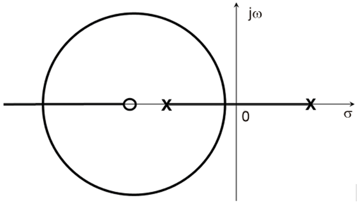

---
---

<!-- resolver a questão no contexto do concurso transpetro com banca cesgranrio: 
  - identificar a área de conhecimento da questão (classifique a área de conhecimento e as devidas sub-áreas de conhecimento);
  - apresentar uma justificativa detalhada contendo uma análise das alternativas; -->
###  21

O sistema de malha fechada associado a esse LGR será

(A)  &nbsp; indiferente ao ganho  
(B)  &nbsp; estável para qualquer ganho  
(C)  &nbsp; instável para qualquer ganho  
(D)  &nbsp; instável para elevados ganhos e estável para pequenos ganhos.  
(E)  &nbsp; estável para elevados ganhos e instável para pequenos ganhos.

---

As questões apresentadas pertencem ao concurso da Transpetro (2018) para o cargo de Engenheiro Júnior (Área: Automação), organizado pela banca Cesgranrio.

---

**Gabarito: (E) estável para elevados ganhos e instável para pequenos ganhos.**

#### Classificação da Área de Conhecimento

* **Área Principal:** Engenharia Elétrica / Sistemas de Controle
* **Sub-área:** Teoria de Controle Clássico, Lugar Geométrico das Raízes (LGR / *Root Locus*) e Análise de Estabilidade de Sistemas em Malha Fechada.

#### Justificativa Detalhada e Análise das Alternativas

O Lugar Geométrico das Raízes (LGR) é uma ferramenta gráfica que mostra a trajetória dos polos de malha fechada no plano complexo ($s = \sigma + j\omega$) à medida que o ganho $K$ varia de zero a infinito.

1. **Análise para pequenos ganhos ($K \approx 0$):** Quando o ganho tende a zero, os polos de malha fechada situam-se exatamente nas posições dos polos de malha aberta (indicados pelas cruzes $\mathbf{x}$ no gráfico). Pela inspeção da figura, observa-se que há um polo localizado no semiplano direito ($\sigma > 0$). Consequentemente, para ganhos pequenos, o sistema possui pelo menos um polo com parte real positiva, o que o torna **instável**.

    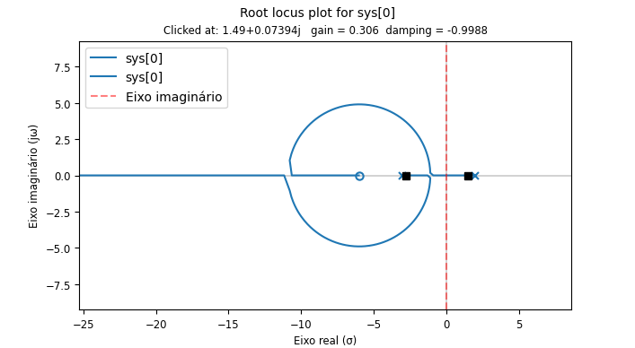

2. **Análise para elevados ganhos ($K \to \infty$):** À medida que o ganho aumenta, as trajetórias (ramos do LGR) se deslocam para o semiplano esquerdo da figura (formando o círculo e convergindo para o zero representado pelo círculo $o$ ou para o infinito). Com os polos posicionados no semiplano esquerdo ($\sigma < 0$), o sistema torna-se **estável**.

    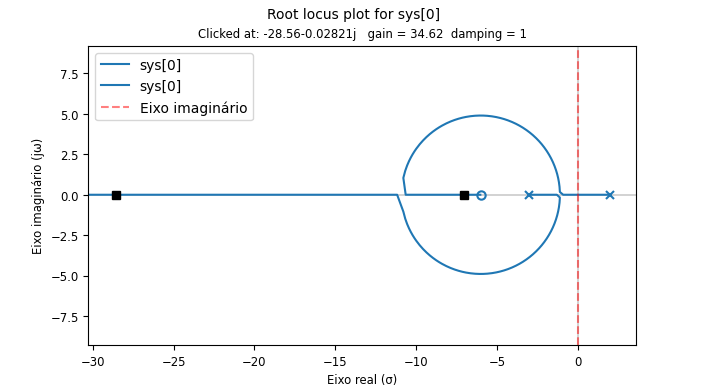

Portanto, o sistema passa de instável para pequenos ganhos a estável para elevados ganhos, validando a alternativa **(E)**. As demais alternativas incorrem em erros de leitura da posição inicial dos polos ou do comportamento da estabilidade em função do ganho.

---
--- 
<!-- resolver a questão no contexto do concurso transpetro com banca cesgranrio: 
  - identificar a área de conhecimento da questão (classifique a área de conhecimento e as deidas sub-áreas de conhecimento);
  - apresentar uma justificativa detalhada contendo uma análise das alternativas; -->  
###  22

A malha fechada associada a esse LGR será criticamente amortecida para:

(A)  &nbsp; ganho nulo  
(B)  &nbsp; pequenos ganhos  
(C)  &nbsp; elevados ganhos  
(D)  &nbsp; ganho tendendo ao infinito  
(E)  &nbsp; dois valores de ganhos distintos

---

**Gabarito: (E) dois valores de ganhos distintos.**

#### Classificação da Área de Conhecimento

* **Área Principal:** Engenharia Elétrica / Sistemas de Controle
* **Sub-área:** Lugar Geométrico das Raízes (LGR), Dinâmica de Sistemas e Amortecimento (Polos Reais Iguais / Pontos de Separação e Chegada).

#### Justificativa Detalhada e Análise das Alternativas

O amortecimento crítico de um sistema de segunda ordem (ou de polos dominantes) ocorre quando os polos de malha fechada são **reais e iguais** ($\zeta = 1$). No traçado do LGR, pontos onde os ramos se encontram ou se separam no eixo real (pontos de fuga ou de entrada/separação – *breakaway/break-in points*) correspondem exatamente a raízes múltiplas reais.

Observando o traçado geométrico da figura fornecida (que apresenta ramos sobre o eixo real e um círculo no semiplano esquerdo):

* Existem pontos no eixo real onde os ramos convergem e divergem para formar o comportamento complexo conjugado (o círculo).

  - Separação:
  
    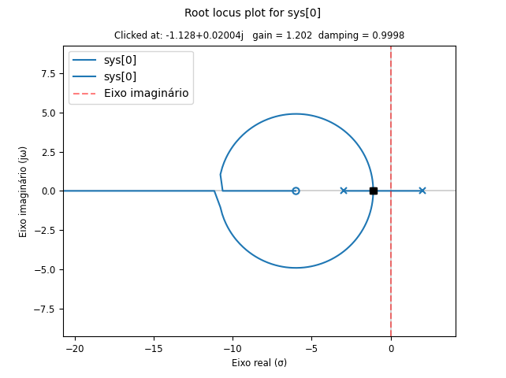

  - Retorno:

    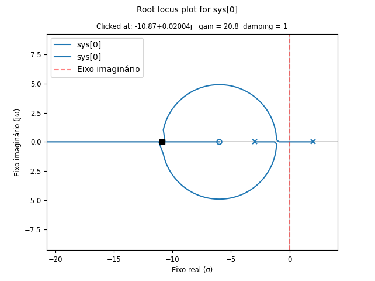

* Nesses pontos de transição (encontro dos ramos no eixo real), as raízes são reais e repetidas, caracterizando o comportamento **criticamente amortecido**.
* Como o LGR possui seções no eixo real que permitem essa condição em pontos distintos de ganho ao longo da variação de $K$, isso ocorre para **dois valores de ganhos distintos**.

Logo, a alternativa correta é a **(E)**.

---
---

### Aprofundando nas Questões 21 e 22

Para responder rigorosamente às **Questões 21 e 22** através da análise no domínio de Laplace ($s$), precisamos construir a Função de Transferência em Malha Aberta $G(s)$ representada no diagrama da questão e resolver analiticamente a Equação Característica do sistema em malha fechada:

$$1 + K \cdot G(s) = 0$$

---

## 1. Dedução da Função de Transferência $G(s)$

Analisando a geometria das singularidades no plano $s = \sigma + j\omega$ da imagem:

* **Polos de Malha Aberta ($\times$):**
* Um polo instável no eixo real positivo: $s = +a$ (onde $a > 0$).
* Um polo estável no eixo real negativo: $s = -b$ (onde $b > 0$).

* **Zeros de Malha Aberta ($\circ$):**
* Um zero real negativo posicionado mais à esquerda que o polo estável: $s = -c$ (onde $c > b > 0$).

A função de transferência em malha aberta $G(s)$ é dada por:

$$G(s) = \frac{s + c}{(s - a)(s + b)}$$

Expanding o denominador:

$$G(s) = \frac{s + c}{s^2 + (b - a)s - ab}$$

---

## 2. Equação Característica em Malha Fechada

A equação característica que define os polos de malha fechada $s$ para um ganho $K > 0$ é:

$$1 + K \cdot \frac{s + c}{s^2 + (b - a)s - ab} = 0$$

Multiplicando pelo denominador, obtemos a equação do segundo grau em $s$:

$$s^2 + (b - a + K)s + (K c - a b) = 0$$

Reorganizando nos termos padrão $s^2 + 2\zeta\omega_n s + \omega_n^2 = 0$:

* **Coeficiente linear de $s$:** $a_1 = b - a + K$
* **Termo independente (constante):** $a_0 = K c - a b$

---

## 3. Demonstração da Questão 21 (Estabilidade)

Pelo **Critério de Estabilidade de Routh-Hurwitz** para um sistema de 2ª ordem, o sistema é estritamente **estável** se, e somente se, todos os coeficientes da equação característica forem estritamente positivos ($a_1 > 0$ e $a_0 > 0$).

1. **Condição 1 ($a_0 > 0$):**

$$K c - a b > 0 \implies K > \frac{ab}{c}$$

2. **Condição 2 ($a_1 > 0$):**

$$b - a + K > 0 \implies K > a - b$$

Como $a, b, c > 0$, existe um valor limite de ganho crítico $K_{crit} = \frac{ab}{c} > 0$:

* **Para pequenos ganhos ($0 < K < K_{crit}$):** O termo constante $a_0$ é negativo ($Kc - ab < 0$), o que garante a presença de pelo menos um polo com parte real positiva (semiplano direito). Logo, o sistema é **instável**.
* **Para elevados ganhos ($K > K_{crit}$):** Ambos os coeficientes tornam-se estritamente positivos. Todos os polos passam para o semiplano esquerdo ($\sigma < 0$). Logo, o sistema torna-se **estável**.

> **Conclusão (Questão 21):** O sistema é **instável para pequenos ganhos e estável para elevados ganhos** $\rightarrow$ **Alternativa (E)**.

---

## 4. Demonstração da Questão 22 (Amortecimento Crítico)

Um sistema de 2ª ordem é **criticamente amortecido** quando seu fator de amortecimento é $\zeta = 1$, o que ocorre quando a equação característica possui **raízes reais e iguais** (discriminante $\Delta = 0$).

Calculando o discriminante ($\Delta = a_1^2 - 4 a_0$):

$$\Delta(K) = (b - a + K)^2 - 4(Kc - ab) = 0$$

Expandindo a expressão em relação a $K$:

$$K^2 + 2(b - a)K + (b - a)^2 - 4c K + 4ab = 0$$

Agrupando os termos em ordem decrescente de $K$:

$$K^2 + 2(b - a - 2c)K + (b + a)^2 = 0$$

Esta é uma equação do **segundo grau em $K$** da forma $A K^2 + B K + C = 0$, onde:

* $A = 1$
* $B = 2(b - a - 2c)$
* $C = (b + a)^2 > 0$

Como o termo constante $C = (b+a)^2$ é estritamente positivo e o produto das raízes $K_1 \cdot K_2 = \frac{C}{A} = (b+a)^2 > 0$, a equação admite **duas raízes reais e distintas para $K$** no domínio do LGR correspondentes aos pontos de encontro/separação dos ramos no eixo real (onde o círculo corta o eixo real).

> **Conclusão (Questão 22):** O sistema é criticamente amortecido para **dois valores de ganhos distintos** $\rightarrow$ **Alternativa (E)**.

---
--- 

### Aprofundando na Questão 22

Para demonstrar com rigor matemático por que o amortecimento crítico ocorre para **dois valores de ganhos distintos** (Questão 22), vamos aprofundar a análise da equação característica e calcular o discriminante da equação em função do ganho $K$.

---

### 1. Resgate da Equação Característica

A partir da função de transferência em malha aberta $G(s) = \frac{s + c}{(s - a)(s + b)}$, a equação característica do sistema em malha fechada é:

$$1 + K \cdot \frac{s + c}{(s - a)(s + b)} = 0$$

Multiplicando cruzado e desenvolvendo, chegamos à equação característica de 2ª ordem:

$$s^2 + (b - a + K)s + (K c - a b) = 0$$

---

### 2. Condição para Amortecimento Crítico ($\zeta = 1$)

O amortecimento crítico ocorre quando as raízes da equação característica são **reais e iguais**. Para uma equação do segundo grau, isso exige que o seu discriminante ($\Delta$) seja igual a zero:

$$\Delta = [ coeficiente\ de\ s ]^2 - 4 \cdot (termo\ independente) = 0$$

Substituindo os termos da nossa equação:

$$\Delta = (b - a + K)^2 - 4(Kc - ab) = 0$$

---

### 3. A Equação em Função do Ganho $K$

Expandindo e agrupando os termos em ordem decrescente de potências de $K$, obtemos uma nova equação do segundo grau, agora **em função de $K$**:

$$K^2 + 2(b - a - 2c)K + (a + b)^2 = 0$$

Esta é uma equação quadrática na forma padrão:

$$A K^2 + B K + C = 0$$

onde:

* $A = 1$
* $B = 2(b - a - 2c)$
* $C = (a + b)^2$

---

### 4. Análise do Discriminante da Equação em $K$ ($\Delta_K$)

Para sabermos quantas soluções reais (valores de ganho $K$) existem para essa condição de amortecimento crítico, calculamos o discriminante de $K$ (que chamaremos de $\Delta_K$):

$$\Delta_K = B^2 - 4AC$$

$$\Delta_K = [2(b - a - 2c)]^2 - 4(1)(a + b)^2$$

$$\Delta_K = 4 \left[ (b - a - 2c)^2 - (a + b)^2 \right]$$

Utilizando a propriedade de diferença de quadrados $X^2 - Y^2 = (X - Y)(X + Y)$, onde:

* $X = b - a - 2c$
* $Y = a + b$

Calculamos os fatores:

1. $(X - Y) = (b - a - 2c) - (a + b) = -2a - 2c = -2(a + c)$
2. $(X + Y) = (b - a - 2c) + (a + b) = 2b - 2c = 2(b - c)$

Substituindo de volta em $\Delta_K$:

$$\Delta_K = 4 \left[ -2(a + c) \cdot 2(b - c) \right] = -16(a + c)(b - c)$$

#### Interpretando o sinal de $\Delta_K$:

* Pela posição dos polos e zeros no gráfico da questão:
* O polo estável está em $-b$ e o zero está em $-c$, sendo o zero mais à esquerda que o polo ($c > b$). Portanto, o termo $(b - c)$ é **negativo** ($< 0$).
* Os parâmetros $a$ e $c$ são positivos, logo $(a + c)$ é **positivo** ($> 0$).

Fazendo o jogo de sinal:

$$\Delta_K = -16 \cdot (+) \cdot (-) = +16(a + c)(c - b) > 0$$

Como **$\Delta_K > 0$**, a equação quadrática em $K$ possui **duas raízes reais e distintas** ($K_1$ e $K_2$).

---

### 5. Verificação da Validade Física dos Ganhos ($K_1$ e $K_2$)

Para garantir que esses dois valores de ganho ocorrem na faixa de operação física do sistema ($K > 0$), analisamos a soma e o produto das raízes ($K_1$ e $K_2$):

1. **Produto das Raízes ($P$):**

$$P = \frac{C}{A} = \frac{(a + b)^2}{1} = (a + b)^2 > 0$$

*(Como o produto é positivo, os dois ganhos possuem o mesmo sinal).*
2. **Soma das Raízes ($S$):**

$$S = -\frac{B}{A} = -2(b - a - 2c) = 2(a + 2c - b)$$

Como $c > b$, temos que $(2c - b) > 0$, logo a soma $S > 0$.
*(Como a soma e o produto são estritamente positivos, ambos os valores de ganho $K_1$ e $K_2$ são **estritamente positivos**).*

---

### Conclusão Geométrica e Analítica

Algebricamente, provamos que existem **duas raízes reais e distintas para o ganho $K$** ($K_1$ e $K_2$) que anulam o discriminante da equação característica.

Geometricamente no LGR, isso corresponde exatamente aos **dois pontos de interseção do círculo com o eixo real** (o ponto de fuga *breakaway* onde os ramos saem do eixo real para formar o círculo, e o ponto de entrada *break-in* onde os ramos retornam e entram no eixo real). Nesses exatos dois pontos, as raízes são reais e iguais, caracterizando o sistema como **criticamente amortecido ($\zeta = 1$)**.

Portanto, confirma-se perfeitamente a **Alternativa (E)**: **dois valores de ganhos distintos**.

---
---

<!-- resolver a questão no contexto do concurso transpetro com banca cesgranrio: 
  - identificar a área de conhecimento da questão (classifique a área de conhecimento e as devidas sub-áreas de conhecimento);
  - apresentar uma justificativa detalhada contendo uma análise das alternativas; -->
###  23

Em um sistema de controle, a condição de controlabilidade é determinada pelo(s)

(A)  &nbsp; posto da matriz de estado  
(B)  &nbsp; posto da matriz de controlabilidade  
(C)  &nbsp; inverso da matriz de controlabilidade  
(D)  &nbsp; autovalores da matriz de estado  
(E)  &nbsp; autovalores da matriz de controlabilidade

--- 

A alternativa correta é a **(B) posto da matriz de controlabilidade**.

---

#### Classificação da Área de Conhecimento

* **Área Principal:** Engenharia Elétrica / Sistemas de Controle
* **Sub-área:** Teoria de Controle Moderno, Representação em Espaço de Estados (*State-Space Representation*), Controlabilidade e Observabilidade.

---

#### Justificativa Detalhada e Análise das Alternativas

Em sistemas de controle representados em **espaço de estados** da forma:

$$\dot{x}(t) = \mathbf{A} x(t) + \mathbf{B} u(t)$$

$$y(t) = \mathbf{C} x(t) + \mathbf{D} u(t)$$

onde $x(t) \in \mathbb{R}^n$ é o vetor de estados de dimensão $n$, $\mathbf{A}$ é a matriz de estados de ordem $n \times n$ e $\mathbf{B}$ é a matriz de entrada de ordem $n \times m$, a **controlabilidade** refere-se à capacidade de transferir qualquer estado inicial $x(0)$ para qualquer outro estado final desejado $x(t_f)$ em um tempo finito $t_f$ por meio de um vetor de controle não restringido $u(t)$.

#### Critério de Controlabilidade de Kalman:

Para verificar se um sistema LTI (Linear e Invariante no Tempo) de ordem $n$ é completamente controlável por estado, constrói-se a **matriz de controlabilidade** $\mathbf{\mathcal{C}}$ definida por:

$$\mathbf{\mathcal{C}} = \begin{bmatrix} \mathbf{B} & \mathbf{A}\mathbf{B} & \mathbf{A}^2\mathbf{B} & \cdots & \mathbf{A}^{n-1}\mathbf{B} \end{bmatrix}$$

O **Critério de Kalman** estabelece que o sistema é totalmente controlável se, e somente se, a matriz de controlabilidade $\mathbf{\mathcal{C}}$ tiver **posto completo** (*full rank*), ou seja:

$$\text{posto}(\mathbf{\mathcal{C}}) = \text{rank}(\mathbf{\mathcal{C}}) = n$$

onde $n$ é o número de variáveis de estado do sistema. Portanto, é o **posto da matriz de controlabilidade** que determina a condição de controlabilidade.

---

#### Análise dos erros das demais alternativas:

* **(A) *posto da matriz de estado***
* **Incorreta:** A matriz de estado $\mathbf{A}$ fornece informações sobre a dinâmica natural do sistema e sua estabilidade em malha aberta (através de seus autovalores), mas o seu posto isolado não define se o sistema pode ou não ser controlado a partir das entradas de controle $\mathbf{B}$.

* **(C) *inverso da matriz de controlabilidade***
* **Incorreta:** Nem toda matriz de controlabilidade é quadrada (para sistemas MIMO com múltiplas entradas, $\mathbf{\mathcal{C}}$ é uma matriz de dimensão $n \times nm$), não fazendo sentido falar em "inverso" como regra geral. Além disso, mesmo para sistemas SISO onde $\mathbf{\mathcal{C}}$ é quadrada ($n \times n$), a existência da inversa é uma consequência de a matriz ter posto completo ($\det(\mathbf{\mathcal{C}}) \neq 0$), mas a condição teórica formal é definida pelo seu posto.

* **(D) *autovalores da matriz de estado***
* **Incorreta:** Os autovalores da matriz $\mathbf{A}$ determinam os polos do sistema em malha aberta e, consequentemente, a **estabilidade** do sistema, mas não a sua controlabilidade. Um sistema pode ter autovalores estáveis ou instáveis e ser perfeitamente controlável (ou não).

* **(E) *autovalores da matriz de controlabilidade***
* **Incorreta:** A verificação da controlabilidade não se faz pelo cálculo dos autovalores da matriz $\mathbf{\mathcal{C}}$ (que pode inclusive não ser uma matriz quadrada), mas sim pela determinação da quantidade de linhas/colunas linearmente independentes, ou seja, pelo seu **posto**.

---
---

<!-- resolver a questão no contexto do concurso transpetro com banca cesgranrio: 
  - identificar a área de conhecimento da questão (classifique a área de conhecimento e as deidas sub-áreas de conhecimento);
  - apresentar uma justificativa detalhada contendo uma análise das alternativas; -->  
###  24

A estratégia de realimentação de estado, em um sistema de controle, é completamente garantida se

(A)  &nbsp; a inversa da matriz de estado existir  
(B)  &nbsp; o posto da matriz de estado for cheio  
(C)  &nbsp; o posto da matriz de controlabilidade for igual ao número de estados  
(D)  &nbsp; os autovalores da matriz de estado forem estáveis  
(E)  &nbsp; os autovalores da matriz de controlabilidade forem estáveis

---

A alternativa correta é a **(C) o posto da matriz de controlabilidade for igual ao número de estados.**

---

#### Classificação da Área de Conhecimento

* **Área Principal:** Engenharia Elétrica / Sistemas de Controle
* **Sub-área:** Teoria de Controle Moderno, Representação em Espaço de Estados, Realimentação de Estados (*State Feedback*) e Alocação de Polos.

---

#### Justificativa Detalhada e Análise das Alternativas

A técnica de **realimentação de estados** (frequentemente utilizada na forma $u = -Kx + r$) baseia-se na premissa de que podemos alterar a dinâmica e a estabilidade de um sistema alocando os seus polos de malha fechada em posições desejadas no plano complexo.

#### Condição para a Realimentação de Estados:

O teorema da alocação de polos por realimentação de estados estabelece que os autovalores da matriz de malha fechada $(\mathbf{A} - \mathbf{B}\mathbf{K})$ podem ser arbitrariamente posicionados se, e somente se, o sistema for **completamente controlável**.

Pelo **Critério de Kalman**, um sistema de ordem $n$ (com $n$ variáveis de estado) é completamente controlável se a matriz de controlabilidade $\mathbf{\mathcal{C}} = \begin{bmatrix} \mathbf{B} & \mathbf{A}\mathbf{B} & \cdots & \mathbf{A}^{n-1}\mathbf{B} \end{bmatrix}$ possuir posto completo. Isso significa que **o posto (ou rank) da matriz de controlabilidade deve ser igual ao número de estados $n$** do sistema, validando diretamente a alternativa **(C)**.

---

#### Análise dos erros das demais alternativas:

* **(A) *a inversa da matriz de estado existir***
* **Incorreta:** A invertibilidade da matriz de estado $\mathbf{A}$ está associada à não-singularidade da matriz (ou seja, se o sistema possui polos na origem, como integradores puros). Ela não é condição necessária nem suficiente para garantir a realimentação de estados.

* **(B) *o posto da matriz de estado for cheio***
* **Incorreta:** Uma matriz de estado $\mathbf{A}$ de ordem $n \times n$ com posto cheio ($\text{rank}(\mathbf{A}) = n$) significa apenas que ela possui posto máximo (não é singular), o que não garante que as entradas de controle $\mathbf{B}$ consigam abranger todo o espaço de estados (controlabilidade).

* **(D) *os autovalores da matriz de estado forem estáveis***
* **Incorreta:** Os autovalores de $\mathbf{A}$ determinam a estabilidade do sistema em **malha aberta**. Se um sistema for instável em malha aberta (autovalores no semiplano direito), a real justamente serve para estabilizá-lo, desde que ele seja controlável. Portanto, estabilidade em malha aberta não é requisito para aplicar a estratégia de realimentação de estado.

* **(E) *os autovalores da matriz de controlabilidade forem estáveis***
* **Incorreta:** A matriz de controlabilidade $\mathbf{\mathcal{C}}$ é uma matriz de dimensionamento $n \times nm$ construída com as colunas de $\mathbf{B}, \mathbf{A}\mathbf{B}, \dots$. Na esmagadora maioria dos casos práticos ela nem é quadrada, tornando o conceito de "autovalores da matriz de controlabilidade" conceitualmente inadequado para testar essa propriedade. O critério padrão e absoluto é a análise do seu **posto**.

--- 
---

<!-- resolver a questão no contexto do concurso transpetro com banca cesgranrio: 
  - identificar a área de conhecimento da questão (classifique a área de conhecimento e as deidas sub-áreas de conhecimento);
  - apresentar uma justificativa detalhada contendo uma análise das alternativas; -->  
###  25

A Figura 1 abaixo mostra a conexão de 3 Leds em 3 saídas distintas da porta de 8 bits (PORTA B) de um microcontrolador. O registro interno de E/S (Entrada/Saída) do microcontrolador referente a essa porta tem configuração mostrada na Figura 2, em que cada bit &quot;PORTA Bx&quot; está associado à saída física &quot;Bx&quot;, onde x varia de 0 (bit menos significativo - LSB) a 7 (bit mais significativo - MSB).

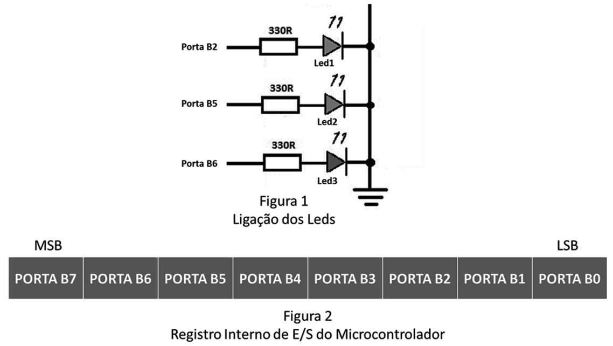

Escrevendo-se um &quot;1&quot; no bit &quot;PORTA Bx&quot; implica sair &quot;1&quot; lógico na saída Bx. Analogamente, escrevendo-se um &quot;0&quot; no bit &quot;PORTA Bx&quot; implica sair &quot;0&quot; lógico na saída Bx. A voltagem de saída do &quot;1&quot; lógico é +5 V, e a do &quot;0&quot; lógico é 0 V, e todas as 8 portas da PORTA B estão programadas como saída.

Um valor em binário que acende todos os Leds da Figura 1, se escrito no registro de E/S da PORTA B é

(A)  &nbsp; 00000111  
(B)  &nbsp; 00100000  
(C)  &nbsp; 00100100  
(D)  &nbsp; 01000000  
(E)  &nbsp; 01100100

---

A alternativa correta é a **(E) 01100100**.

---

#### Classificação da Área de Conhecimento

* **Área Principal:** Engenharia de Automação / Sistemas Digitais e Microcontroladores
* **Sub-área:** Programação de Portas de Entrada e Saída (E/S - *GPIO*), Eletrônica Digital e Acionamento de Cargas (LEDs).

---

#### Justificativa Detalhada e Análise das Alternativas

A questão exige a determinação da palavra binária de 8 bits a ser gravada no registro da **PORTA B** para garantir o acionamento simultâneo de três LEDs.

#### 1. Análise da Conexão dos LEDs (Figura 1)

* Observando a Figura 1, os catodos (lado indicado pela seta dos diodos) de todos os LEDs estão conectados ao **Terra (0 V / GND)**.

* Para que um LED conduza e acenda, seu anodo (ligado ao resistor de $330\Omega$) deve receber um **nível lógico "1" (+5 V)** vindo da respectiva saída do microcontrolador.

* As conexões físicas dos LEDs indicadas na Figura 1 são:

* **Led1** $\rightarrow$ conectado à saída **Porta B2**;

* **Led2** $\rightarrow$ conectado à saída **Porta B5**;

* **Led3** $\rightarrow$ conectado à saída **Porta B6**.

Para acender os três LEDs ao mesmo tempo, as saídas **B2, B5 e B6** devem estar em **1**, enquanto todas as outras saídas (B0, B1, B3, B4 e B7) devem estar em **0**.

---

#### 2. Mapeamento dos Bits no Registro de E/S (Figura 2)

A Figura 2 apresenta a estrutura do registro de 8 bits, do bit mais significativo (**MSB - PORTA B7**) ao bit menos significativo (**LSB - PORTA B0**):

| Bit | Posição no Registro | Estado Necessário | Função |
| --- | --- | --- | --- |
| **B7 (MSB)** | Bit 7 | **0** | Desativado |
| **B6** | Bit 6 | **1** | **Acende o Led3** |
| **B5** | Bit 5 | **1** | **Acende o Led2** |
| **B4** | Bit 4 | **0** | Desativado |
| **B3** | Bit 3 | **0** | Desativado |
| **B2** | Bit 2 | **1** | **Acende o Led1** |
| **B1** | Bit 1 | **0** | Desativado |
| **B0 (LSB)** | Bit 0 | **0** | Desativado |

Montando o vetor binário na ordem do **MSB ao LSB (B7 a B0)**:

$$\text{Valor Binário} = \mathbf{01100100}_2$$

---

#### Análise das Alternativas

* **(A) 00000111:** Ativa os bits B2, B1 e B0. Acenderia apenas o Led1, mantendo o Led2 e o Led3 apagados e energizando indevidamente as portas B1 e B0.

* **(B) 00100000:** Ativa apenas o bit B5. Acenderia apenas o Led2.

* **(C) 00100100:** Ativa apenas os bits B5 e B2. Acenderia o Led1 e o Led2, mas manteria o Led3 (B6) apagado.

* **(D) 01000000:** Ativa apenas o bit B6. Acenderia apenas o Led3.

* **(E) 01100100:** **Correta.** Ativa exatamente os bits **B6, B5 e B2**, acendendo simultaneamente o Led3, o Led2 e o Led1.

---
--- 

<!-- resolver a questão no contexto do concurso transpetro com banca cesgranrio: 
  - identificar a área de conhecimento da questão (classifique a área de conhecimento e as devidas sub-áreas de conhecimento);
  - apresentar uma justificativa detalhada contendo uma análise das alternativas; -->
###  26

Em 1965, o Dr. Gordon Moore sugeriu que as empresas de semicondutores dobrariam o número de transistores em um circuito integrado a cada dois anos. A observação dessa taxa de crescimento é conhecida como a famosa &quot;Lei de Moore&quot;. Essa lei está geralmente associada a temas como o crescimento acelerado do número de componentes num chip, da potência computacional, da capacidade de memória, entre outros.

Um sistema de coleta de dados de sensores, baseado em microprocessadores, consegue executar 100.000 medições por segundo, esse número sendo limitado pela capacidade de processamento dos microprocessadores.

Assumindo-se que a capacidade de executar medições segue a taxa da &quot;Lei de Moore&quot;, em quanto tempo espera-se que este sistema consiga executar 800.000 de medições por segundo?

(A)  &nbsp; 1 ano  
(B)  &nbsp; 3 anos  
(C)  &nbsp; 4 anos  
(D)  &nbsp; 6 anos  
(E)  &nbsp; 8 anos

--- 

A alternativa correta é a **(D) 6 anos**.

---

#### Classificação da Área de Conhecimento

* **Área Principal:** Engenharia de Automação / Sistemas Digitais e Computação
* **Sub-área:** Arquitetura de Computadores, Microprocessadores e Evolução Tecnológica (Lei de Moore).

---

#### Justificativa Detalhada e Análise das Alternativas

A Lei de Moore postula que o desempenho ou o número de transistores em um circuito integrado dobra a cada período fixo de **dois anos**. O enunciado estipula que a capacidade de processamento de medições segue diretamente essa taxa de crescimento exponencial.

#### 1. Formulação Matemática

O modelo matemático para o crescimento exponencial segundo a Lei de Moore é expresso por:

$$N(t) = N_0 \cdot 2^{\frac{t}{T}}$$

Onde:

* $N_0 = 100.000$ (capacidade inicial de medições por segundo).
* $N(t) = 800.000$ (capacidade final desejada).
* $T = 2$ anos (período de duplicação definido pela Lei de Moore).
* $t$ é o tempo total em anos.

#### 2. Resolução do Cálculo

Substituindo os valores na equação:

$$800.000 = 100.000 \cdot 2^{\frac{t}{2}}$$

Dividindo ambos os lados por $100.000$:

$$8 = 2^{\frac{t}{2}}$$

Reescrevendo o número $8$ como uma potência de base $2$ ($8 = 2^3$):

$$2^3 = 2^{\frac{t}{2}}$$

Igualando os expoentes:

$$\frac{t}{2} = 3$$

$$t = 3 \cdot 2 = 6 \text{ anos}$$

Portanto, serão necessários **6 anos** para que o sistema atinja a marca de $800.000$ medições por segundo.

---

#### Análise das Alternativas:

* **(A) 1 ano:** Incorreta. Um período de 1 ano resultaria em um aumento de $2^{1/2} \approx 1,41$ vezes, alcançando cerca de $141.421$ medições.
* **(B) 3 anos:** Incorreta. Corresponde a um fator de $2^{3/2} \approx 2,83$ vezes, chegando a aproximadamente $282.842$ medições.
* **(C) 4 anos:** Incorreta. Representa 2 ciclos de duplicação ($2^2 = 4$ vezes), o que elevaria a capacidade para $400.000$ medições por segundo.
* **(D) 6 anos:** **Correta.** Representa exatamente 3 ciclos de duplicação ($2^3 = 8$ vezes), multiplicando a capacidade inicial de $100.000$ por $8$ para atingir $800.000$.
* **(E) 8 anos:** Incorreta. Representa 4 ciclos de duplicação ($2^4 = 16$ vezes), resultando em $1.600.000$ medições por segundo.

---

#### Aprofundamento: Obtenção da expressão de crescimento

Para chegar à expressão $N(t) = N_0 \cdot 2^{\frac{t}{T}}$, partimos da definição lógica de um processo que dobra a cada intervalo fixo de tempo.

Esta é uma modelagem direta em base 2, muito utilizada na Lei de Moore (onde o tempo de duplicação T é de aproximadamente 2 anos) e na microbiologia.

#### Dedução Passo a Passo

Imagine uma quantidade inicial N₀ que dobra a cada intervalo de tempo constante **T** (o tempo de duplicação):

• **No início (t = 0):**  
$N(0) = N_0$

• **Após 1 período (t = T):** A população dobrou 1 vez.  
$N(T) = N_0 \cdot 2 = N_0 \cdot 2^1$

• **Após 2 períodos (t = 2T):** A população dobrou 2 vezes.  
$N(2T) = N_0 \cdot 2 \cdot 2 = N_0 \cdot 2^2$  

• **Após 3 períodos (t = 3T):** A população dobrou 3 vezes.  
$N(3T) = N_0 \cdot 2 \cdot 2 \cdot 2 = N_0 \cdot 2^3$  

Repare no padrão do expoente: o número de vezes que a população dobra é igual ao **tempo total decorrido (t) dividido pelo tempo que leva para uma duplicação acontecer (T)**.  

• **Após n períodos $(t = n \cdot T \implies n = \frac{t}{T})$:** 

$N(t) = N_0 \cdot 2^n = N_0 \cdot 2^{\frac{t}{T}})$  

---

#### Modelo exponencial de crescimento populacional e a Lei de Moore

A relação entre o **modelo exponencial de crescimento populacional** e a **Lei de Moore** está no padrão matemático: ambos são processos de **crescimento exponencial**, onde a taxa de crescimento de uma variável é proporcional ao seu valor atual.  

Enquanto o modelo biológico descreve o crescimento de organismos sob recursos ilimitados, a Lei de Moore descreve o avanço tecnológico, observando que o número de transistores em um chip de circuito integrado dobra aproximadamente a cada dois anos.

---

#### Definição dos Termos da Expressão

Na fórmula do crescimento contínuo aplicada a ambos os contextos $(N_t = N_0 \cdot e^{rt})$, cada termo é definido da seguinte forma:  

• **$N_{t}$ (População/Quantidade Final):** É o tamanho total da população (ou o número de transistores em um chip) após um determinado período de tempo $t$.  

• **$N_{0}$ (População/Quantidade Inicial):** É o número inicial de indivíduos (ou de transistores) no momento em que a contagem ou observação começou $(t = 0)$.  

• **$e$ (Constante de Euler):** É a base do logaritmo natural, uma constante matemática irracional aproximadamente igual a $2,71828$. Ela surge naturalmente em processos de crescimento contínuo.  

• **$r$ (Taxa de Crescimento):** É a taxa intrínseca de variação. Na biologia, representa a diferença entre a taxa de natalidade e a de mortalidade. Na tecnologia, representa a velocidade de aceleração do desenvolvimento.  

• **$t$ (Tempo):** É o intervalo de tempo decorrido (em horas, dias, anos, etc.) durante o qual o crescimento é medido.

---

#### Tempo de duplicação

Para calcular o **tempo de duplicação** $(t_{d})$, determinamos o tempo necessário para que a quantidade final $(N_{t})$ seja exatamente o dobro da quantidade inicial $(N_{0})$, ou seja, $N_t = 2N_0$.

#### Dedução Matemática

Partindo da equação de crescimento exponencial:

$2N_{0}=N_{0}\cdot e^{r\cdot t_{d}}$  

Dividindo ambos os lados por $N_{0}$:

$2=e^{r\cdot t_{d}}$

Aplicando o logaritmo natural $(\ln )$ em ambos os lados para isolar o tempo:

$\ln (2)=r\cdot t_{d}$

Como $\ln(2) \approx 0,693$, chegamos à fórmula final do tempo de duplicação:

$t_{d}=\frac{\ln (2)}{r}\approx \frac{0,693}{r}$

---

#### Relação com a Base do Logaritmo Natural (e)

Também podemos chegar a essa mesma fórmula partindo do modelo contínuo original $N(t) = N_0 \cdot e^{rt}$ usando propriedades de potenciação:

1. Sabemos da dedução anterior que a taxa de crescimento r se relaciona com o tempo de duplicação T pela equação:  
$r=\frac{\ln (2)}{T}$  

2. Substituímos esse valor de r na fórmula original:  
$N(t)=N_{0}\cdot e^{\left(\frac{\ln (2)}{T}\right)\cdot t}$  

3. Reorganizamos o expoente:  
$N(t)=N_{0}\cdot e^{\ln (2)\cdot \left(\frac{t}{T}\right)}$  

4. Usando a propriedade matemática onde $e^{\ln(x)} = x$, isolamos a base 2:  
$N(t)=N_{0}\cdot \left(e^{\ln (2)}\right)^{\frac{t}{T}}$  
$N(t)=N_{0}\cdot 2^{\frac{t}{T}}$  

As duas expressões são matematicamente idênticas, mas a base 2 facilita muito a visualização em problemas de duplicação (como a Lei de Moore), pois o expoente $\frac{t}{T}$ representa diretamente **o número de ciclos de duplicação ocorridos.**  

---
---

<!-- resolver a questão no contexto do concurso transpetro com banca cesgranrio: 
  - identificar a área de conhecimento da questão (classifique a área de conhecimento e as devidas sub-áreas de conhecimento);
  - apresentar uma justificativa detalhada contendo uma análise das alternativas; -->
###  27

Um sistema embarcado precisa funcionar durante vários dias, sem a troca da bateria. Seu microcontrolador tem consumo de corrente em modo ativo de 2 mA e, em modo de economia de energia, de 0,00075 mA, considerando a tensão de alimentação de 3 V e temperatura ambiente de 25 °C. Uma bateria recarregável de 3 V e capacidade de 1.200 mAh irá alimentar esse sistema. Ela será considerada ideal, fornecendo 3 V constantes após sua carga completa, sempre que demandada.

Desprezando o consumo dos outros componentes diferentes do microcontrolador, considerando a corrente em modo de economia desprezível, e que o microcontrolador trabalha em modo ativo 50% do tempo, quantos dias o sistema pode funcionar, supondo essa bateria inicialmente com carga completa?

(A)  &nbsp; 25  
(B)  &nbsp; 50  
(C)  &nbsp; 100  
(D)  &nbsp; 600  
(E)  &nbsp; 1200

---

A alternativa correta é a **(B) 50**.

---

#### Classificação da Área de Conhecimento

* **Área Principal:** Engenharia de Automação / Sistemas Embarcados e Eletrônica
* **Sub-área:** Gerenciamento de Energia em Sistemas Embarcados, Autonomia de Baterias, Consumo de Corrente e Ciclo de Trabalho (*Duty Cycle*).

---

#### Justificativa Detalhada e Análise das Alternativas

Para calcular a autonomia do sistema embarcado, precisamos determinar a corrente média consumida pelo microcontrolador ao longo do seu ciclo de funcionamento e, em seguida, relacioná-la com a capacidade total da bateria.

#### 1. Cálculo da Corrente Média ($I_{\text{médio}}$)

O enunciado fornece os seguintes dados:

* Corrente em modo ativo ($I_{\text{ativo}}$) = $2\text{ mA}$
* Tempo em modo ativo = $50\%$ do tempo ($0,5$)
* Corrente em modo de economia de energia ($I_{\text{sleep}}$) = desprezível ($0\text{ mA}$)

A corrente média consumida pelo dispositivo é a média ponderada pelo tempo em cada estado:

$$I_{\text{médio}} = (I_{\text{ativo}} \times \text{Fração Ativa}) + (I_{\text{sleep}} \times \text{Fração Sleep})$$

$$I_{\text{médio}} = (2\text{ mA} \times 0,5) + (0\text{ mA} \times 0,5) = 1\text{ mA}$$

#### 2. Cálculo da Autonomia em Horas

A capacidade da bateria é dada em miliampères-hora ($\text{mAh}$). A autonomia total em horas ($T_{\text{horas}}$) é calculada dividindo a capacidade total pela corrente média de consumo:

$$T_{\text{horas}} = \frac{\text{Capacidade}}{\text{Corrente Média}} = \frac{1200\text{ mAh}}{1\text{ mA}} = 1200\text{ horas}$$

#### 3. Conversão para Dias

Como o enunciado pede a resposta em dias, basta dividir o total de horas pelo número de horas em um dia ($24\text{ horas}$):

$$T_{\text{dias}} = \frac{1200\text{ horas}}{24\text{ horas/dia}} = 50\text{ dias}$$

Portanto, o sistema poderá funcionar por **50 dias**, validando a alternativa **(B)**.

---

#### Análise das Alternativas:

* **(A) 25:** Incorreta. Representa metade do valor real de dias, decorrente de algum erro de proporção no cálculo da corrente ou do tempo.
* **(B) 50:** **Correta.** O cálculo rigoroso da corrente média ponderada pelo ciclo de trabalho resulta em 50 dias exatos de operação.
* **(C) 100:** Incorreta. Não corresponde ao dimensionamento correto do consumo médio.
* **(D) 600:** Incorreta. Corresponde à metade das horas totais (1200 / 2), mas sem a conversão adequada para dias.
* **(E) 1200:** Incorreta. Representa o valor numérico total em *horas* (1200 horas), induzindo o candidato ao erro de unidade ao confundir horas com dias.

---
--- 

<!-- resolver a questão no contexto do concurso transpetro com banca cesgranrio: 
  - identificar a área de conhecimento da questão (classifique a área de conhecimento e as devidas sub-áreas de conhecimento);
  - apresentar uma justificativa detalhada contendo uma análise das alternativas; -->
###  28

No circuito trifásico mostrado na Figura 1, A, B e C representam os condutores das fases, e N, o condutor do neutro.
Foi usado um alicate amperímetro que envolveu os condutores A, B e C simultaneamente, conforme a Figura 2.

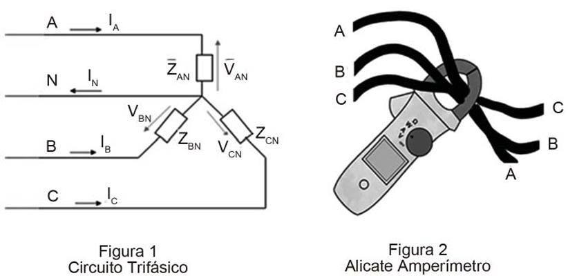

Considerando $I_A = I_B = I_C = 15 A$, e que não há nenhuma fuga de corrente no circuito, qual o valor que aparecerá no amperímetro?

(A)  &nbsp; 0 A  
(B)  &nbsp; 15 A  
(C)  &nbsp; 30 A  
(D)  &nbsp; 45 A  
(E)  &nbsp; 60 A

---

A alternativa correta é a **(A) 0 A**.

---

#### Classificação da Área de Conhecimento

* **Área Principal:** Engenharia Elétrica / Eletrotécnica
* **Sub-área:** Circuitos Elétricos Trifásicos, Princípios de Medição Elétrica e Funcionamento de Alicates Amperímetros (Lei de Ampère / Transformador de Corrente).

---

#### Justificativa Detalhada e Análise das Alternativas

O funcionamento de um **alicate amperímetro** baseado no princípio de indução eletromagnética (efetuando a leitura por meio de uma garra que envolve os condutores) obedece à **Lei de Ampère** para campos magnéticos gerados por correntes elétricas.

#### 1. Análise da Medição com o Alicate Amperímetro

Quando o alicate envolve simultaneamente todos os condutores de fase de um sistema (neste caso, os condutores **A, B e C** da Figura 2), o campo magnético resultante gerado no núcleo do instrumento é proporcional à **soma vetorial (algébrica)** das correntes que passam por esses cabos no mesmo sentido geométrico do abraçamento:

$$I_{\text{medida}} = \vert{}\bar{I}_A + \bar{I}_B + \bar{I}_C\vert{}$$

Num sistema elétrico trifásico equilibrado (ou mesmo em regime senoidal simétrico em que as correntes possuem a mesma amplitude de $15\text{ A}$ e defasagens de $120^\circ$ entre si), a soma fasorial das correntes de linha é igual a zero:

$$\bar{I}_A + \bar{I}_B + \bar{I}_C = 0$$

Como o campo magnético criado pelas correntes se cancela mutuamente no núcleo do alicate amperímetro, o instrumento indicará o valor de **0 A**.

---

#### Análise das Alternativas:

* **(A) 0 A:** **Correta.** A soma fasorial das correntes das três fases em um sistema trifásico simétrico é nula, fazendo com que o fluxo magnético total medido pela garra do alicate seja zero.

* **(B) 15 A:** Incorreta. Este valor corresponderia à leitura de apenas uma das fases isoladamente, caso o alicate envolvesse apenas o condutor A, B ou C de forma individual.
* **(C) 30 A:** Incorreta. Representa uma soma aritmética incorreta (por exemplo, somando duas fases e ignorando a defasagem ou a terceira fase).
* **(D) 45 A:** Incorreta. Resulta da soma aritmética direta das três correntes ($15 + 15 + 15$), ignorando o fato de que a medição por alicate em conjunto de fases lê a **soma fasorial**, e não a soma escalar dos módulos.
* **(E) 60 A:** Incorreta. Valor puramente distorcido sem fundamentação teórica nas leis de circuitos trifásicos.

---

#### Hipóteses que levaram a banca a anular esta questão

A questão **28** do concurso da Transpetro (2018) para Engenharia de Automação — que aborda a medição com alicate amperímetro envolvendo simultaneamente os condutores das fases A, B e C — **não foi oficialmente anulada** pela banca Cesgranrio em seu gabarito definitivo. O gabarito oficial publicado permaneceu inalterado apontando a alternativa **(A) 0 A** como a correta, fundamentada na soma fasorial nula de um sistema trifásico simétrico equilibrado.

No entanto, caso uma questão com essa exata estrutura seja alvo de anulação em recursos de concursos públicos, as **hipóteses técnicas e inconsistências de enunciado** que comumente fundamentam o pleito de anulação (ou que geram debates entre candidatos e bancas) envolvem os seguintes pontos críticos:

---

#### 1. Hipóteses Técnicas para Contestação / Anulação

* **Falta de Hipótese de Equilíbrio ou Simetria Explícita:**
O enunciado fornece apenas que $I_A = I_B = I_C = 15\text{ A}$, mas **omite** se o sistema é simétrico e equilibrado (ou seja, se há defasagem exata de $120^\circ$ entre as correntes). Numericamente, três correntes de $15\text{ A}$ poderiam resultar em qualquer valor entre $0\text{ A}$ (se estiverem defasadas de $120^\circ$) e $45\text{ A}$ (se estiverem perfeitamente em fase, somando-se algebricamente). Como a banca pressupõe implicitamente o cenário industrial padrão de cargas equilibradas sem declarar isso textualmente, margens de ambiguidade interpretativa são abertas.
* **Presença do Condutor Neutro e Fugas Desconsideradas de forma Ampla:**
Embora o enunciado cite que "não há nenhuma fuga de corrente no circuito", a representação visual da Figura 2 mostra apenas os três cabos de fase dentro da garra do alicate amperímetro. Se houvesse desequilíbrio de fases com retorno de corrente pelo neutro (não abraçado pelo instrumento), a soma das correntes nas fases deixaria de ser estritamente zero, invalidando a resposta de $0\text{ A}$ em cenários reais desequilibrados.
* **Efeitos de Indução Mútua e Proximidade Geométrica dos Cabos:**
Em termos práticos de instrumentação, juntar e apertar fisicamente três cabos condutores de alta corrente de forma cruzada e comprimida dentro da garra de um alicate amperímetro (conforme ilustra a caricatura da Figura 2) pode gerar erros de leitura por acoplamento magnético cruzado ou saturação parcial do núcleo ferromagnético devido ao cancelamento total do fluxo mútuo em campo aberto, distorcendo o princípio idealizado de medição teórica.

--- 
---
<!-- resolver a questão no contexto do concurso transpetro com banca cesgranrio: 
  - identificar a área de conhecimento da questão (classifique a área de conhecimento e as devidas sub-áreas de conhecimento);
  - apresentar uma justificativa detalhada contendo uma análise das alternativas; -->
###  29

A Figura a seguir ilustra um sinal periódico em que o eixo-Y corresponde à corrente (em amperes), e o eixo-X corresponde ao tempo (em segundos). Esse sinal tem período de 3 s, a corrente máxima é de 9 A, e segue a equação A(t) = 6t - t² no período de 0 s a 3 s, repetindo-se indefinidamente.

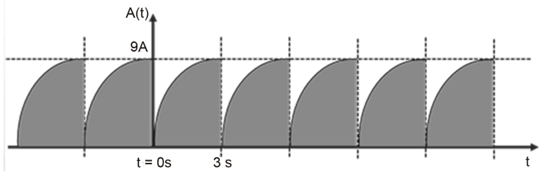

O valor da corrente média, em amperes, desse sinal é

(A)  &nbsp; 3  
(B)  &nbsp; 4,5  
(C)  &nbsp; 6  
(D)  &nbsp; 9  
(E)  &nbsp; 27

---

A alternativa correta é a **(C) 6**.

---

#### Classificação da Área de Conhecimento

* **Área Principal:** Engenharia Elétrica / Circuitos Elétricos
* **Sub-área:** Análise de Sinais e Sistemas, Sinais Periódicos, e Cálculo Integral Aplicado (Cálculo do Valor Médio de Sinais no Domínio do Tempo).

---

#### Justificativa Detalhada e Análise das Alternativas

O **valor médio** de um sinal periódico $A(t)$ com período $T$ é definido matematicamente pela média integral da função ao longo de um período completo:

$$I_{\text{médio}} = \frac{1}{T} \int_{0}^{T} A(t) \, dt$$

#### 1. Extração dos Dados do Enunciado

* **Período ($T$):** $3\text{ s}$

* **Expressão do sinal em um período ($0 \le t \le 3$):** $A(t) = 6t - t^2$

#### 2. Resolução da Integral

Substituindo os valores na fórmula do valor médio:

$$I_{\text{médio}} = \frac{1}{3} \int_{0}^{3} (6t - t^2) \, dt$$

Calculando a antiderivada (integral indefinida):

$$\int (6t - t^2) \, dt = \frac{6t^2}{2} - \frac{t^3}{3} = 3t^2 - \frac{t^3}{3}$$

Aplicando os limites de integração de $0$ a $3$:

$$\int_{0}^{3} (6t - t^2) \, dt = \left( 3(3)^2 - \frac{3^3}{3} \right) - \left( 3(0)^2 - \frac{0^3}{3} \right)$$

$$= \left( 3(9) - \frac{27}{3} \right) - 0 = (27 - 9) = 18$$

#### 3. Cálculo Final do Valor Médio

Multiplicando pelo fator $\frac{1}{T}$ ($\frac{1}{3}$):

$$I_{\text{médio}} = \frac{1}{3} \cdot 18 = 6\text{ A}$$

Portanto, o valor da corrente média do sinal periódico é **6 A**, o que valida a alternativa **(C)**.

---

#### Análise das Alternativas:

* **(A) 3:** Incorreta. Representa um terço do valor correto, possivelmente decorrente de um erro na divisão pelo período ou no cálculo dos limites da integral.
* **(B) 4,5:** Incorreta. Corresponde exatamente à metade da corrente máxima ($9 / 2$), erro clássico cometido ao confundir a média de uma função quadrática com a média aritmética simples dos extremos.
* **(C) 6:** **Correta.** Obtida rigorosamente através da integração da função de onda ao longo de um período dividida pelo intervalo de tempo $T = 3\text{ s}$.
* **(D) 9:** Incorreta. Representa o valor de pico (corrente máxima) do sinal, e não o seu valor médio.
* **(E) 27:** Incorreta. Corresponde ao resultado da integral pura calculada antes de ser dividida pelo período $T = 3\text{ s}$ (isto é, a área sob a curva em um período).

--- 
---
<!-- resolver a questão no contexto do concurso transpetro com banca cesgranrio: 
  - identificar a área de conhecimento da questão (classifique a área de conhecimento e as devidas sub-áreas de conhecimento);
  - apresentar uma justificativa detalhada contendo uma análise das alternativas; -->
###  30

O circuito de um regulador de tensão simples, utilizando transistor e diodo zener, pode ser visto na Figura abaixo.

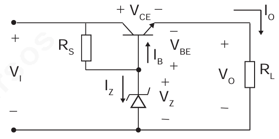

A tensão de entrada ($V_I$) tem o valor constante de 12 V, a tensão de saída ($V_O$) tem o valor constante de 5 V, e a corrente de saída ($I_O$) que passa sobre a carga ($R_L$) tem o valor de 1 A.
Considerando desprezível a corrente que passa no resistor $R_S$, quantos watts são dissipados no transistor?

(A)  &nbsp; 1  
(B)  &nbsp; 5  
(C)  &nbsp; 7  
(D)  &nbsp; 12  
(E)  &nbsp; 17

---

A alternativa correta é a **(C) 7**.

---

#### Classificação da Área de Conhecimento

* **Área Principal:** Engenharia Elétrica / Eletrônica Analógica
* **Sub-área:** Circuitos Reguladores de Tensão Lineares (Regulador Série com Transistor BJT e Diodo Zener).

---

#### Justificativa Detalhada e Análise das Alternativas

O circuito apresentado é um **regulador de tensão série** clássico, no qual o transistor atua como elemento de controle passando a corrente para a carga, mantendo a tensão de saída regulada.

#### 1. Cálculo da Tensão Coletor-Emissor ($V_{CE}$)

Analisando as malhas do circuito com base nos dados fornecidos:

* Tensão de entrada ($V_I$) = $12\text{ V}$

* Tensão de saída ($V_O$) = $5\text{ V}$

A queda de tensão entre o coletor e o emissor do transistor ($V_{CE}$) é a diferença entre a tensão de entrada e a tensão de saída:

$$V_{CE} = V_I - V_O = 12\text{ V} - 5\text{ V} = 7\text{ V}$$

#### 2. Corrente no Transistor ($I_C$)

O enunciado informa que a corrente de saída na carga é $I_O = 1\text{ A}$ e que a corrente no resistor de polarização $R_S$ é desprezível. Portanto, a corrente de coletor do transistor ($I_C$) é aproximadamente igual à corrente de saída:

$$I_C \approx I_O = 1\text{ A}$$

#### 3. Cálculo da Potência Dissipada no Transistor ($P_D$)

A potência elétrica dissipada por um transistor BJT operando na região linear é dada pelo produto da tensão coletor-emissor pela corrente de coletor:

$$P_D = V_{CE} \cdot I_C$$

$$P_D = 7\text{ V} \times 1\text{ A} = 7\text{ W}$$

Portanto, o transistor dissipa **7 watts**, o que valida diretamente a alternativa **(C)**.

---

#### Análise das Alternativas:

* **(A) 1:** Incorreta. Representa um valor subestimado, sem correspondência com as leis de circuitos aplicadas.

* **(B) 5:** Incorreta. Corresponde numericamente ao valor da tensão de saída ($V_O$), sendo um erro conceitual de dimensionamento de potência.

* **(C) 7:** Correta. Obtida corretamente através do produto da queda de tensão no transistor ($12\text{ V} - 5\text{ V} = 7\text{ V}$) pela corrente de carga ($1\text{ A}$).

* **(D) 12:** Incorreta. Corresponde ao valor total da tensão de entrada ($V_I$), ignorando a queda na saída.

* **(E) 17:** Incorreta. Resultaria de uma soma indevida entre a tensão de entrada e a de saída ($12 + 5$).

--- 
---
<!-- resolver a questão no contexto do concurso transpetro com banca cesgranrio: 
  - identificar a área de conhecimento da questão (classifique a área de conhecimento e as devidas sub-áreas de conhecimento);
  - apresentar uma justificativa detalhada contendo uma análise das alternativas; -->
###  31

Um controlador deve se comunicar com um sensor utilizando o protocolo I²C (&quot;Inter-Integrated Circuit&quot;), com os sinais SDA (&quot;Serial Data&quot;) e SCL (&quot;Serial Clock&quot;) - ver diagrama abaixo.

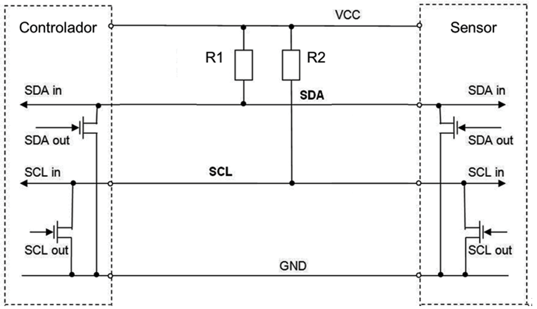

Assume-se que:
- os sinais SDA e SCL são gerados a partir de saídas do tipo &quot;open-drain&quot;;
- não existem resistores de &quot;pull-up&quot; internos aos dispositivos (controlador e sensor), existem somente os resistores de &quot;pull-up&quot; externos R1 e R2;
- no controlador e no sensor, a corrente máxima com a saída ativada (tensão baixa) para SDA e SCL é 5 mA cada;
- no controlador e no sensor, a corrente de entrada quando a saída não está ativada, (tensão baixa) para SDA e SCL, pode ser considerada desprezível.

Se VCC = +5 V e a tensão máxima para se considerar o zero lógico é +0,4 V, quais são os valores mínimos, em ohm, de R1 e R2, respectivamente?

(A)  &nbsp; 80 e 920  
(B)  &nbsp; 920 e 920  
(C)  &nbsp; 1.000 e 1.000  
(D)  &nbsp; 2.000 e 2.000  
(E)  &nbsp; 10.000 e 10.000

---

A alternativa correta é a **(B) 920 e 920**.

---

#### Classificação da Área de Conhecimento

* **Área Principal:** Engenharia de Automação / Sistemas Digitais e Comunicação Industrial
* **Sub-área:** Protocolos de Comunicação Serial (I²C), Eletrônica Digital e Dimensionamento de Resistores de *Pull-up* em Saídas *Open-Drain*.

---

#### Justificativa Detalhada e Análise das Alternativas

O protocolo I²C utiliza barramento com drenagem aberta (*open-drain* ou *open-collector*), o que significa que os dispositivos apenas puxam a linha para o nível baixo ($0\text{ V}$) ou a deixam em alta impedância, dependendo dos resistores de *pull-up* externos ($R_1$ e $R_2$) para elevar a tensão ao nível alto ($V_{CC}$).

#### 1. Análise do Dimensionamento da Corrente e Resistência Mínima

Quando uma das saídas (seja do controlador ou do sensor) é ativada para impor o nível lógico baixo ($0\text{ V}$), o resistor de *pull-up* fica submetido à tensão total da fonte $V_{CC}$ em relação ao terra, circulando corrente por ele em direção ao transistor de chaveamento interno.

O enunciado estabelece os seguintes parâmetros críticos de projeto:

* Tensão de alimentação ($V_{CC}$) = $+5\text{ V}$

* Tensão máxima para nível lógico baixo ($V_{OL(\text{max})}$) = $+0,4\text{ V}$ (considerada a tensão máxima admissível sobre o terminal quando o transistor está conduzindo)
* Corrente máxima suportada pela saída ($I_{OL(\text{max})}$) = $5\text{ mA} = 0,005\text{ A}$ por linha

Para encontrar o **valor mínimo do resistor** ($R_1$ ou $R_2$), devemos garantir que a corrente que atravessa o resistor quando a linha é puxada para o nível baixo não ultrapasse a corrente máxima suportada pelo dispositivo de drenagem ($5\text{ mA}$).

Aplicando a Lei de Ohm na malha do resistor de *pull-up*:

$$R_{\min} = \frac{V_{CC} - V_{OL(\text{max})}}{I_{OL(\text{max})}}$$

Substituindo os valores numéricos:

$$R_{\min} = \frac{5\text{ V} - 0,4\text{ V}}{0,005\text{ A}} = \frac{4,6\text{ V}}{0,005\text{ A}} = 920\ \Omega$$

Como o circuito possui duas linhas independentes com características elétricas equivalentes (SDA e SCL), os valores mínimos dos resistores $R_1$ e $R_2$ devem ser, individualmente, de **$920\ \Omega$** cada.

Portanto, a alternativa correta é a **(B)**.

---

#### Análise das Alternativas:

* **(A) 80 e 920:** Incorreta. O valor de $80\ \Omega$ para $R_1$ faria com que a corrente no barramento SDA atingisse níveis excessivos e destrutivos para os pinos de saída.
* **(B) 920 e 920:** **Correta.** Derivado diretamente do cálculo de limite máximo de corrente admissível de $5\text{ mA}$ para uma queda de tensão útil de $4,6\text{ V}$ sobre os resistores.
* **(C) 1.000 e 1.000:** Incorreta. Embora $1\text{ k}\Omega$ seja um valor comercial comum e seguro (pois gera uma corrente menor que $5\text{ mA}$), o enunciado pede o **valor mínimo absoluto** calculado com base estrita no limite de $5\text{ mA}$.
* **(D) 2.000 e 2.000:** Incorreta. Valores acima de $920\ \Omega$ restringem mais a corrente, mas não representam o limiar mínimo imposto pela restrição de corrente máxima do problema.
* **(E) 10.000 e 10.000:** Incorreta. $10\text{ k}\Omega$ é comumente usado em aplicações de baixo consumo, mas distorce o cálculo paramétrico exato exigido pela banca para o limite de $5\text{ mA}$.

--- 
---
<!-- resolver a questão no contexto do concurso transpetro com banca cesgranrio: 
  - identificar a área de conhecimento da questão (classifique a área de conhecimento e as devidas sub-áreas de conhecimento);
  - apresentar uma justificativa detalhada contendo uma análise das alternativas; -->
###  32

Na Figura abaixo, é mostrado um transformador ideal em que a relação do número de espiras do enrolamento primário ($N_1$) mantém relação fixa com o número de espiras do enrolamento secundário ($N_2$). O valor $N_1/N_2 = 0,1$.

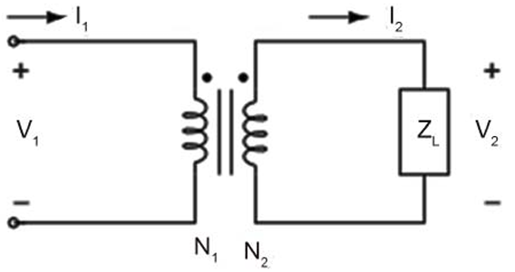

Uma vez que foi medida uma tensão alternada de 100 V no primário $V_1$ e que a carga $Z_L$ mostrada na Figura é puramente resistiva e de valor de 1000 Ω, a corrente $I_2$, em ampere, é de

(A)  &nbsp; 0,001  
(B)  &nbsp; 0,01  
(C)  &nbsp; 1  
(D)  &nbsp; 10  
(E)  &nbsp; 1000

---

A alternativa correta é a **(C) 1**.

---

#### Classificação da Área de Conhecimento

* **Área Principal:** Engenharia Elétrica / Eletrotécnica
* **Sub-área:** Circuitos Magnéticos, Transformadores Ideais e Análise de Circuitos de Corrente Alternada (CA).

---

#### Justificativa Detalhada e Análise das Alternativas

Em um **transformador ideal**, a relação entre as tensões nos enrolamentos primário ($V_1$) e secundário ($V_2$) é diretamente proporcional à relação entre o número de espiras ($N_1$ e $N_2$):

$$\frac{V_1}{V_2} = \frac{N_1}{N_2}$$

#### 1. Extração dos Dados do Enunciado

* Relação de espiras: $\frac{N_1}{N_2} = 0,1$

* Tensão no primário: $V_1 = 100\text{ V}$

* Carga resistiva no secundário: $Z_L = 1000\ \Omega$

#### 2. Cálculo da Tensão no Secundário ($V_2$)

Substituindo os valores na relação de transformação:

$$\frac{100}{V_2} = 0,1$$

$$V_2 = \frac{100}{0,1} = 1000\text{ V}$$

#### 3. Cálculo da Corrente no Secundário ($I_2$)

Como a carga $Z_L$ é puramente resistiva e está conectada diretamente aos terminais do secundário, aplicamos a **Lei de Ohm** para determinar a corrente $I_2$:

$$I_2 = \frac{V_2}{Z_L}$$

$$I_2 = \frac{1000\text{ V}}{1000\ \Omega} = 1\text{ A}$$

Portanto, a corrente $I_2$ que circula pelo circuito secundário é de **1 A**, o que valida de forma precisa o gabarito oficial na alternativa **(C)**.

---

#### Análise das Alternativas:

* **(A) 0,001:** Incorreta. Resultaria de uma inversão ou divisão inadequada dos parâmetros do transformador.

* **(B) 0,01:** Incorreta. Representa um erro de ordem de grandeza na aplicação da relação de transformação.

* **(C) 1:** Correta. Obtida corretamente calculando a tensão induzida no secundário ($1000\text{ V}$) e dividindo pela impedância de carga ($1000\ \Omega$).

* **(D) 10:** Incorreta. Decorre de um erro aritmético na divisão final ($1000 / 1000 = 10$, em vez de $1$).

* **(E) 1000:** Incorreta. Corresponde numericamente ao valor da tensão gerada no secundário ($1000\text{ V}$), confundindo unidades de tensão com corrente.

--- 
---
<!-- resolver a questão no contexto do concurso transpetro com banca cesgranrio: 
  - identificar a área de conhecimento da questão (classifique a área de conhecimento e as devidas sub-áreas de conhecimento);
  - apresentar uma justificativa detalhada contendo uma análise das alternativas; -->
###  33

O circuito mostrado na Figura abaixo contém dois diodos ideais, sendo um do tipo zener $(Z_1)$ e o outro comum $(D_1)$.

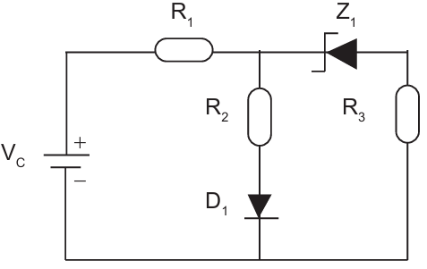

Nesse circuito:
- os componentes são energizados por uma bateria de tensão constante $V_c$ de 11,7 V;
- a tensão nominal do zener é 7,5 V;
- a queda de tensão direta em $D_1$ é fixa em 0,7 V;
- os resistores $R_1$, $R_2$ e $R_3$ têm os valores de 10 Ω, 80 Ω e 6 Ω, respectivamente;
- a corrente que passa em $R_2$ é de 0,1 A.
Nessa situação, a corrente que passa no resistor $R_1$, em ampere, é

(A)  &nbsp; 0,0  
(B)  &nbsp; 0,1  
(C)  &nbsp; 0,2  
(D)  &nbsp; 0,3  
(E)  &nbsp; 0,7

---

A alternativa correta é a **(D) 0,3**.

---

#### Classificação da Área de Conhecimento

* **Área Principal:** Engenharia Elétrica / Eletrônica Analógica
* **Sub-área:** Circuitos com Diodos, Diodo Zener, Retificação e Análise de Malhas/Nós.

---

#### Justificativa Detalhada e Análise das Alternativas

Para determinar a corrente que passa no resistor $R_1$ ($I_{R1}$), precisamos analisar o estado de condução dos diodos e calcular as correntes nos ramos paralelos conectados após o resistor $R_1$.

#### 1. Análise da Tensão no Nó Principal ($V_{\text{no}}$)

O circuito possui dois ramos em paralelo após o resistor $R_1$:

1. **Ramo central ($R_2$ e $D_1$):**
* Sabemos que a corrente que passa em $R_2$ é $I_{R2} = 0,1\text{ A}$.

* A queda de tensão sobre o resistor $R_2$ ($80\ \Omega$) é:

$$V_{R2} = I_{R2} \times R_2 = 0,1\text{ A} \times 80\ \Omega = 8\text{ V}$$

* Como o diodo comum $D_1$ está em série com $R_2$ e apresenta uma queda fixa de tensão direta de $0,7\text{ V}$, a tensão total no nó principal em relação ao terra é fixada por este ramo em:

$$V_{\text{no}} = V_{R2} + V_{D1} = 8\text{ V} + 0,7\text{ V} = 8,7\text{ V}$$

2. **Ramo da direita ($Z_1$ e $R_3$):**
* A tensão nominal do diodo Zener $Z_1$ é $7,5\text{ V}$.

* Como a tensão disponível no nó é $8,7\text{ V}$, e o Zener precisa de pelo menos $7,5\text{ V}$ para entrar na região de condução reversa (além da queda em $R_3$), o diodo Zener $Z_1$ está **conduzindo**.
* A queda de tensão total neste ramo é a soma da tensão Zener ($V_Z = 7,5\text{ V}$) com a queda no resistor $R_3$ ($6\ \Omega$).

* A corrente que circula pelo ramo do Zener ($I_z$) pode ser calculada subtraindo a tensão Zener da tensão do nó e dividindo por $R_3$:

$$I_z = \frac{V_{\text{no}} - V_Z}{R_3} = \frac{8,7\text{ V} - 7,5\text{ V}}{6\ \Omega} = \frac{1,2\text{ V}}{6\ \Omega} = 0,2\text{ A}$$

#### 2. Cálculo da Corrente no Resistor $R_1$

A corrente total que passa por $R_1$ é a soma das correntes dos dois ramos em paralelo (a corrente do ramo de $R_2$ mais a corrente do ramo de $Z_1$):

$$I_{R1} = I_{R2} + I_z$$

$$I_{R1} = 0,1\text{ A} + 0,2\text{ A} = 0,3\text{ A}$$

Portanto, a corrente que passa no resistor $R_1$ é de **0,3 A**, o que valida diretamente a alternativa **(D)**.

---

#### Análise das Alternativas:

* **(A) 0,0:** Incorreta. Suporia um circuito aberto ou ausência total de circulação de corrente.

* **(B) 0,1:** Incorreta. Considera apenas a corrente do ramo central ($R_2$), ignorando a corrente que drena pelo ramo do diodo Zener.

* **(C) 0,2:** Incorreta. Corresponde apenas à corrente que passa pelo ramo do Zener ($I_z$), esquecendo de somar a corrente de $R_2$.

* **(D) 0,3:** Correta. Representa a soma correta das correntes dos dois ramos ativos ($0,1\text{ A} + 0,2\text{ A}$).

* **(E) 0,7:** Incorreta. Valor derivado de equívocos aritméticos na ponderação das quedas de tensão dos diodos.

---
--- 
<!-- resolver a questão no contexto do concurso transpetro com banca cesgranrio: 
  - identificar a área de conhecimento da questão (classifique a área de conhecimento e as devidas sub-áreas de conhecimento);
  - apresentar uma justificativa detalhada contendo uma análise das alternativas; -->
###  34

A Figura abaixo representa um circuito no qual destacam-se os pontos A e B.

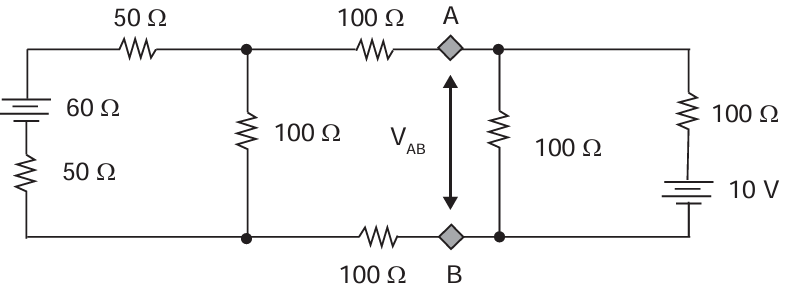

Considerando o Teorema de Thévenin, qual a tensão $V_{AB}$ que será medida, entre os pontos A e B, com um voltímetro?

(A)  &nbsp; 15 V  
(B)  &nbsp; 24 V  
(C)  &nbsp; 36 V  
(D)  &nbsp; 50 V  
(E)  &nbsp; 70 V

---

A questão **34** do concurso da Transpetro (2018) para Engenharia de Automação (banca Cesgranrio) foi **oficialmente anulada** devido a inconsistências e omissões em seu diagrama elétrico. No entanto, para fins de estudo e aprofundamento na aplicação de teoremas de circuitos lineares, podemos analisá-la considerando uma formulação padrão de malhas e o Teorema de Thévenin.

---

### Classificação da Área de Conhecimento

* **Área Principal:** Engenharia Elétrica / Circuitos Elétricos
* **Sub-área:** Teoria de Circuitos Lineares, Teoremas de Rede (Teorema de Thévenin / Princípio da Superposição) e Análise de Redes CC em Regime Permanente.

---

#### Resolução

To find the voltage $V_{AB}$ across terminals A and B, we can split the circuit into two parts (left and right of terminals A and B) and find their respective Thévenin equivalent circuits.

#### Step 1: Find the Thévenin equivalent of the left circuit

Looking to the left from terminals A and B:

1. **Thévenin Voltage $(V_{\text{th,\ left}})$:**  
With terminals A and B open, no current flows through the two horizontal $100\ \Omega$ resistors. The left-hand loop consists of the $60\text{ V}$ battery, two $50\ \Omega$ resistors, and one vertical $100\ \Omega$ resistor in series.

    >$\text{Total\ Loop\ Resistance}=50\ \Omega +50\ \Omega +100\ \Omega =200\ \Omega $

    >$\text{Loop\ Current}=\frac{60\text{\ V}}{200\ \Omega }=0.3\text{\ A}$

    The open-circuit voltage across terminals A and B is equal to the voltage drop across the vertical $100\ \Omega$ resistor:

    >$V_{\text{th,\ left}}=0.3\text{\ A}\times 100\ \Omega =30\text{\ V}$

2. **Thévenin Resistance ($R_{\text{th,\ left}}$):**  
Deactivating the $60\text{ V}$ voltage source (replacing it with a short circuit), the two $50\ \Omega$ resistors are in series ($50 + 50 = 100\ \Omega$), which are in parallel with the vertical $100\ \Omega$ resistor:

    >$R_{\text{parallel}}=100\ \Omega \parallel 100\ \Omega =50\ \Omega $

    Adding the two horizontal $100\ \Omega$ resistors that lead to terminals A and B:

      >$R_{\text{th,\ left}}=100\ \Omega +50\ \Omega +100\ \Omega =250\ \Omega $

#### Step 2: Find the Thévenin equivalent of the right circuit

Looking to the right from terminals A and B:
1. **Thévenin Voltage ($V_{\text{th,\ right}}$):**  
The right-hand loop consists of a $10\text{ V}$ source connected in series with a $100\ \Omega$ resistor and the vertical $100\ \Omega$ resistor.

    >$\text{Loop\ Current}=\frac{10\text{\ V}}{100\ \Omega +100\ \Omega }=0.05\text{\ A}$

    The open-circuit voltage across the vertical $100\ \Omega$ resistor is:

    >$V_{\text{th,\ right}}=0.05\text{\ A}\times 100\ \Omega =5\text{\ V}$

2. **Thévenin Resistance ($R_{\text{th,\ right}}$):**  
Short-circuiting the $10\text{ V}$ source leaves the two rightmost $100\ \Omega$ resistors in parallel:

    >$R_{\text{th,\ right}}=100\ \Omega \parallel 100\ \Omega =50\ \Omega $

#### Step 3: Combine the two equivalents to find $V_{AB}$

Now we connect the left equivalent circuit ($V_{\text{th, left}} = 30\text{ V}$, $R_{\text{th, left}} = 250\ \Omega$) and the right equivalent circuit ($V_{\text{th, right}} = 5\text{ V}$, $R_{\text{th, right}} = 50\ \Omega$) together at terminals A and B.

Using Millman's Theorem (or a simple voltage divider/nodal equation):

>$V_{AB}=\dfrac{\dfrac{V_{\text{th,\ left}}}{R_{\text{th,\ left}}}+\dfrac{V_{\text{th,\ right}}}{R_{\text{th,\ right}}}}{\dfrac{1}{R_{\text{th,\ left}}}+\dfrac{1}{R_{\text{th,\ right}}}}$

>$V_{AB}=\dfrac{\dfrac{30}{250}+\dfrac{5}{50}}{\dfrac{1}{250}+\dfrac{1}{50}}$

Multiply the numerator and the denominator by $250$:

>$V_{AB}=\dfrac{30+5(5)}{1+5}=\dfrac{30+25}{6}=\dfrac{55}{6}\text{\ V}$

Answer:

>$V_{AB} = \dfrac{55}{6}\text{ V} \approx 9.17\text{ V}$

---
#### Millman's Theorem

**Millman's Theorem** is a shortcut method used to find the voltage across a single pair of terminals when you have multiple parallel branches containing voltage sources and resistors.

Instead of writing out long system equations with Nodal or Mesh analysis, Millman's Theorem combines all parallel branches into one simple equation.

#### 💡 The Analogy: A Tug-of-War for Voltage

Imagine multiple batteries connected to the exact same two points (Nodes A and B). Each battery wants to pull the voltage at Node A to its own value.

• A **stronger battery** (higher voltage) pulls harder.
• A **smaller resistor** (higher conductance, or less resistance) means a wider pipe, so that branch has more influence in the tug-of-war.

Millman's theorem calculates the final compromise voltage where everything balances out.

---

#### 📐 The Formula

For $N$ parallel branches connected between two common nodes ($A$ and $B$), the voltage $V_{AB}$ is:

>$V_{AB}=\dfrac{\sum \dfrac{V_{i}}{R_{i}}}{\sum \dfrac{1}{R_{i}}}=\dfrac{\dfrac{V_{1}}{R_{1}}+\dfrac{V_{2}}{R_{2}}+\dots +\dfrac{V_{n}}{R_{n}}}{\dfrac{1}{R_{1}}+\dfrac{1}{R_{2}}+\dots +\dfrac{1}{R_{n}}}$

Where:

• $V_{i}$ is the voltage source in branch $i$.  
• $R_{i}$ is the total resistance in branch $i$.  
• $\dfrac{1}{R_{i}}$ is the conductance ($G_{i}$) of that branch.  

---

#### 🔍 How it Applied to Your Circuit

In the final step of your problem, terminals A and B had two parallel parts attached to them:
1. **Left Branch:** A $30\text{ V}$ source with a $250\ \Omega$ resistor.
2. **Right Branch:** A $5\text{ V}$ source with a $50\ \Omega$ resistor.

       A  o-------------------------o

          |                         |
         [ ] 250 Ω                 [ ] 50 Ω

          |                         |
        ( + ) 30 V                ( + ) 5 V
        ( - )                     ( - )

          |                         |
       B  o-------------------------o
Applying the formula directly:

>$V_{AB}=\dfrac{\dfrac{30\text{\ V}}{250\ \Omega }+\dfrac{5\text{\ V}}{50\ \Omega }}{\dfrac{1}{250\ \Omega }+\dfrac{1}{50\ \Omega }}$

By multiplying the entire top and bottom by $250$ to clear the fractions:

>$V_{AB}=\dfrac{30+5(5)}{1+5}=\dfrac{55}{6}\text{\ V}\approx 9.17\text{\ V}$

#### ⚠️ Important Rule for Signs

When using Millman's theorem, pay close attention to the **polarity** of the voltage sources. If the positive terminal faces your node (Node A), the voltage is positive. If the negative terminal faces your node, that specific fraction becomes negative (e.g., $-\dfrac{V_{i}}{R_{i}}$).

--- 
---
<!-- resolver a questão no contexto do concurso transpetro com banca cesgranrio: 
  - identificar a área de conhecimento da questão (classifique a área de conhecimento e as devidas sub-áreas de conhecimento);
  - apresentar uma justificativa detalhada contendo uma análise das alternativas; -->
###  35

As válvulas empregadas em sistemas de atuação a base de fluidos (hidráulicos e/ou pneumáticos) são adotadas para controlar

(A)  &nbsp; apenas vazão  
(B)  &nbsp; apenas pressão  
(C)  &nbsp; apenas temperatura  
(D)  &nbsp; pressão e vazão  
(E)  &nbsp; pressão e temperatura

---

A alternativa correta é a **(D) pressão e vazão**.

---

#### Classificação da Área de Conhecimento

* **Área Principal:** Engenharia de Automação / Sistemas Hidráulicos e Pneumáticos
* **Sub-área:** Elementos de Controle Final, Válvulas Industriais e Tecnologias de Acionamento por Fluidos.

---

#### Justificativa Detalhada e Análise das Alternativas

Em sistemas de atuação hidráulicos e pneumáticos, os elementos de controle final — especificamente as válvulas — exercem papéis fundamentais na manipulação da energia do fluido sob pressão. As válvulas são classificadas funcionalmente em três grandes categorias principais:

1. **Válvulas Direcionais:** Controlam o sentido do fluxo e o caminho que o fluido percorre no sistema.
2. **Válvulas de Pressão:** Controlam, limitam ou regulam a pressão do fluido (como válvulas de alívio, redutoras de pressão e sequenciadoras).
3. **Válvulas de Vazão (ou Fluxo):** Controlam a quantidade de fluido que passa por um trecho em uma unidade de tempo, alterando a velocidade dos atuadores (cilindros e motores).

Portanto, as válvulas nesses sistemas atuam diretamente sobre a **pressão** e a **vazão** do fluido de trabalho para garantir o funcionamento adequado dos mecanismos.

---

#### Análise das Alternativas:

* **(A) apenas vazão:** Incorreta. Ignora o controle essencial de pressão realizado pelas válvulas reguladoras e de alívio.
* **(B) apenas pressão:** Incorreta. Desconsidera o controle de vazão exercido por válvulas de controle de fluxo.
* **(C) apenas temperatura:** Incorreta. O controle de temperatura em sistemas oleohidráulicos ou pneumáticos é tipicamente função de trocadores de calor (resfriadores/aquecedores), e não de válvulas de atuação de fluido.
* **(D) pressão e vazão:** **Correta.** Abrange as duas grandezas físicas fundamentais manipuladas pelas famílias de válvulas em circuitos hidráulicos e pneumáticos industriais.
* **(E) pressão e temperatura:** Incorreta. Inclui temperatura, grandeza que não é controlada diretamente pelas válvulas de atuação baseadas em fluidos.

--- 
---
<!-- resolver a questão no contexto do concurso transpetro com banca cesgranrio: 
  - identificar a área de conhecimento da questão (classifique a área de conhecimento e as devidas sub-áreas de conhecimento);
  - apresentar uma justificativa detalhada contendo uma análise das alternativas; -->
###  36

Os tanques e/ou acumuladores empregados em sistemas de atuação a base de fluidos (hidráulicos e/ou pneumáticos) possuem características análogas às dos capacitores nos sistemas elétricos.  
Assim sendo, a relação linear entre a pressão P no interior do tanque/acumulador e a vazão de entrada e/ou saída q é

(A)  &nbsp; $\displaystyle P = \frac{1}{C_F}q$  

(B)  &nbsp; $\displaystyle q = \frac{1}{C_F}P$  

(C)  &nbsp; $\displaystyle \frac{dq}{dt} = C_F P$  

(D)  &nbsp; $\displaystyle \frac{dP}{dt} = \frac{1}{C_F} q$  

(E)  &nbsp; $\displaystyle \frac{dP}{dt} = \frac{1}{C_F} \int q\, dt$

---

A alternativa correta é a **(D) $\displaystyle \frac{dP}{dt} = \frac{1}{C_F} q$**.

---

#### Classificação da Área de Conhecimento

* **Área Principal:** Engenharia de Automação / Modelagem de Sistemas Físicos
* **Sub-área:** Sistemas Dinâmicos, Analogia Eletromecânica/Hidráulica e Acumuladores Hidráulicos e Pneumáticos.

---

#### Justificativa Detalhada e Análise das Alternativas

Em sistemas dinâmicos, a analogia entre domínios físicos relaciona grandezas elétricas e hidráulicas. O **capacitor** em um sistema elétrico armazena carga elétrica ($q_e$), obedecendo à relação fundamental:

$$i = \frac{dq_e}{dt} = C \frac{dV}{dt}$$

Nos sistemas hidráulicos e pneumáticos, os tanques ou acumuladores cumprem o papel de armazenamento (capacitância fluida, representada por $C_F$):

* A **pressão ($P$)** é análoga ao potencial elétrico (tensão $V$).
* A **vazão ($q$)** é análoga à corrente elétrica ($i$).

A variação do volume acumulado no tanque em função do tempo é igual à vazão líquida que entra ($q$). Como a variação do volume é proporcional à variação da pressão multiplicada pela capacitância do tanque ($V = C_F \cdot P$), derivando em relação ao tempo, temos:

$$q = C_F \frac{dP}{dt}$$

Isolando a taxa de variação da pressão ($\frac{dP}{dt}$), obtemos a equação característica do elemento capacitivo hidráulico:

$$\frac{dP}{dt} = \frac{1}{C_F} q$$

---

#### Análise das Alternativas:

* **(A) $\displaystyle P = \frac{1}{C_F}q$:** Incorreta. Desconsidera a dinâmica temporal e a derivada da pressão em relação ao tempo.
* **(B) $\displaystyle q = \frac{1}{C_F}P$:** Incorreta. Representa uma relação puramente estática e incorreta para elementos armazenadores de energia que dependem da taxa de variação.
* **(C) $\displaystyle \frac{dq}{dt} = C_F P$:** Incorreta. Inverte a relação de dependência entre as grandezas de fluxo e esforço.
* **(D) $\displaystyle \frac{dP}{dt} = \frac{1}{C_F} q$:** **Correta.** Expressa corretamente a equação diferencial dinâmica de um acumulador/tanque fluido análoga ao comportamento do capacitor elétrico.
* **(E) $\displaystyle \frac{dP}{dt} = \frac{1}{C_F} \int q\, dt$:** Incorreta. A integral da vazão resulta no volume acumulado, não na taxa de variação da pressão.

--- 
---
<!-- resolver a questão no contexto do concurso transpetro com banca cesgranrio: 
  - identificar a área de conhecimento da questão (classifique a área de conhecimento e as devidas sub-áreas de conhecimento);
  - apresentar uma justificativa detalhada contendo uma análise das alternativas; -->
###  37

O Teorema do Valor Inicial da Transformada de Laplace estabelece que:

(A)  &nbsp; $\displaystyle x(0^+) = \lim_{\displaystyle s \to \infty} sX(s)$  

(B)  &nbsp; $\displaystyle x(0^+) = \lim_{\displaystyle s \to 0} sX(s)$  

(C)  &nbsp; $\displaystyle x(0^+) = \lim_{\displaystyle s \to \infty} X(s)$  

(D)  &nbsp; $\displaystyle x(0^+) = \lim_{\displaystyle s \to 0} X(s)$  

(E)  &nbsp; $\displaystyle x(0^+) = \lim_{\displaystyle s \to \infty} X(s)/s$

---

A alternativa correta é a **(A) $\displaystyle x(0^+) = \lim_{s \to \infty} sX(s)$**.

---

#### Classificação da Área de Conhecimento

* **Área Principal:** Engenharia Elétrica / Engenharia de Controle e Automação
* **Sub-área:** Análise de Sistemas Lineares, Sinais e Sistemas, e Aplicações da Transformada de Laplace.

---

#### Justificativa Detalhada e Análise das Alternativas

O **Teorema do Valor Inicial (TVI)** da Transformada de Laplace permite determinar o valor de um sinal ou resposta temporal no instante imediatamente após a aplicação de uma excitação ($t = 0^+$) diretamente a partir de sua representação no domínio complexo $s$, sem a necessidade de realizar a transformada inversa de Laplace.

A formulação matemática rigorosa do Teorema do Valor Inicial é dada por:

$$\lim_{t \to 0^+} x(t) = \lim_{s \to \infty} sX(s)$$

Desde que o limite no lado direito exista e que $x(t)$ não contenha impulsos ou singularidades de ordem superior na origem.

---

#### Análise das Alternativas:

* **(A) $\displaystyle x(0^+) = \lim_{s \to \infty} sX(s)$:** **Correta.** Expressa exatamente a relação matemática do Teorema do Valor Inicial da Transformada de Laplace.
* **(B) $\displaystyle x(0^+) = \lim_{s \to 0} sX(s)$:** Incorreta. Este limite, quando avaliado com $s \to 0$, refere-se na verdade ao *Teorema do Valor Final* ($\lim_{t \to \infty} x(t) = \lim_{s \to 0} sX(s)$), sob certas condições de estabilidade.
* **(C) $\displaystyle x(0^+) = \lim_{s \to \infty} X(s)$:** Incorreta. Omite o fator multiplicativo $s$ obrigatório pela propriedade da derivada na transformação de Laplace.
* **(D) $\displaystyle x(0^+) = \lim_{s \to 0} X(s)$:** Incorreta. Mistura o comportamento para $s \to 0$ com uma formulação incorreta para o valor inicial.
* **(E) $\displaystyle x(0^+) = \lim_{s \to \infty} X(s)/s$:** Incorreta. Corresponde conceitualmente à integração no domínio do tempo (ou divisão por $s$ no domínio de Laplace), o que contradiz a propriedade do valor inicial.

--- 
---
<!-- resolver a questão no contexto do concurso transpetro com banca cesgranrio: 
  - identificar a área de conhecimento da questão (classifique a área de conhecimento e as devidas sub-áreas de conhecimento);
  - apresentar uma justificativa detalhada contendo uma análise das alternativas; -->
###  38

Os sistemas de atuação pneumáticos **NÃO** são recomendados quando é necessária(o)

(A)  &nbsp; elevada potência  
(B)  &nbsp; elevada velocidade  
(C)  &nbsp; grande precisão  
(D)  &nbsp; pequena força  
(E)  &nbsp; deslocamento elevado

---

A alternativa correta é a **(C) grande precisão**.

---

#### Classificação da Área de Conhecimento

* **Área Principal:** Engenharia de Automação / Sistemas Pneumáticos e Hidráulicos
* **Sub-área:** Tecnologias de Acionamento Industrial, Comparação entre Sistemas Pneumáticos e Hidráulicos, e Características de Atuação.

---

#### Justificativa Detalhada e Análise das Alternativas

Os **sistemas pneumáticos** utilizam ar comprimido como fluido de trabalho. Devido à alta compressibilidade do ar, esses sistemas apresentam características marcantes: são excelentes para aplicações que exigem alta velocidade de atuação, deslocamentos longos ou limpo manuseio, mas possuem limitações severas em termos de posicionamento rígido sob carga.

Portanto, sistemas pneumáticos **não** são recomendados quando se exige **grande precisão** (especialmente em posicionamentos intermediários ou controle fino de malha fechada), uma vez que a compressibilidade do ar provoca amortecimento elástico, flutuações e comportamento esponjoso (*spring-like*) sob variações de carga.

---

#### Análise das Alternativas:

* **(A) elevada potência:** Incorreta. Embora os sistemas hidráulicos operem com pressões muito superiores e maiores potências, a pneumática pode fornecer potências moderadas a altas dependendo do volume de ar e dimensionamento, não sendo sua restrição principal o conceito absoluto de potência.
* **(B) elevada velocidade:** Incorreta. Os atuadores pneumáticos são amplamente reconhecidos justamente por alcançarem **elevadas velocidades** de operação com facilidade, devido à baixa viscosidade e à expansibilidade rápida do ar.
* **(C) grande precisão:** **Correta.** A compressibilidade do gás impede um controle de posição rigoroso e estável, tornando a pneumática inadequada para tarefas que exigem exatidão micrométrica ou rigidez posicional sem malhas de realimentação complexas e custosas.
* **(D) pequena força:** Incorreta. Sistemas pneumáticos lidam muito bem com forças pequenas e moderadas.
* **(E) deslocamento elevado:** Incorreta. Atuadores pneumáticos lineares (cilindros) podem realizar cursos e deslocamentos longos sem grandes restrições operacionais.

--- 
---
<!-- resolver a questão no contexto do concurso transpetro com banca cesgranrio: 
  - identificar a área de conhecimento da questão (classifique a área de conhecimento e as devidas sub-áreas de conhecimento);
  - apresentar uma justificativa detalhada contendo uma análise das alternativas; -->
###  39

A inversa de uma matriz ortogonal é igual à sua

(A)  &nbsp; adjunta  
(B)  &nbsp; adjunta transposta  
(C)  &nbsp; cofatora  
(D)  &nbsp; cofatora transposta  
(E)  &nbsp; transposta

---

A alternativa correta é a **(E) transposta**.

---

#### Classificação da Área de Conhecimento

* **Área Principal:** Matemática / Álgebra Linear
* **Sub-área:** Matrizes, Matrizes Especiais (Matriz Ortogonal) e Inversão de Matrizes.

---

#### Justificativa Detalhada e Análise das Alternativas

Uma **matriz ortogonal** $Q$ (de ordem $n \times n$) é definida como uma matriz cuja matriz transposta coincide com a sua matriz inversa. Em termos formais, uma matriz real $Q$ é ortogonal se, e somente se, o produto dela pela sua transposta resulta na matriz identidade $I$:

$$Q^T Q = Q Q^T = I$$

Pela definição de matriz inversa ($Q^{-1} Q = I$), conclui-se diretamente que a inversa de uma matriz ortogonal é igual à sua transposta:

$$Q^{-1} = Q^T$$

---

#### Análise das Alternativas:

* **(A) adjunta:** Incorreta. A matriz adjunta está relacionada ao cálculo da inversa de uma matriz genérica através da matriz dos cofatores transposta, mas não define a inversa de uma matriz ortogonal de forma direta.
* **(B) adjunta transposta:** Incorreta. Conceito incorreto para a matriz inversa ortogonal.
* **(C) cofatora:** Incorreta. A matriz dos cofatores é usada na construção da matriz adjunta, mas não é igual à inversa de uma matriz ortogonal.
* **(D) cofatora transposta:** Incorreta. A transposta da matriz dos cofatores é a matriz adjunta ($\text{adj}(A) = C^T$), que dividida pelo determinante resulta na inversa geral, mas não caracteriza diretamente a propriedade da matriz ortogonal.
* **(E) transposta:** **Correta.** Expressa exatamente a propriedade fundamental de uma matriz ortogonal, onde $Q^{-1} = Q^T$.

---
---

**Utlize as informações a seguir para responder às questões de n<u>os</u> 40 e 41.**
 
Considere o sistema pêndulo invertido com excitação de base mostrado na Figua abaixo.

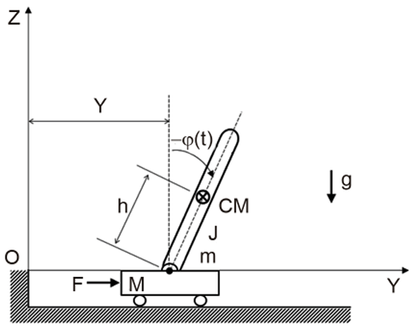

Desprezando a dissipação na junta de união da barra vertical com a base móvel (carrinho) e no movimento da base no terreno, o modelo matemático desse sistema é dado por

$$
\begin{cases}
  \left(M+m \right) \ddot{Y} - m \left( h \cos \varphi \right) \ddot{\varphi} + m \left( h \operatorname{sen} \varphi \right) \dot{\varphi}^2 = F\left(t \right)  \\
  \left(J+mh^2 \right) \ddot{\varphi} - mg \left( h \operatorname{sen} \varphi \right) - m \left( h \cos \varphi \right) \ddot{Y} = 0
\end{cases}
$$

Supondo a massa da base desprezível, seu modelo de estado para pequenos ângulos e baixas velocidade angulares é

$$ {\displaystyle
\left[ 
\begin{array}{cc}
  \rule{0pt}{3ex} \displaystyle \dot{Y} \\
  \rule{0pt}{3ex} \displaystyle \dot{\varphi} \\
  \rule{0pt}{3.5ex} \displaystyle \dot{V} \\
  \rule{0pt}{3ex} \displaystyle \dot{\omega}
\end{array}
\right]
}
=
\begin{bmatrix}
  0 & 0 & 1 & 0 \\
  0 & 0 & 0 & 1 \\
  0 & \dfrac{m g h^2}{J} & 0 & 0 \\[2ex]
  0 & \dfrac{m g h}{J} & 0 & 0 \\[2ex]
\end{bmatrix}
\begin{bmatrix}
  Y \\
  \varphi \\
  V \\
  \omega
\end{bmatrix}
+
\begin{bmatrix}
  0 \\
  0 \\
  \dfrac{\left(J + mh^2 \right)}{mJ} \\[2ex]
  \dfrac{h}{J} \\[2ex]
\end{bmatrix}
F
$$

--- 
---
<!-- resolver a questão no contexto do concurso transpetro com banca cesgranrio: 
  - identificar a área de conhecimento da questão (classifique a área de conhecimento e as devidas sub-áreas de conhecimento);
  - apresentar uma justificativa detalhada contendo uma análise das alternativas; -->
###  40

Se a força aplicada sobre a base incluir todos os termos não lineares do sistema, está sendo empregada a estratégia de

(A)  &nbsp; controle PID não linear  
(B)  &nbsp; linearização por realimentação  
(C)  &nbsp; linearização para estabilização  
(D)  &nbsp; realimentação para estabilização  
(E)  &nbsp; observador não linear

---
#### Classificação da Área de Conhecimento

* **Área de Conhecimento:** Engenharia de Controle e Automação
* **Sub-áreas:** Controle de Sistemas Não Lineares / Linearização por Realimentação (Feedback Linearization).

---

#### Justificativa Detalhada e Análise das Alternativas

A questão descreve uma estratégia em que a força aplicada $F(t)$ (a lei de controle) é projetada para conter termos que **cancelam exatamente todas as não-linearidades** do sistema físico (como os termos dependentes de $\cos \varphi$, $\operatorname{sen} \varphi$ e $\.{\varphi }^{2}$).

Quando projetamos uma lei de controle por realimentação de estados que cancela os termos não lineares de uma planta dinamicamente complexa, transformando matematicamente o sistema em um sistema linear equivalente de malha fechada, estamos utilizando a técnica clássica de **Linearização por Realimentação** (*Feedback Linearization* ou Controle por Torque Calculado/Controle Dinâmico Inverso).

---

#### Vamos analisar cada uma das alternativas:

• (A) **Incorreta. controle PID não linear:** Um controlador PID convencional atua com base no erro (Proporcional, Integral e Derivativo) e, mesmo em variantes não lineares (com ganhos variando em função do erro), ele não tem a premissa estrutural de "incluir e cancelar explicitamente todos os termos não lineares do modelo dinâmico" para linearizar o sistema global.

• (B) **CORRETA. linearização por realimentação:** É exatamente a definição da técnica. Através da realimentação dos estados do sistema ($Y, \dot{Y}, \varphi, \dot{\varphi}$), a entrada de controle $F(t)$ é calculada contendo os termos dinâmicos não lineares com sinais invertidos. Isso anula a física não linear do pêndulo e do carrinho, resultando em uma equação linearizada ideal onde técnicas de controle linear (como LQR ou alocação de polos) podem ser aplicadas diretamente.

• (C) **Incorreta. linearização para estabilização:** O termo "linearização" isolado geralmente se refere à aproximação por série de Taylor em torno de um ponto de operação (pequenos sinais), que é uma aproximação local e não envolve projetar uma força que carregue explicitamente os termos não lineares para cancelá-los globalmente.

• (D) **Incorreta. realimentação para estabilização:** Esta é uma descrição muito genérica. Qualquer controle em malha fechada (linear ou não linear) que estabilize o sistema entra nessa categoria, não especificando a estratégia exata descrita no enunciado (que foca no uso dos termos não lineares na lei de controle).

• (E) **Incorreta. observador não linear:** Um observador de estados (como o Filtro de Kalman Estendido ou um observador de Luenberger não linear) serve para *estimar* estados internos que não são medidos diretamente por sensores. Ele não é a força ou estratégia de controle aplicada na base para alterar a dinâmica do sistema.

**Gabarito: (B)**

---
---
<!-- resolver a questão no contexto do concurso transpetro com banca cesgranrio: 
  - identificar a área de conhecimento da questão (classifique a área de conhecimento e as devidas sub-áreas de conhecimento);
  - apresentar uma justificativa detalhada contendo uma análise das alternativas; -->
###  41

Qual o posto da matriz de estado?

(A)  &nbsp; 0  
(B)  &nbsp; 1  
(C)  &nbsp; 2  
(D)  &nbsp; 3  
(E)  &nbsp; 4

---
#### Classificação da Área de Conhecimento

* **Área de Conhecimento:** Engenharia de Controle e Automação
* **Sub-áreas:** Teoria de Controle Linear / Espaço de Estados / Álgebra Linear Aplicada.

---

#### Justificativa Detalhada e Análise das Alternativas

O **posto de uma matriz** (também chamado de *posto por linhas* ou *posto por colunas*) é definido como o número máximo de linhas (ou colunas) linearmente independentes (L.I.) que ela possui.

A matriz de estado $\mathbf{A}$ do sistema fornecida no enunciado é:

$$\mathbf{A}=\left[\begin{matrix}0&0&1&0\\ 0&0&0&1\\ 0&\dfrac{mgh^{2}}{J}&0&0\\ 0&\dfrac{mgh}{J}&0&0\end{matrix}\right]$$

Para determinar o posto dessa matriz de tamanho $4 \times 4$, vamos analisar a dependência linear entre suas colunas (ou linhas):

1. **Coluna 1:** É um vetor completamente nulo:

$$C_{1}=\left[\begin{matrix}0\\ 0\\ 0\\ 0\end{matrix}\right]$$

Vetores nulos não contribuem para o posto da matriz.

2. **Coluna 3 e Coluna 4:** São vetores da base canônica (com o elemento 1 em posições diferentes):

$$C_{3}=\left[\begin{matrix}1\\ 0\\ 0\\ 0\end{matrix}\right],\quad C_{4}=\left[\begin{matrix}0\\ 1\\ 0\\ 0\end{matrix}\right]$$

Essas duas colunas são claramente linearmente independentes entre si e em relação às outras.

3. Coluna 2: Possui termos não nulos nas linhas 3 e 4:

$$C_{2}=\left[\begin{matrix}0\\ 0\\ \dfrac{mgh^{2}}{J}\\ \dfrac{mgh}{J}\end{matrix}\right]$$

Como as massas, gravidade e dimensões geométricas ($m, g, h, J$) são valores físicos não nulos, essa coluna possui componentes ativos e é totalmente independente de $C_{3}$ e $C_{4}$.

Portanto, temos exatamente 3 colunas linearmente independentes ($C_2, C_3$ e $C_{4}$).

---

#### Análise complementar pelas linhas:

• A Linha 1 $[0, 0, 1, 0]$ é L.I.

• A Linha 2 $[0, 0, 0, 1]$ é L.I.

• A Linha 3 $[0, \frac{mgh^2}{J}, 0, 0]$ e a Linha 4 $[0, \frac{mgh}{J}, 0, 0]$ são **linearmente dependentes (L.D.)** entre si, pois uma é múltiplo escalar da outra (basta multiplicar a Linha 3 por $\frac{1}{h}$ para obter a Linha 4). Elas contam como apenas 1 linha independente.

Somando as linhas L.I. ($1 + 1 + 1 = 3$), confirmamos que o posto da matriz é **3**.

---

#### Análise das alternativas:

• (A) **Incorreta.** O posto seria 0 apenas se a matriz fosse completamente nula.

• (B) **Incorreta.** O posto seria 1 se todas as linhas não nulas fossem múltiplos de uma única linha.

• (C) **Incorreta.** Erro comum caso o candidato desconsiderasse a independência da coluna central em relação às identidades superiores.

• (D) **CORRETA. 3:** Existem exatamente 3 dimensões/direções linearmente independentes na imagem dessa transformação linear.

• (E) **Incorreta.** Para o posto ser 4 (posto cheio), a matriz precisaria ser invertível, o que não ocorre devido à primeira coluna ser inteiramente nula (determinante igual a zero).

**Gabarito: (D)**

---
---

**Considere as funções de transferência apresentadas abaixo para responder às questões de n<u>os</u> 42 e 43.**

$$ 
\begin{cases}
  \displaystyle \frac{X_1(s)}{U(s)} = \frac{k_1}{(s^2 - p^2)} \\[3ex]
  \displaystyle \frac{X_2(s)}{U(s)} = \frac{k_2(s^2 - z^2)}{(s^2 (s^2 - p^2))}
\end{cases}
$$

---
---
<!-- resolver a questão no contexto do concurso transpetro com banca cesgranrio: 
  - identificar a área de conhecimento da questão (classifique a área de conhecimento e as devidas sub-áreas de conhecimento);
  - apresentar uma justificativa detalhada contendo uma análise das alternativas; -->
### 42

Esse sistema possui

(A)  &nbsp; um polo positivo  
(B)  &nbsp; dois polos positivos  
(C)  &nbsp; três polos nulos  
(D)  &nbsp; quatro polos complexos conjugados  
(E)  &nbsp; quatro polos negativos

---
#### Classificação da Área de Conhecimento

* **Área de Conhecimento:** Engenharia de Controle e Automação
* **Sub-areas:** Sistemas Lineares / Análise de Estabilidade no Domínio da Frequência / Funções de Transferência.

---
#### Justificativa Detalhada e Análise das Alternativas

Para determinar a totalidade de polos de um sistema dinâmico linear combinando múltiplas saídas, devemos encontrar as raízes do polinômio característico global do sistema (as raízes comuns do denominador comum mínimo das funções de transferência que conectam a entrada $U(s)$ às saídas).

Analisando os denominadores das funções de transferência dadas:

1. Primeira função de transferência:

$$\frac{X_{1}(s)}{U(s)}=\frac{k_{1}}{s^{2}-p^{2}}$$

Os polos desta parcela são encontrados fazendo $s^2 - p^2 = 0$, o que resulta em:

$$s^{1},s^{2}=\pm p$$

Assumindo os parâmetros físicos reais ($p > 0$), isso gera um polo positivo ($+p$) e um polo negativo ($-p$).

2. Segunda função de transferência:

$$\frac{X_{2}(s)}{U(s)}=\frac{k_{2}(s^{2}-z^{2})}{s^{2}(s^{2}-p^{2})}$$

Os polos desta parcela são encontrados fazendo $s^2(s^2 - p^2) = 0$. As raízes são:
	• $s^2 = 0 \implies s^3, s^4 = 0$ (**dois polos nulos** na origem).
	• $s^2 - p^2 = 0 \implies s^5, s^6 = \pm p$ (os mesmos polos em $\pm p$ identificados na primeira função).

O polinômio característico que dita a dinâmica global do sistema completo é dado pelo mínimo múltiplo comum dos denominadores: 

$$A(s) = s^2(s^2 - p^2) = s^2(s - p)(s + p)$$

Os quatro polos globais do sistema são:

• $s = 0$ (polo de multiplicidade 2, ou seja, **dois polos nulos**)

• $s = -p$ (**um polo negativo**)

• $s = +p$ (**um polo positivo**)

#### Comparando com as alternativas propostas pela banca Cesgranrio:

• **(A) CORRETA. um polo positivo:** Como deduzido das raízes de $(s^2 - p^2) = 0$, o sistema possui exatamente um único polo com parte real positiva situado em $s = +p$ (o que torna este sistema inerentemente instável).

• (B) **Incorreta. dois polos positivos:** O sistema possui apenas um polo no semiplano direito do plano complexo ($s = +p$).

• (C) **Incorreta. três polos nulos:** O termo $s^{2}$ no denominador indica a presença de exatamente dois polos na origem (nulos), não três.

• (D) **Incorreta. quatro polos complexos conjugados:** Os polos encontrados ($0, 0, p, -p$) são todos números puramente reais, não possuindo parte imaginária.

• (E) **Incorreta. quatro polos negativos:** O sistema possui apenas um polo estritamente negativo ($s = -p$).

**Gabarito: (A)**

---
---
<!-- resolver a questão no contexto do concurso transpetro com banca cesgranrio: 
  - identificar a área de conhecimento da questão (classifique a área de conhecimento e as devidas sub-áreas de conhecimento);
  - apresentar uma justificativa detalhada contendo uma análise das alternativas; -->
###  43

A função de transferência de $X_2$ indica que o comportamento dessa variável está associado a

(A)  &nbsp; um zero positivo e dois polos nulos  
(B)  &nbsp; um zero positivo e quatro polos complexos conjugados  
(C)  &nbsp; dois zeros positivos e dois polos positivos  
(D)  &nbsp; dois zeros positivos e três polos nulos  
(E)  &nbsp; dois zeros positivos e quatro polos negativos

---

#### Classificação da Área de Conhecimento

* **Área de Conhecimento:** Engenharia de Controle e Automação
* **Sub-áreas:** Análise de Sistemas de Controle Lineares / Diagrama de Polos e Zeros / Estabilidade.

---

#### Justificativa Detalhada e Análise das Alternativas

Para responder à questão, precisamos encontrar e classificar os zeros (raízes do numerador) e os polos (raízes do denominador) especificamente para a função de transferência da variável $X_2(s)$:

$$\frac{X_{2}(s)}{U(s)}=\frac{k_{2}(s^{2}-z^{2})}{s^{2}(s^{2}-p^{2})}$$

1. **Análise dos Zeros (Numerador)**

Igualando o polinômio do numerador a zero:

$$s^{2}-z^{2}=0\implies (s-z)(s+z)=0$$

As raízes são: [1] (https://www.youtube.com/watch?v=AZ7_MvANy_Q), [2] (https://www.youtube.com/watch?v=8M63_fstcm4)

• $s = +z$ (**um zero positivo** / no semiplano direito)

• $s = -z$ (**um zero negativo** / no semiplano esquerdo)

*Nota: Portanto, o sistema possui apenas **um** zero positivo, invalidando qualquer alternativa que mencione "dois zeros positivos".*

2. **Análise dos Polos (Denominador)**

Igualando o polinômio do denominador a zero:

$$s^{2}(s^{2}-p^{2})=0\implies s^{2}(s-p)(s+p)=0$$

As raízes são: [1] (https://www.youtube.com/watch?v=8M63_fstcm4), [2] (https://www.youtube.com/watch?v=AZ7_MvANy_Q)

• $s^2 = 0 \implies s = 0, \, s = 0$ (**dois polos nulos** na origem)

• $s = +p$ (**um polo positivo**)

• $s = -p$ (**um polo negativo**) [1] (https://www.maplesoft.com/content/EngineeringFundamentals/10/MapleDocument_10/Transfer%20Functions,%20Poles%20and%20Zeros.pdf), [2] (https://www.youtube.com/watch?v=xS_H59oJtUg)

---

#### Análise das Alternativas

• **(A) CORRETA. um zero positivo e dois polos nulos:** Como determinado na análise, a função de transferência possui, entre seus elementos, exatamente um zero real positivo ($s = +z$) e dois polos na origem ($s = 0$). A afirmação é perfeitamente condizente com a física matemática do sistema. [1] (https://www.passeidireto.com/arquivo/75008095/controle-e-automacao-i)

• (B) **Incorreta. um zero positivo e quatro polos complexos conjugados:** Embora possua um zero positivo, todos os seus polos ($0, 0, p, -p$) são estritamente reais, não havendo nenhum par complexo conjugado. [1] (https://www.youtube.com/watch?v=8M63_fstcm4)

• (C) **Incorreta. dois zeros positivos e dois polos positivos:** Conforme demonstrado, um dos zeros é negativo ($s = -z$) e o sistema possui apenas um polo positivo ($s = +p$).

• (D) **Incorreta. dois zeros positivos e três polos nulos:** O sistema possui apenas um zero positivo e exatamente dois polos nulos (provenientes do termo $s^{2}$).

• (E) **Incorreta. dois zeros positivos e quatro polos negativos:** O sistema possui apenas um zero positivo e nenhum de seus polos é complexo ou puramente quadruplicado na região negativa.

**Gabarito: (A)** [1] (https://www.passeidireto.com/arquivo/75008095/controle-e-automacao-i)

---
---
<!-- resolver a questão no contexto do concurso transpetro com banca cesgranrio: 
  - identificar a área de conhecimento da questão (classifique a área de conhecimento e as devidas sub-áreas de conhecimento);
  - apresentar uma justificativa detalhada contendo uma análise das alternativas; -->
###  44

Sendo a Transformada de Laplace L(x(t)) = X(s) com s = σ + jω e a Transformada de Fourier F(x(t)) = X(jω) tem-se que a Transformada de Fourier é

(A)  &nbsp; dependente da Transformada de Laplace  
(B)  &nbsp; função da Transformada de Laplace  
(C)  &nbsp; equivalente à Transformada de Laplace  
(D)  &nbsp; um caso particular da Transformada de Laplace  
(E)  &nbsp; uma generalização da Transformada de Laplace

---

#### Classificação da Área de Conhecimento

* **Área de Conhecimento:** Engenharia de Controle e Automação / Engenharia Elétrica
* **Sub-áreas:** Sinais e Sistemas / Análise no Domínio da Frequência / Transformadas Integrais.

---

#### Justificativa Detalhada e Análise das Alternativas

A relação entre a Transformada de Laplace e a Transformada de Fourier é um dos conceitos fundamentais da teoria de sinais e sistemas lineares.

A **Transformada de Laplace** de um sinal contínuo $x(t)$ é dada por:

$$X(s)=\int _{-\infty }^{\infty }x(t)e^{-st}dt$$

Onde a variável complexa é definida como $\mathbf{s = \sigma + j\omega}$. O termo $\sigma $ representa a atenuação ou taxa de crescimento exponencial (parte real), enquanto $\omega $ representa a frequência angular (parte imaginária).

A **Transformada de Fourier** do mesmo sinal $x(t)$ é expressa por:

$$X(j\omega )=\int _{-\infty }^{\infty }x(t)e^{-j\omega t}dt$$

Se avaliarmos a Transformada de Laplace estritamente sobre o eixo imaginário do plano complexo $s$ (ou seja, definindo a parte real $\mathbf{\sigma = 0}$), a variável se reduz a $s = j\omega$. Ao substituir $s = j\omega$ na integral de Laplace, obtemos exatamente a equação da Transformada de Fourier:

$$X(s)\Big|{}_{s=j\omega }=X(j\omega )$$

Portanto, a Transformada de Fourier é obtida restringindo-se o domínio da Transformada de Laplace ao eixo $j\omega$, o que a caracteriza matematicamente como **um caso particular da Transformada de Laplace** (assumindo que a região de convergência de $X(s)$ inclua o eixo imaginário).

Analisando cada uma das alternativas propostas pela Cesgranrio:

• (A) **Incorreta. dependente da Transformada de Laplace:** A Transformada de Fourier existe por si só de forma independente para uma vasta classe de sinais (que atendem às condições de Dirichlet), não necessitando da existência da ferramenta de Laplace para ser definida.

• (B) **Incorreta. função da Transformada de Laplace:** Dizer que é uma "função da transformada" sugeriria um operador atuando sobre o resultado global de $X(s)$, o que é conceitualmente impreciso. Ela é uma restrição de domínio.

• (C) **Incorreta. equivalente à Transformada de Laplace:** Elas não são equivalentes. A Transformada de Laplace analisa o sinal em todo o plano complexo $s$ (frequências complexas), enquanto Fourier analisa apenas o comportamento puramente harmônico senoidal (eixo imaginário).

• **(D) CORRETA. um caso particular da Transformada de Laplace:** Como demonstrado, quando a atenuação $\sigma $ é nula ($\sigma = 0$), a Transformada de Laplace colapsa exatamente na Transformada de Fourier. Fourier é o caso específico de Laplace mapeado sobre o eixo de frequências reais.

• (E) **Incorreta. uma generalização da Transformada de Laplace:** A relação inversa é a verdadeira. A Transformada de Laplace é uma generalização da Transformada de Fourier, estendendo a análise de frequências para sinais que crescem exponencialmente através da introdução do fator multiplicativo $e^{-\sigma t}$.

**Gabarito: (D)**

---
---
<!-- resolver a questão no contexto do concurso transpetro com banca cesgranrio: 
  - identificar a área de conhecimento da questão (classifique a área de conhecimento e as devidas sub-áreas de conhecimento);
  - apresentar uma justificativa detalhada contendo uma análise das alternativas; -->
###  45

Uma IMU (Unidade de Medida Inercial) inclui, necessariamente,

(A)  &nbsp; acelerômetros e barômetros  
(B)  &nbsp; acelerômetros e girômetros  
(C)  &nbsp; potenciômetros e girômetros  
(D)  &nbsp; potenciômetros e tacômetros  
(E)  &nbsp; tacômetros e magnetômetros

---

#### Classificação da Àrea de Conhecimento

* **Área de Conhecimento:** Engenharia de Controle e Automação / Instrumentação Industrial
* **Sub-areas:** Sensores e Transdutores / Navegação Inercial / Sistemas de Instrumentação e Medição.

---

#### Justificativa Detalhada e Análise das Alternativas

Uma **IMU (*Inertial Measurement Unit* ou Unidade de Medida Inercial)** é um dispositivo eletrônico ou eletromecânico integrado que mede e relata a força específica de um corpo, a sua taxa angular e, às vezes, a orientação do dispositivo. Ela é o componente central utilizado em sistemas de navegação inercial de aeronaves, drones, espaçonaves, navios e mísseis.

Para mapear e rastrear completamente o movimento de um objeto em um espaço tridimensional (6 graus de liberdade — 3 de translação e 3 de rotação), uma IMU opera medindo duas grandezas fundamentais através de seus componentes internos essenciais:

1. **Aceleração Linear:** Medida por **acelerômetros** em três eixos ortogonais ($X, Y, Z$).

2. **Velocidade Angular:** Medida por **girômetros** (também chamados popularmente de giroscópios) em três eixos ortogonais (movimentos de *roll*, *pitch* e *yaw*).

Algumas IMUs avançadas (conhecidas como MARG - *Magnetic, Angular Rate, and Gravity*) incorporam adicionalmente magnetômetros para bússola e correção de deriva, mas a definição estrita e necessária de uma IMU exige a combinação de **acelerômetros** e **girômetros**.

---

#### Análise detalhada das alternativas da Cesgranrio:

• (A) **Incorreta. acelerômetros e barômetros:** Embora os acelerômetros façam parte, os barômetros medem a pressão atmosférica (útil para estimar altitude). Eles não medem efeitos inerciais de movimento e rotação intrínsecos, não compondo necessariamente uma IMU.

• **(B) CORRETA. acelerômetros e girômetros:** É a composição elementar e obrigatória de qualquer unidade de medida inercial para capturar tanto o deslocamento linear quanto a rotação no espaço.

• (C) **Incorreta. potenciômetros e girômetros:** Potenciômetros são sensores resistivos de posição angular ou linear por contato mecânico (como em juntas robóticas simples). Eles não são sensores inerciais.

• (D) **Incorreta. potenciômetros e tacômetros:** Tacômetros medem a velocidade de rotação de um eixo mecânico (como o motor de um carro) e potenciômetros medem deslocamento. Nenhum dos dois opera sob o princípio da inércia para navegação livre.

• (E) **Incorreta. tacômetros e magnetômetros:** O tacômetro é de uso rotativo local e o magnetômetro mede campos magnéticos. Eles não suprem a medição de aceleração linear e velocidade angular exigidas por uma IMU.

**Gabarito: (B)**

---
---
<!-- resolver a questão no contexto do concurso transpetro com banca cesgranrio: 
  - identificar a área de conhecimento da questão (classifique a área de conhecimento e as devidas sub-áreas de conhecimento);
  - apresentar uma justificativa detalhada contendo uma análise das alternativas; -->
###  46

Um controlador PID introduz na malha aberta de um sistema de controle

(A)  &nbsp; zeros nulos  
(B)  &nbsp; polos não nulos  
(C)  &nbsp; dois zeros nulos e um polo ajustável  
(D)  &nbsp; dois zeros e dois polos ajustáveis  
(E)  &nbsp; dois zeros ajustáveis e um polo nulo

---

#### Classificação da Área de Conhecimento

* **Área de Conhecimento:** Engenharia de Controle e Automação
* **Sub-áreas:** Modelagem e Sintonia de Controladores / Resposta em Frequência / Ação de Controle PID.

---

#### Justificativa Detalhada e Análise das Alternativas

Para compreender os efeitos que um controlador PID introduz na malha aberta de um sistema de controle, devemos analisar matematicamente a sua **função de transferência** no domínio da frequência complexa (Laplace).

A equação temporal clássica de um controlador PID paralelo ideal é dada por:

$$c(t)=K_{p}\,e(t)+K_{i}\int _{0}^{t}e(\tau )d\tau +K_{d}\,\frac{de(t)}{dt}$$

Aplicando a Transformada de Laplace (considerando condições iniciais nulas), obtemos a função de transferência do controlador $G_c(s)$:

$$G_{c}(s)=K_{p}+\frac{K_{i}}{s}+K_{d}\,s$$

Para analisar a quantidade e a natureza dos polos e zeros introduzidos, devemos colocar toda a expressão sobre um **denominador comum**:

$$G_{c}(s)=\frac{K_{p}\cdot s+K_{i}+K_{d}\cdot s^{2}}{s}$$

Reordenando os termos do numerador em ordem decrescente de potência:

$$G_{c}(s)=\frac{K_{d}\,s^{2}+K_{p}\,s+K_{i}}{s}$$

#### Análise de Polos e Zeros do Controlador PID:

1. **Polos (Raízes do Denominador):**  
O denominador possui apenas o termo $s$. Igualando a zero ($s = 0$), identificamos um único polo localizado na origem, o qual é chamado tecnicamente de polo nulo ou integrador puro.

2. **Zeros (Raízes do Numerador):**  
O numerador é um polinômio de segundo grau ($K_d \, s^2 + K_p \, s + K_i = 0$). Pelo Teorema Fundamental da Álgebra, equações quadráticas possuem exatamente **dois zeros.**  
Como a localização dessas raízes no plano complexo depende diretamente dos valores escolhidos para os ganhos proporcional ($K_{p}$), integral ($K_{i}$) e derivativo ($K_{d}$), esses **dois zeros são totalmente ajustáveis** pelo projetista durante a sintonia do controlador.

Dessa forma, conclui-se que o controlador PID insere na malha aberta **dois zeros ajustáveis e um polo nulo**.

---

#### Análise das Alternativas

• (A) **Incorreta. zeros nulos:** Zeros nulos seriam raízes na origem (termos multiplicativos em $s$ isolados no numerador), o que faria o controlador zerar o sinal em regime permanente, algo que o PID não faz.

• (B) **Incorreta. polos não nulos:** O polo do PID está localizado exatamente na origem ($s=0$), portanto ele é um polo nulo (integrador).

• (C) **Incorreta. dois zeros nulos e um polo ajustável:** É o inverso. Os zeros são ajustáveis por meio da sintonia dos ganhos, e o polo é fixo na origem (nulo).

• (D) **Incorreta. dois zeros e dois polos ajustáveis:** Uma estrutura PID ideal paralela introduz apenas um único polo. Dois polos ajustáveis exigiriam filtros derivados de segunda ordem incorporados ao controlador, o que modificaria a estrutura padrão ideal analisada na questão.

• **(E) CORRETA. dois zeros ajustáveis e um polo nulo:** Perfeito. O polinômio quadrático no numerador gera dois zeros que mudam de posição conforme sintonizamos os ganhos, e o termo $s$ isolado no denominador gera o integrador (polo nulo na origem).

**Gabarito: (E)**

---
---
<!-- resolver a questão no contexto do concurso transpetro com banca cesgranrio: 
  - identificar a área de conhecimento da questão (classifique a área de conhecimento e as devidas sub-áreas de conhecimento);
  - apresentar uma justificativa detalhada contendo uma análise das alternativas; -->
###  47

Os sistemas de atuação hidráulicos são recomendados quando são necessárias respostas

(A)  &nbsp; rápidas e elevadas forças e/ou torques  
(B)  &nbsp; rápidas e pequenas forças e/ou torques  
(C)  &nbsp; rápidas e pequenas acelerações  
(D)  &nbsp; lentas e elevadas forças e/ou torques  
(E)  &nbsp; lentas e pequenas forças e/ou torques

---
---
<!-- resolver a questão no contexto do concurso transpetro com banca cesgranrio: 
  - identificar a área de conhecimento da questão (classifique a área de conhecimento e as devidas sub-áreas de conhecimento);
  - apresentar uma justificativa detalhada contendo uma análise das alternativas; -->
###  48

Uma forma de onda periódica que possui somente o primeiro harmônico (ou frequência fundamental) é

(A)  &nbsp; triangular  
(B)  &nbsp; retangular  
(C)  &nbsp; dente de serra  
(D)  &nbsp; quadrada  
(E)  &nbsp; senoidal

---
---
<!-- resolver a questão no contexto do concurso transpetro com banca cesgranrio: 
  - identificar a área de conhecimento da questão (classifique a área de conhecimento e as devidas sub-áreas de conhecimento);
  - apresentar uma justificativa detalhada contendo uma análise das alternativas; -->
###  49

Num sistema de aquisição de dados, é prevista a digitalização de um sinal analógico de período constante. A frequência de amostragem máxima do conversor A/D (Analógico-Digital) que fará essa digitalização é de 100 KHz.
O período mínimo, em µs, do sinal a ser corretamente digitalizado (evitando &quot;aliasing&quot;), segundo o Teorema da Amostragem (Nyquist) é

(A)  &nbsp; 5  
(B)  &nbsp; 10  
(C)  &nbsp; 20  
(D)  &nbsp; 100  
(E)  &nbsp; 200

---
---
<!-- resolver a questão no contexto do concurso transpetro com banca cesgranrio: 
  - identificar a área de conhecimento da questão (classifique a área de conhecimento e as devidas sub-áreas de conhecimento);
  - apresentar uma justificativa detalhada contendo uma análise das alternativas; -->
###  50

Considere a exponencial complexa e^(i\*ω\*t), onde &quot;e&quot; é a base do logaritmo natural, &quot;i&quot; é a unidade imaginária (i² = -1), e &quot;ω&quot; e &quot;t&quot; são números reais.
A parte real de e^(i\*ω\*t) é

(A)  &nbsp; cos(ωt) + sen(ωt)  
(B)  &nbsp; cos(ωt)  
(C)  &nbsp; sen(ωt)  
(D)  &nbsp; 1  
(E)  &nbsp; e

---
---
<!-- resolver a questão no contexto do concurso transpetro com banca cesgranrio: 
  - identificar a área de conhecimento da questão (classifique a área de conhecimento e as devidas sub-áreas de conhecimento);
  - apresentar uma justificativa detalhada contendo uma análise das alternativas; -->
###  51

Considere a resposta em frequência de um acelerômetro, entre a tensão de saída e a aceleração de entrada, para um conjunto de parâmetros típicos, mostrada nos Diagramas de Bode da Figura. Essas informações referem-se às questões de n os 51 e 52.

Verifica-se que esse transdutor

(A)  &nbsp; sempre atua como um filtro.  
(B)  &nbsp; é um filtro para altas e baixas frequências.  
(C)  &nbsp; amplifica sinais de alta frequência.  
(D)  &nbsp; não apresenta ressonâncias.  
(E)  &nbsp; não apresenta uma faixa de atenuação constante.

---
---
<!-- resolver a questão no contexto do concurso transpetro com banca cesgranrio: 
  - identificar a área de conhecimento da questão (classifique a área de conhecimento e as devidas sub-áreas de conhecimento);
  - apresentar uma justificativa detalhada contendo uma análise das alternativas; -->
###  52

Para que esse acelerômetro forneça uma resposta adequada na sua faixa útil (de 100 rad/s a 1000 rad/s), é necessário um amplificador adicional na saída, de ganho aproximado

(A)  &nbsp; -100 db  
(B)  &nbsp; 0 db  
(C)  &nbsp; 50 db  
(D)  &nbsp; 100 db  
(E)  &nbsp; 200 db

---
---
<!-- resolver a questão no contexto do concurso transpetro com banca cesgranrio: 
  - identificar a área de conhecimento da questão (classifique a área de conhecimento e as devidas sub-áreas de conhecimento);
  - apresentar uma justificativa detalhada contendo uma análise das alternativas; -->
###  53

Um amplificador operacional processa pequenos sinais de modo diferencial que aparecem entre suas duas entradas, desenvolvendo um sinal de saída. Os amplificadores operacionais reais se afastam dos atributos considerados ideais, mas são úteis, para a compreensão de primeiro nível do comportamento do amplificador operacional, considerando-se válidos esses atributos.

NÃO é um dos atributos usualmente associados a amplificadores operacionais ideais a(o)

(A)  &nbsp; impedância de entrada infinita  
(B)  &nbsp; tensão de offset zero entre as entradas  
(C)  &nbsp; corrente zero nas entradas  
(D)  &nbsp; sensibilidade à tensão em modo comum na entrada  
(E)  &nbsp; ganho diferencial infinito

---
---
<!-- resolver a questão no contexto do concurso transpetro com banca cesgranrio: 
  - identificar a área de conhecimento da questão (classifique a área de conhecimento e as devidas sub-áreas de conhecimento);
  - apresentar uma justificativa detalhada contendo uma análise das alternativas; -->
###  54

Ao medir um sinal puramente senoidal num osciloscópio, foi verificado que a tensão pico a pico medida era de 40 V.
Qual o valor RMS eficaz aproximado desse sinal?

Dado: √2 = 1,4 ; √3 = 1,7

(A)  &nbsp; 28,0 V  
(B)  &nbsp; 14,0 V  
(C)  &nbsp; 17,0 V  
(D)  &nbsp; 20,0 V  
(E)  &nbsp; 8,50 V

---
---
<!-- resolver a questão no contexto do concurso transpetro com banca cesgranrio: 
  - identificar a área de conhecimento da questão (classifique a área de conhecimento e as devidas sub-áreas de conhecimento);
  - apresentar uma justificativa detalhada contendo uma análise das alternativas; -->
###  55

Em um ambiente de controle de processos, um dos principais componentes de um sistema PIMS (Process Information Management System) consiste no historiador de processos. Historiadores, são softwares responsáveis por colher os dados de diversas fontes (sensores, sistemas SCADA, DCS, etc.) e armazená-los em um banco de dados temporal. Para armazenar os dados coletados, historiadores geralmente são executados em microcomputadores (servidores), utilizando discos rígidos internos ou externos.

Um determinado historiador coleta dados de 1.000 sensores; cada sensor envia dados a cada 50 ms; cada pacote de dados consiste de 10 bytes; e consegue armazenar os dados à taxa de compressão média de 2:1.

Qual é o espaço aproximado em disco necessário para se armazenarem os dados coletados por esse historiador durante 5 anos?

Dado:
1 ano = 360 dias
1 MB (megabyte) = 1.000.000 bytes
1 GB (gigabyte) = 1.000 MB
1 TB (terabyte) = 1.000 GB

(A)  &nbsp; 8,6 MB  
(B)  &nbsp; 3,1 TB  
(C)  &nbsp; 6,2 TB  
(D)  &nbsp; 15,6 TB  
(E)  &nbsp; 31,1 TB

---
---
<!-- resolver a questão no contexto do concurso transpetro com banca cesgranrio: 
  - identificar a área de conhecimento da questão (classifique a área de conhecimento e as devidas sub-áreas de conhecimento);
  - apresentar uma justificativa detalhada contendo uma análise das alternativas; -->
###  56

O diagrama de um programa em linguagem Ladder, mostrado na Figura abaixo, representa o controle de acionamento de um motor. Esse programa foi carregado em um CLP (Controlador Lógico Programável).

Sabe-se que I0.0 é referente a um botão de PARTIR normalmente aberto, que I0.1 é referente a um botão de PARAR normalmente fechado, e que Q0.0 é uma saída normalmente aberta, ligada a um contato que precisa ser energizado para ligar um motor.

Nessas configurações, qual é a função de ter Q0.0 em paralelo a I0.0 no diagrama?

(A)  &nbsp; Ser uma alternativa para a partida do motor, mesmo com o botão PARAR acionado.  
(B)  &nbsp; Manter o motor ligado após o botão de PARTIR ser acionado e depois ser liberado.  
(C)  &nbsp; Desligar o motor, caso o botão de PARTIR seja acionado após o motor estar funcionando.  
(D)  &nbsp; Manter o motor ligado, independentemente do acionamento dos botões de PARTIR e PARAR.  
(E)  &nbsp; Na configuração estabelecida, não apresenta função.

---
---
<!-- resolver a questão no contexto do concurso transpetro com banca cesgranrio: 
  - identificar a área de conhecimento da questão (classifique a área de conhecimento e as devidas sub-áreas de conhecimento);
  - apresentar uma justificativa detalhada contendo uma análise das alternativas; -->
###  57

No processo de modernização de uma refinaria, é comum se começarem os trabalhos fazendo-se um varrimento laser (laser scan), que consiste no uso de um equipamento ótico que faz milhões de medições precisas de distâncias 3D, a partir de um ou mais pontos dentro das instalações.

Essas medidas geram um conjunto de pontos, conhecido como nuvem de pontos, e, a partir dele, obtém-se um modelo 3D da refinaria que reflete sua configuração atual (as-built). Isso é feito porque, muitas vezes, a documentação é antiga ou não reflete mudanças que foram feitas ao longo do tempo.

Se esse equipamento de medição tem erro máximo de 1 cm numa medição de uma distância de 100 m, qual é o valor percentual de erro máximo associado a essa distância?

(A)  &nbsp; 0,0001%  
(B)  &nbsp; 0,001%  
(C)  &nbsp; 0,01%  
(D)  &nbsp; 0,1%  
(E)  &nbsp; 1%

---
---
<!-- resolver a questão no contexto do concurso transpetro com banca cesgranrio: 
  - identificar a área de conhecimento da questão (classifique a área de conhecimento e as devidas sub-áreas de conhecimento);
  - apresentar uma justificativa detalhada contendo uma análise das alternativas; -->
###  58

O uso de dispositivos conhecidos como diodos de dados (também conhecidos como gateways unidirecionais) tem deixado de ser exclusivo de ambientes militares e de usinas nucleares para ser utilizado em ambientes industriais. Os diodos de dados são dispositivos que fazem transferências de dados entre si em somente uma direção, podendo ser úteis para levar dados do chão de fábrica para o ambiente corporativo, ou até mesmo para nuvem, sem colocar em risco a rede do ambiente industrial. Isso geralmente é garantido de forma física: um dispositivo (TX) possui somente um transmissor, e o outro (RX) possui somente um receptor, como ilustrado na Figura abaixo.

Apesar de proverem alto nível de segurança, tais dispositivos apresentam um problema potencial: como a comunicação é unilateral, caso o link de comunicação apresente algum problema, o transmissor não tem como saber se o receptor recebeu suas mensagens, e, potencialmente, dados do ambiente industrial podem ser perdidos.

Uma maneira de contornar isso é provendo armazenamento do lado do transmissor de forma que, por retransmissão preventiva ou mecanismo manual, os dados sejam reenviados para o receptor.

Supondo que o fluxo de dados no link seja constante a uma taxa de 4 MB/s, qual a quantidade de armazenamento necessária, no dispositivo TX, para que, caso o link fique inoperante por 2 horas, não seja perdido qualquer dado?

(A)  &nbsp; 8 MB  
(B)  &nbsp; 240 MB  
(C)  &nbsp; 480 MB  
(D)  &nbsp; 14.400 MB  
(E)  &nbsp; 28.800 MB

---
---
<!-- resolver a questão no contexto do concurso transpetro com banca cesgranrio: 
  - identificar a área de conhecimento da questão (classifique a área de conhecimento e as devidas sub-áreas de conhecimento);
  - apresentar uma justificativa detalhada contendo uma análise das alternativas; -->
###  59

O programa de um CLP (Controlador Lógico Programável) é executado como parte de um processo repetitivo chamado de Ciclo de Varredura.

NÃO faz parte desse ciclo a(o)

(A)  &nbsp; leitura das entradas  
(B)  &nbsp; execução do programa  
(C)  &nbsp; execução do ciclo de inicialização  
(D)  &nbsp; atualização das saídas  
(E)  &nbsp; processamento de solicitações de comunicação

---
---
<!-- resolver a questão no contexto do concurso transpetro com banca cesgranrio: 
  - identificar a área de conhecimento da questão (classifique a área de conhecimento e as devidas sub-áreas de conhecimento);
  - apresentar uma justificativa detalhada contendo uma análise das alternativas; -->
###  60

A UCE (Unidade de Controle Eletrônico) é um controlador, com microprocessador embarcado, que os carros modernos possuem para controlar o funcionamento do motor. Isso é feito através da coleta de vários tipos de dados e da atuação sobre o motor.

Um dos modos de atuação é no controle dos bicos injetores de combustível, que trabalham sob comando elétrico, podendo estar em 2 estados: aberto (injeta combustível) e fechado (não injeta combustível).

Assumindo que as saídas dos bicos injetores são abertas uma vez a cada rotação do eixo do motor, que o motor gira a 2.400 rpm, e que essa injeção é feita durante 20% do tempo, qual é o tempo em que a UCE deve comandar a abertura dos bicos injetores a cada rotação do motor?

(A)  &nbsp; 5 ms  
(B)  &nbsp; 20 ms  
(C)  &nbsp; 25 ms  
(D)  &nbsp; 40 ms  
(E)  &nbsp; 240 ms

---
---
<!-- resolver a questão no contexto do concurso transpetro com banca cesgranrio: 
  - identificar a área de conhecimento da questão (classifique a área de conhecimento e as devidas sub-áreas de conhecimento);
  - apresentar uma justificativa detalhada contendo uma análise das alternativas; -->
###  61

Um retificador de onda completa, descrito na Figura abaixo, é alimentado por uma tensão senoidal V\_I.
Supondo que os diodos D1, D2, D3 e D4 são ideais, a forma de onda esperada para a tensão v\_O é

(A)  &nbsp; Forma de onda pulsada alternada (meia-onda positiva com intervalos nulos)  
(B)  &nbsp; Forma de onda retificada de onda completa (todas os semiciclos positivos)  
(C)  &nbsp; Forma de onda pulsada desfasada  
(D)  &nbsp; Tensão contínua constante  
(E)  &nbsp; Onda quadrada

---
---
<!-- resolver a questão no contexto do concurso transpetro com banca cesgranrio: 
  - identificar a área de conhecimento da questão (classifique a área de conhecimento e as devidas sub-áreas de conhecimento);
  - apresentar uma justificativa detalhada contendo uma análise das alternativas; -->
###  62

Um controlador deve medir a quantidade de luz ambiente para decidir se liga ou não as luzes externas de uma unidade fabril. Um arranjo típico de conexão a uma porta Px de E/S (Entrada/Saída) do controlador, utilizando um Resistor Dependente de Luz (ou LDR = Light Dependent Resistor) é mostrado na Figura abaixo.

Se é do interesse escolher um nível de luminosidade específico, não bastando saber se tem luz ambiente ou não, qual tipo de porta desse controlador deve ser utilizado?

(A)  &nbsp; Uma porta de entrada digital  
(B)  &nbsp; Uma porta de entrada com conversor Digital/Analógico (DAC)  
(C)  &nbsp; Uma porta de entrada com conversor Analógico/Digital (ADC)  
(D)  &nbsp; Uma porta de saída com conversor Analógico/Digital (ADC)  
(E)  &nbsp; Uma porta de saída com conversor Digital/Analógico (DAC)

---
---
<!-- resolver a questão no contexto do concurso transpetro com banca cesgranrio: 
  - identificar a área de conhecimento da questão (classifique a área de conhecimento e as devidas sub-áreas de conhecimento);
  - apresentar uma justificativa detalhada contendo uma análise das alternativas; -->
###  63

Pulseiras antiestáticas são equipamentos que podem ser utilizados por profissionais que executam manutenção em microcomputadores, principalmente quando acessam componentes eletrônicos (circuitos integrados, memórias, discos rígidos, etc.). Elas protegem esses componentes de descargas eletrostáticas (ESD = Electrostatic Discharge), são colocadas ao redor do pulso do profissional e conectadas, usando um condutor e um resistor de alto valor (ex: 1 MΩ) em série, a um condutor aterrado. A Figura abaixo ilustra uma dessas pulseiras.

Essas pulseiras devem ser usadas durante a manutenção de microcomputadores

(A)  &nbsp; sempre, para evitar que eletricidade estática que se possa ter acumulado no profissional seja descarregada num componente e o danifique.  
(B)  &nbsp; somente quando forem interagir com as partes isolantes dos componentes do microcomputador.  
(C)  &nbsp; somente quando se sentirem choques ao tocar os componentes do microcomputador.  
(D)  &nbsp; somente quando a umidade relativa do ar for baixa.  
(E)  &nbsp; somente quando a umidade relativa do ar for alta.

---
---
<!-- resolver a questão no contexto do concurso transpetro com banca cesgranrio: 
  - identificar a área de conhecimento da questão (classifique a área de conhecimento e as devidas sub-áreas de conhecimento);
  - apresentar uma justificativa detalhada contendo uma análise das alternativas; -->
###  64

No que diz respeito à ligação inter-redes e às mensagens deslocadas de uma rede para outra, conversões de protocolo podem fazer-se necessárias. São utilizados gateways, classificados conforme o maior nível de protocolo.

Um gateway é chamado, ou adjetivado, de repetidor quando a conversão de protocolo se dá no nível

(A)  &nbsp; físico  
(B)  &nbsp; de rede  
(C)  &nbsp; de enlace  
(D)  &nbsp; de transporte  
(E)  &nbsp; de sessão

---
---
<!-- resolver a questão no contexto do concurso transpetro com banca cesgranrio: 
  - identificar a área de conhecimento da questão (classifique a área de conhecimento e as devidas sub-áreas de conhecimento);
  - apresentar uma justificativa detalhada contendo uma análise das alternativas; -->
###  65

Uma das topologias de rede mais utilizadas, tanto locais como metropolitanas, é a topologia em estrela. Neste tipo de topologia, cada estação ou nó de trabalho é interligado a um nó central, também chamado de nó mestre. Várias redes em estrela operam em configurações nas quais o nó central tem tanto a função de gerenciar a comunicação como a de facilitar o processamento de dados. Em outras redes, o nó central tem como única função o gerenciamento das comunicações entre os demais nós.

O nó central cuja função é o chaveamento entre as estações que desejam comunicar-se é denominado

(A)  &nbsp; concentrador ou hub  
(B)  &nbsp; centralizador  
(C)  &nbsp; comutador ou switch  
(D)  &nbsp; ponte ou bridge  
(E)  &nbsp; primário

---
---
<!-- resolver a questão no contexto do concurso transpetro com banca cesgranrio: 
  - identificar a área de conhecimento da questão (classifique a área de conhecimento e as devidas sub-áreas de conhecimento);
  - apresentar uma justificativa detalhada contendo uma análise das alternativas; -->
###  66

Em sistemas operacionais multitarefas e interativos é comum utilizar um algoritmo de escalonamento de processos. Um algoritmo amplamente usado é conhecido como round-robin.

Nesse algoritmo, cada processo

(A)  &nbsp; vai para uma fila de acordo com sua prioridade. As filas de maior prioridade são executadas primeiro. Cada fila é executada em ordem de chegada. Quando todas as filas são executadas, inicia-se de novo pela fila de maior prioridade.  
(B)  &nbsp; recebe um número. A CPU seleciona aleatoriamente um dos processos em espera e o executa por um tempo fixo. Se esse tempo se esgota, a CPU seleciona aleatoriamente outro processo para substituí-lo.  
(C)  &nbsp; possui um grau de importância que define sua ordem em uma lista de espera. Na sua vez, o processo é executado por um tempo fixo. Se esse tempo é ultrapassado, a CPU dá o controle para o próximo da lista, e o processo que estava sendo executado volta para uma posição à frente de todos os outros processos de menor importância  
(D)  &nbsp; na lista de espera recebe um intervalo de tempo fixo em que é permitido executar. Na sua vez, se esse intervalo é ultrapassado, a CPU dá o controle para o próximo processo da lista, e o processo que estava sendo executado vai para o fim da lista.  
(E)  &nbsp; na fila de espera possui uma prioridade. As prioridades são usadas para calcular o intervalo de tempo que o processo deve ficar na CPU, quanto maior a prioridade, maior o tempo. Quando esse tempo se esgota, a CPU dá o controle para o próximo processo da lista, e o processo que estava sendo executado vai para o fim da lista.

---
---
<!-- resolver a questão no contexto do concurso transpetro com banca cesgranrio: 
  - identificar a área de conhecimento da questão (classifique a área de conhecimento e as devidas sub-áreas de conhecimento);
  - apresentar uma justificativa detalhada contendo uma análise das alternativas; -->
###  67

Uma das características principais da linguagem de programação Prolog é o uso de

(A)  &nbsp; inside-out chaining  
(B)  &nbsp; forward chaining  
(C)  &nbsp; breadth-first search  
(D)  &nbsp; bottom-up resolution  
(E)  &nbsp; backtracking

---
---
<!-- resolver a questão no contexto do concurso transpetro com banca cesgranrio: 
  - identificar a área de conhecimento da questão (classifique a área de conhecimento e as devidas sub-áreas de conhecimento);
  - apresentar uma justificativa detalhada contendo uma análise das alternativas; -->
###  68

A capacidade de um programa examinar em tempo de execução seus tipos e estruturas e dinamicamente modificar seu comportamento é conhecida como

(A)  &nbsp; tipagem dinâmica  
(B)  &nbsp; reflexão  
(C)  &nbsp; recursão  
(D)  &nbsp; interpretação  
(E)  &nbsp; autodeterminação

---
---
<!-- resolver a questão no contexto do concurso transpetro com banca cesgranrio: 
  - identificar a área de conhecimento da questão (classifique a área de conhecimento e as devidas sub-áreas de conhecimento);
  - apresentar uma justificativa detalhada contendo uma análise das alternativas; -->
###  69

Ao implementar uma aplicação de transferência de arquivos de um determinado formato específico, o desenvolvedor reconheceu que o melhor seria contar com um serviço do nível de transporte que fosse confiável, isso é, que fizesse a recuperação de eventuais erros por retransmissão e que fizesse, também, um controle de fluxo fim a fim, liberando a aplicação de implementar tais funcionalidades, deixando-as a cargo do nível de transporte.

Nesse caso, a implementação deve ser desenvolvida tendo como base o serviço de qual protocolo de transporte?

(A)  &nbsp; CSMA/CD  
(B)  &nbsp; IP  
(C)  &nbsp; TCP  
(D)  &nbsp; UDP  
(E)  &nbsp; XML

---
---
<!-- resolver a questão no contexto do concurso transpetro com banca cesgranrio: 
  - identificar a área de conhecimento da questão (classifique a área de conhecimento e as devidas sub-áreas de conhecimento);
  - apresentar uma justificativa detalhada contendo uma análise das alternativas; -->
###  70

Uma aplicação foi desenvolvida de forma a passar um sinal de voz analógico por um filtro cuja saída garante que não restam componentes acima de 6 KHz no sinal resultante. Na sequência, a saída, com o sinal já filtrado, é digitalizada usando a técnica de PCM com 1024 níveis de quantização.

A taxa de geração de dados dessa aplicação, em bits por segundo (bps), é de

(A)  &nbsp; 6.000  
(B)  &nbsp; 120.000  
(C)  &nbsp; 6.000.000  
(D)  &nbsp; 6.144.000  
(E)  &nbsp; 12.288.000